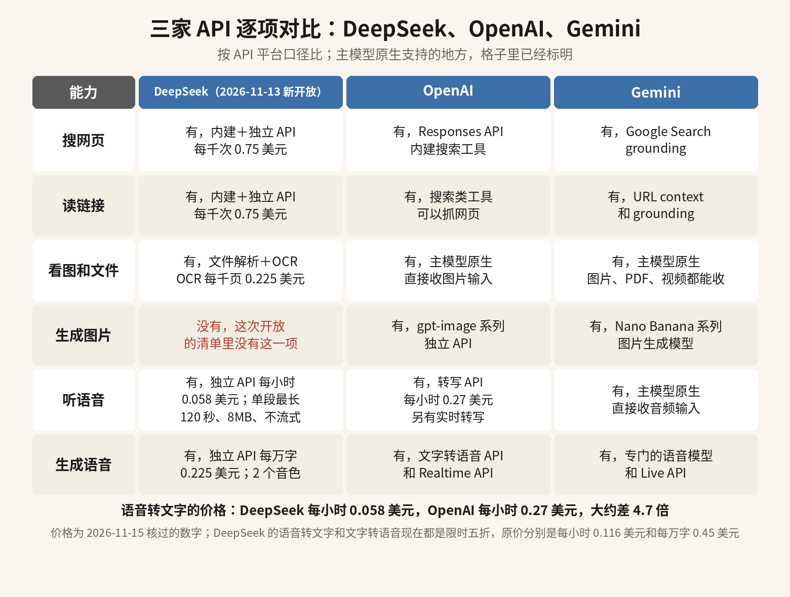

11 月 13 日，DeepSeek 在 X 上连发四帖，公布了一批新的 API。开发者现在可以调用 DeepSeek App 里面已经在用的搜索、文件解析、读链接和语音能力，而且调用方式有两种。一种是在对话请求里打开内建功能，另一种是把每一项能力当成独立 API 单独调用。

内建功能的名单一共有八项。搜索网页的时候，回答会带上引用。文件解析可以处理图片和文件，而且手写内容也在处理范围里面。读链接这一项会先抓取网页，然后模型再根据网页内容做推理。

名单里面还有三项和对话本身有关的功能。模型回答完之后，系统会自动生成对话标题。安全检查会检查用户输入和模型输出有没有安全风险。用户标记这一项可以把时区、地点和语言传给模型，所以模型回答的时候能用上这些信息。

剩下两项是深度搜索和语音。深度搜索的意思是，模型在多步推理的过程中自己去搜网页和读链接，据 DeepSeek 文档的转述，一次最多大约调用 20 次工具。语音包括两部分，用户说话之后系统把语音转成文字，模型回答之后系统再把文字读出来。

如果开发者想打开内建功能或者深度搜索，那么他用的模型必须是 DeepSeek V4.1-Flash，接口里写的模型名是 deepseek-flash。因为模型不对的时候，参数虽然能传进去，但是功能不会打开，所以接入之前要确认自己调用的是不是这个模型。

## 主模型原生支持和平台独立 API 的区别

DeepSeek、OpenAI 和 Gemini 这三家放在一起比的时候，要先把口径分清楚，因为口径不同，结论就会不同。如果只问一个主模型自己能不能直接收语音和发语音，那么三家的答案不一样。如果问的是整个 API 平台有没有提供这项能力，那么三家都有相应的服务。所以下面的比较按平台口径来写，而且主模型原生支持的地方我会另外标出来。

## OpenAI 和 Gemini 本来就有的能力

OpenAI 的 Responses API 本来就有内建的网页搜索工具，而且出现的时间比 DeepSeek 这次公布要早。OpenAI 的主模型可以直接收图片输入，所以看图这一项不需要另外接一个解析服务。生成图片有单独的 gpt-image 系列 API，而且这个系列也可以作为 Responses 的内建工具来调用。

语音这一项容易说错，因为很多人会把 OpenAI 的主模型和 OpenAI 的平台混在一起。平台上有独立的转写 API，现在推荐的模型是 gpt-transcribe，价格是每分钟 0.0045 美元，换算成每小时是 0.27 美元。这个转写 API 除了处理录好的音频文件之外，也提供实时转写。平台上也有文字转语音的 API，模型包括 tts-1 和 gpt-4o-mini-tts。

除了转写和文字转语音之外，OpenAI 还有 Realtime API，它可以直接做语音进和语音出的对话。另外，tts-1 和 gpt-4o-mini-tts 已经公告会在 2027 年 1 月 6 日停用，停用之后要迁到 Realtime，所以现在接入的人要把这个日期算进去。

Gemini 的情况和 OpenAI 又不一样，因为 Gemini 官方的模型说明把文字、图片、音频、视频和 PDF 都列进了主模型的输入模态里面。也就是说，用户发一段语音过去，主模型可以直接收，不需要先经过一个单独的转写步骤。搜索这一项，Gemini 用的是 Google Search grounding，也就是让模型的回答接上 Google 搜索的结果。

画图方面，Gemini 有 Nano Banana 系列的图片生成模型。生成语音方面，Gemini 有专门的文字转语音模型系列，而且 Live API 可以做语音进和语音出的对话。所以只看主模型原生支持的范围，Gemini 能直接收的输入种类比另外两家多。

## DeepSeek 的价格和限制

DeepSeek 的搜索和读链接价格相同，每调用一千次收费 0.75 美元。OCR 按页收费，每一千页收费 0.225 美元，而且 OCR 做的是从图片和文件里面认出文字，它本身不会生成新图片。

语音转文字（ASR）按小时收费，现在的价格是每小时 0.058 美元，因为现在是限时五折，所以原价是每小时 0.116 美元。文字转语音（TTS）按字数收费，现在的价格是每一万字 0.225 美元，原价是每一万字 0.45 美元，同样是限时五折。

语音转文字这一项可以算一笔账。DeepSeek 每小时收费 0.058 美元，而 OpenAI 每小时收费 0.27 美元，所以 OpenAI 的价格大约是 DeepSeek 的 4.7 倍。搜索这一项，OpenAI 和 Gemini 同类工具的价格我这一轮没有逐项核官方价目，所以这里只写 DeepSeek 自己的单价，不和别家比。

生成图片这一项，三家里面只有 DeepSeek 没有，OpenAI 有 gpt-image 系列，Gemini 有 Nano Banana 系列。如果一个应用需要用户上传图片之后再生成新图片，那么 DeepSeek 这批 API 覆盖不了这一步，开发者仍然要另外接别家的图片生成服务。

语音转文字的限制更具体。DeepSeek 的 ASR 单段最长 120 秒，文件最大 8MB，而且不支持流式转写，它支持 21 种语言。因为有这三个限制，所以它适合处理短语音片段。但是用户对着麦克风连续说话、一边说一边出文字的场景，它现在的用法和 OpenAI 的实时转写、Gemini 的原生音频输入并不一样。

文字转语音这一边，DeepSeek 提供 2 个音色和 10 种语言，而且可以走 WebSocket 流式输出。OpenAI 的同类模型有 11 到 13 个音色，所以如果应用需要让用户挑音色，那么 DeepSeek 现在能提供的选择会少很多。

## DeepSeek 的打包方式和 chat-demo

和另外两家比，DeepSeek 有一处具体的做法差别，就在接法上。OpenAI 的内建工具主要放在 Responses API 里，Gemini 用的是 generateContent 接口加 grounding 和工具调用。

DeepSeek 是把 App 里面已经在用的搜索、文件解析和语音做成了参数开关，而且这些开关加在它既有的 Messages、Responses 和 Chat Completions 三种端点上，由服务端执行。除了内建方式之外，同一批能力又做成了独立 API，所以开发者可以只调用其中一项，不必把整套对话流程都换过去。

官方同时开源了一个前端 demo，名字叫 chat-demo，这个 demo 支持把 DeepSeek 的对话记录导入进去。开源两天之后，这个仓库攒了 1,507 个星。官方的说法是，开发者照着这个 demo，就能在自己的应用里面把 DeepSeek App 重新做出来。

这个说法是官方自己的表述，我没有亲手装过这个 demo，所以它到底能复刻到什么程度，这里不下结论。demo 本身摆在那里，开发者可以自己去看代码，再判断它离一个能直接用的应用还差多少。

## 费用的算法和接入之前的确认事项

工具费和 token 费分开收，这件事在三家都存在，因为 OpenAI 的价目里也写了，带工具的模型会按工具另外收费。所以开发者要算的，是自己每个月会调用多少次搜索、读多少页文件和转写多少小时语音，然后把每一项的单价乘上去，再和 token 费加在一起。只看 token 单价，会漏掉工具费这一部分。

我自己平时就让 agent 读网页和读文件，所以我看这种价格表的时候，会先把调用次数估出来，因为搜索和读文件都是按次和按页累积的。接入之前，开发者可以拿一周的真实记录算一遍，这样就能知道工具费大概会占到总费用里的多少，再决定哪些功能默认打开，哪些功能等用户点了之后再调用。

如果你也在搭聊天机器人或者 agent，而且正在选搜索、文件和语音这几项能力接哪一家，麻烦收藏一下，再订阅这个博客。后面我还会接着发这类把几家放在一起核过的比较。
