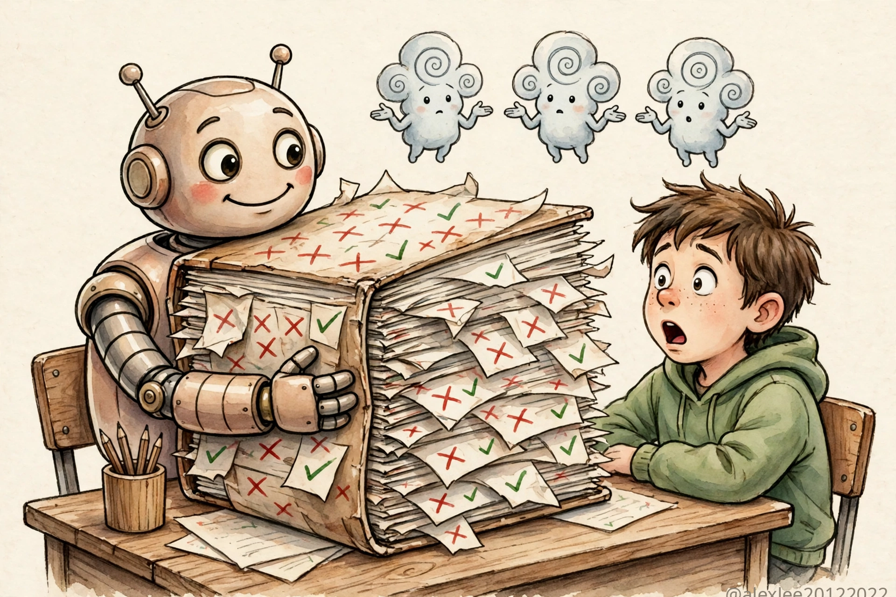
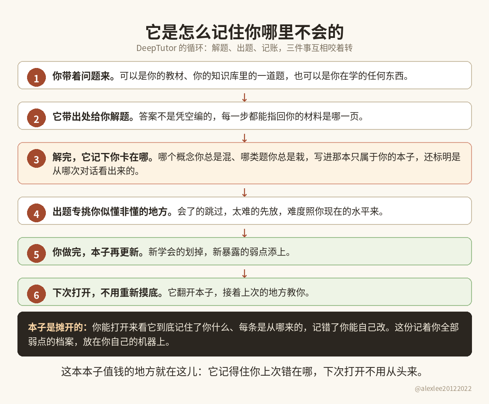
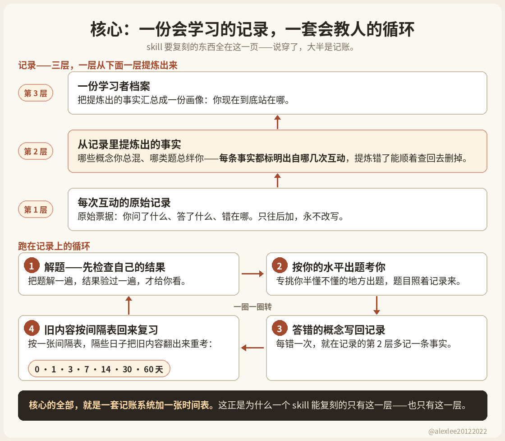
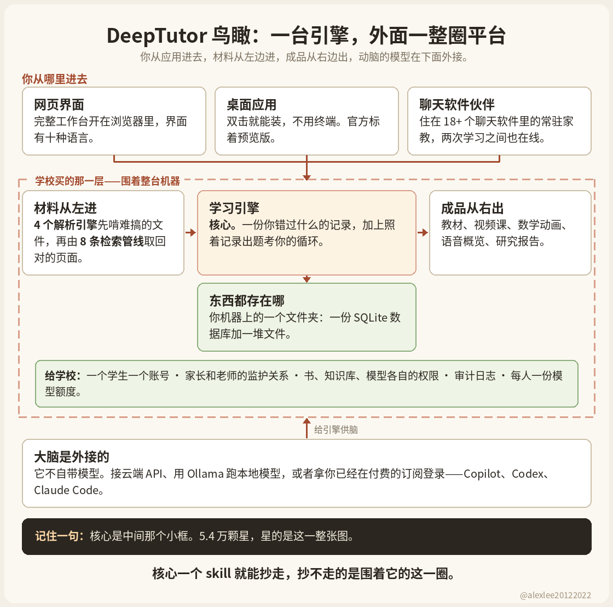
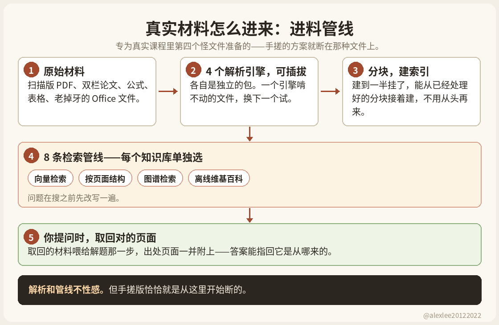
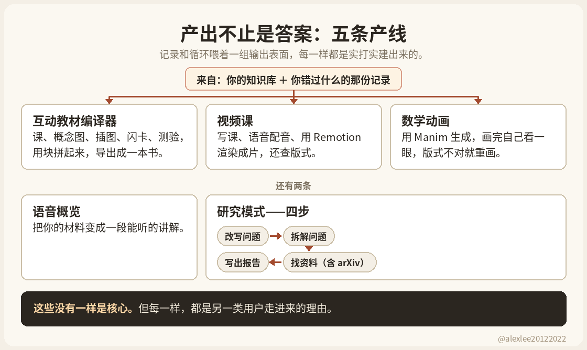
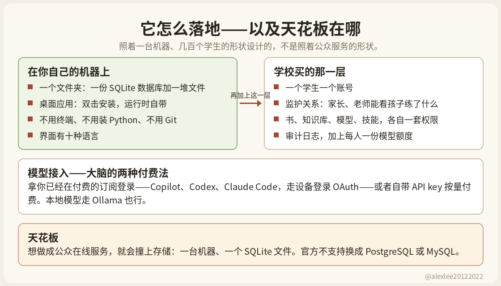
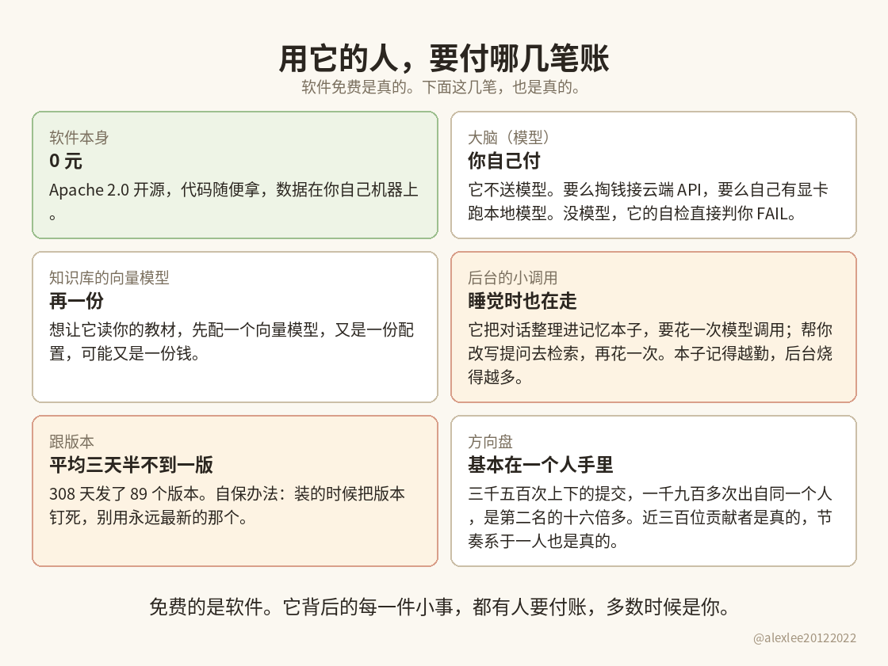

港大一个开源 AI 家教，仓库建起来第 4 天就有 1,369 星。十个月后逼近 5.4 万，其中 5,700 多是最近四天涨的。我 10 月 28 号把它的 v1.7.0 装上真跑了一遍，稿子还没写完，10 月 31 号，v1.7.1 又发布了。

这一篇篇幅不短，结论先放这儿，理由在后面慢慢摆：DeepTutor 的核心，一份结构化的错题记录加一套围着它转的出题循环，是这个团队自己做出来的东西。但恰恰是这一层，在 2026 年一个 agent skill 就能复刻。它复刻不了的，是核心周围那一整圈东西，而 5.4 万星主要星的是那一圈：一个平台、一种不懂技术的人也能装能用的交付形态，外加一个会发新项目的实验室。

你要是个自己学东西的技术用户，这一圈你可能一样都不需要。这篇讲的就是这条界线划在哪。

## 现在的聊天框到底记得多少

普通聊天框早就不是两年前的水平了。要测一个家教的记性，得先看清它现在到底什么水平。同一个对话里你前面说过的话，模型本来就看得见，这一点从来不用怀疑。

换个新对话呢？几家大平台现在都给自己加了跨会话的记忆层。ChatGPT 有 saved memories，专门存它记住的关于你的事实，另外还能在回答时翻你过去的聊天记录。Claude 的记忆在消费版是默认开着的，学到的东西按主题存成文件，你能打开看，也能改。Gemini 也有一个 Memory 设置，会从你过去的对话里学。

细节各家不一样：Claude 对敏感话题默认不记，Gemini 的记忆要开着 Keep Activity（活动记录）才有。

所以「聊天家教是条金鱼，关掉窗口就把你忘了」这幅画面，放到 2026 年已经不成立了。

但是它记的东西是什么，同样得说清楚。OpenAI 自己的帮助页写得很直白：记忆不会保留每段对话的每个细节，记哪些、忘哪些，是 ChatGPT 自己判断哪些相关。平台记下来的，是一个好助理会记的那类东西：你的偏好、你在做的项目、你的水平大概在哪。

学习记录要细得多。它不是「这个人物理弱」这种话。它是：哪几天、做了哪几道题、透镜公式的符号丢了两次、像距混了一次、上周二同类型的题终于连对三道。有这样一份逐条记下来的记录，出题的程序才有东西可算。偏好写成一段话，是驱动不了这些的，因为那些具体的事，根本没有被逐条写下来过。

## 核心：一份出题程序能算的记录

DeepTutor 是港大数据科学团队做的，它把上面说的那种细记录，建在你自己的机器上。记录分三层。最底层存每一次互动的原始记录，只往后加，永不改写，就像会计留着原始票据。中间一层把原始记录提炼成关于你的事实：哪些概念你总混、哪类题总绊你，每条事实都挂着它是从哪几次互动来的，所以哪条提炼错了，能顺着查回去删掉。最上面一层把这些事实合成一份你的学习画像。

记录上面跑着一套循环。你让它解一道题，它先判断这是什么类型的题，解一遍，再把结果验一遍才给你看。然后它回过头来考你，难度贴着你现在的水平出，你答错的那个概念被写回记录里去，下次问什么，就受这条记录的影响。还有个调度器管旧材料什么时候回来复习，不同种类的知识，间隔不一样。解题、出题、记账、到期重考，这套循环配上这份记录，就是这个产品的核心，也是大多数聊天家教确实没有的那块。

## 核心恰恰是 skill 能复刻的那一层

上一节讲的东西，说穿了是一套文件格式加一份操作说明。你给现在的大模型 agent 一个 skill 文件，写明记录分三层存、出题照着记录来、错题按这个间隔表回来复习，再指给它一个本地文件夹，它就能跑出一个大体一样的循环。间隔复习本身就是一张间隔表加一个到期队列，这个代码库里的调度器是扎实的工程，不是魔法。

单人、技术用户、在自己天天用的工具里学东西，skill 版能把核心这层的大部分事办了。项目方自己的材料和外面的报道我都看了，没有哪份正面回答过这一条，因为这一条对核心来说，就是对的。

那问题就反过来了：核心要是装得进一个 skill 文件，这个仓库里剩下的 33 万行 Python 和 33 万行 TypeScript 是干什么的？真正的产品在那儿。

## 核心周围的那一圈

真实的学习材料是很难看的：扫描的 PDF、双栏论文、公式、表格，老到能投票的 Office 文件。DeepTutor 自带 4 个可换的文档解析引擎，各自是独立的包，一个引擎啃不动的文件可以换一个试；它的建库管线断在一半能从已经处理好的部分接着建，不用从头再来。

解析后面坐着 8 套可换的检索管线，不是一套：向量检索、按页面结构检索、图谱类的、离线维基百科的，每个知识库可以单独选，查询进来之前先改写一遍。skill 能给你干净的文件接一个解析器加一个向量库。真实课程里的第四个怪文件，就是手搓版开始断的地方，而这个项目明显在这些文件上断过又修好过，反复很多次；它的 issue 区躺着的正是这类 bug、这类用户。

记录和循环喂着一组输出表面，每一样都是实打实建出来的。互动教材是个编译器：课由块拼成，概念图、插图、动画、测验、闪卡、互动元素，拼完能导出成书。视频课是一条管线：写课、语音合成配音、用 Remotion 工程渲染，还查版式。

数学动画用 Manim 渲染，渲染完它自己看一眼，版式不对就重试。还有个音频概览，能把你的材料变成一段能听的讲解。还有个研究模式，把一个问题拆开去查，来源包括 arXiv 的论文，最后写成一份报告。笔记本重做成了页和块，配了个编辑助手，它的改动要你点头才落地。这些没有一样是核心。但每一样，都是另一类用户走进来的理由。

DeepTutor 有个「伙伴」系统：一个常驻的家教伙伴，住在 18+ 个聊天软件里，微信、QQ、钉钉、飞书、企业微信、Telegram、WhatsApp、Slack、Discord 等等，还有伙伴群。学生可以在自己天天用的聊天软件里学，伙伴在两次学习之间也在线，这是对话窗口做不到的在场方式。

skill 是会话形状的，你跟 agent 说话的时候它才在。18 个网络上常驻的伙伴是服务，要维持连接、要主动推送，是另一个物种的软件。

多用户这一层是机构级的：账号、家长或老师跟学生之间的监护关系、按资源分开的授权（书、知识库、模型、技能各管各的）、审计日志、设备凭证、个人模型配额。光这一层的测试文件就有 38 个。学校不会采用一个文件夹加一段提示词，它要么采用账号、权限和审计这一套，要么根本不采用。

它的供应层除了常规的 API 商家和本地 Ollama，还做了订阅型的：Copilot、Codex、Claude Code 走设备登录的 OAuth，用户拿已经在付费的订阅就能跑，不用另开按量计费的 key。桌面端是 Mac 和 Windows 的双击安装，内置运行时，点开就把整个 Web 界面起起来，用户不用碰终端、不用装 Python、不用 Git。

界面有 10 种语言，翻译的一致性有自动检查盯着。全仓测试文件 905 个。这些你可以嫌口味，但不能管它叫套壳。

skill 和平台的关系，最能说明问题的一个证据，在它自己的服务层里。DeepTutor 内置了自己的技能注册表，一套装技能的枢纽；仓库根目录还自带一份 SKILL.md，全部内容就是让外部的 agent 通过它的命令行来驱动它。在这套架构里，skill 是盖在平台上的一层插件，其中一份 skill 干脆就是这个平台的遥控器。「一个 skill 就能做」这句批评，把从属关系说反了。

## 到底能不能用起来

我装了它、拆了安装、读了代码和发布说明、读了团队的论文。我没有接上模型，真的拿它学上一个月。所以谁拿一次安装测试给你下「长期学习有没有用」的结论，你都别信，我的也不行。

裸装 v1.7.0 的 core，约两分半钟，装完占 190MB，依赖检查干净。core 里只有对话、命令行和 SDK，截图里人人看的那个 Web 界面是另一套更重的安装。模块目录一共 25 个，解题、出题、知识库、记忆、笔记本都在里面。

装完干的第一件事，它用自检命令 doctor 当面判了我两个 FAIL：没配对话模型，没配向量模型（把教材和题目转成可检索数字的那个，知识库靠它找材料）。它不装「一切就绪」，缺什么当面说清。条件也就摆在这里了：开箱的 DeepTutor 什么都干不了，模型、API key、预算，你得自己带。

这还是在终端里手动装 core 的路。桌面安装包存在的意义，正是它的大多数目标用户会在这几步里的第一步就停下来。

用起来的持续成本是结构性的，不是偶然的。软件本身免费，Apache 2.0，代码随便拿。模型不在里面。你每问一句、它每验一步、每出一次题，都是真金白银的一次模型调用。还有些调用是藏在后台的：一节学完，它要再调一次模型，把刚发生的事提炼进记录；你下次提问之前，它可能先拿记录把你的问题改写一遍再问。记录维护得越勤，后台的模型调用就越多，账单跟着涨。

再往上是维护的账，这个更磨人：这个仓 308 天发了 89 个版本，平均三天半不到一版，光 9、10 两个月就 15 版；我装的版本三天之后就被 1.7.1 顶了，桌面预览版、多了四种界面语言一起进来。

1.7.0 升级说明里埋的那个坑，在 1.7.1 的升级说明里原样还在：机器上要是还留着旧的命令行安装包，先把它卸掉，不然你可能付了新版的代价，还在跑旧的。1.7.1 我没装，这篇里所有上手实测的都是 1.7.0。

方向盘也基本在一个人的手里。GitHub 统计，贡献 3,205 次、268 个账号，其中约 1,900 次出自同一个人，占了六成上下，是第二名 116 次的十六倍多。这个人后面有一条真实的尾巴，贡献 5 次以上的账号有 49 个，所以它不是一个人的仓库。这个人要是停下来，三天半一版的节奏就跟着停，你的维护问题就变成存亡问题。

## 它到底为什么这么火

上面这些加起来，也解释不了 5.4 万星的形状：建仓 4 天 1,369 星，写这篇之前四天又涨了 5,700 多。光靠产品质量，长不出这种曲线。它的走势是台阶型的，一级一级跳，台阶是有机制的。

第一级是门上的招牌。这个实验室就是做 LightRAG 的那个，LightRAG 自己有 4 万星。英文报道写 DeepTutor，开头几行就要提一遍实验室的履历。新项目从这种实验室出来，起点不是零关注，是现成的订阅盘。也要说清这个背书是什么、不是什么：它是一个受尊敬的实验室的牌子、一篇论文、一个项目官网。我没查到港大校级层面的官宣，而它起飞也确实不需要。

第二级是节奏在喂榜单。三天半发一版，等于每三天半把仓库重新推到 GitHub 日榜面前一次，榜单再把它推给下一波星星。涨得最猛的一天是 10 月 29 号，单日 2,300 多星，紧跟在 1.7.0 发模块化安装和桌面预览之后。发布节奏就是它的市场部。

第三级是它站的品类位置。有位评论者把话说得很直：这是自托管的信号，不是家教的信号。大厂聊天应用在自家云里免费答题的市场里，「材料是你的、记录是你的、机器是你的、模型你自己选」，是很大一群人愿意表态支持的位置，而点星就是这群人的表态方式。成品的形状也对同一群人重要：开源家教大多停在演示或库，这个是能当产品装的。

第四级是配套广本身。各子系统是各自独立的门：视频课传播给一批人，数学动画给另一批，研究模式给第三批，聊天软件伙伴给第四批，记错题的故事给第五批。一个窄工具只有一个被世界注意到的表面。这个有十几个，而且「什么都有」本身就是中文报道里现成的标题。

使用不是零：它的安装包在 PyPI 上，10 月最后一周每天被下载 1,200 到 1,950 次；issue 区 30 天新开了 202 条，读起来全是真用户在真机器上的问题，桌面端找不到本地装的工具、某个供应方在 Windows 上失败、旧 Office 文件传得上去却在解析时死掉。

但我找不到任何一家具名的学校或机构出来说它在给自家学生用这个；它的 6,692 个 fork 里最大的一个只有 26 星，真是被采用的平台，fork 不长这样。所以这 5.4 万最准的读法是：一大群围观者，一个真实且在长的用户少数派，和一个还没发生的机构故事。

## 论文里的两个数字，放在它们该在的位置

它有一篇港大自己发的论文，摘要里两个数字传得很广。这两个数字是支撑材料，不是结论，而且标签一个都不能摘。

10.8% 出自它自建的基准 TutorBench：模拟学生，学的是大学课程材料，系统给出的讲解和练习题由另一个大模型按评分表打分，3.91 比 3.53，满分 5 分。这个量的是模拟互动里教学产出的质量分，不是学习成绩。没有真学生先测一次、用一阵、再测一次的那种数据。

29.4% 更要看清。它出自另一组实验：DeepTutor 的解题去比四个基线，那四个基线是作者自己写的简单家教；而且就在这组实验里，它主打的那台个性化引擎，全程是关着的。这个数字再好，跟「记不记得住你哪里不会」也没有关系。

论文自己其实很老实。它的限制部分明说，评估建立在模拟学生之上，那些扩展功能到底能不能让人学得更好，需要拿真人做长期研究。摘要把话说得大，正文把丑话留在了找得到的地方。你按它自己的丑话来要求它就行。

## 它到底适合谁

你要是正在系统地学一门课，备考，或者啃一本厚教材，而且三个月后你还在这件事上，整个平台对你才挣得回它的分量：材料走它那些能伺候怪文件的解析器，记录一节一节攒，出题从你真实的水平出发。这种用法我建议装，装完整版（安装时选 full），走 Docker 把环境固定住，版本钉死，不要用那个永远最新的 latest。钉版的意思是放弃每三天半落下来的新功能，一门几个月的课，这个价付得值。

你要是教书，或者开个小学校、教培机构，你要的是另一层：账号、监护、授权和审计。这一层是聊天应用和 skill 都压根不给你的，而且它明显就是照你的形状做的，一个学生一个账号，材料由管理员统一发，家长能看孩子练了什么。

要用它的人要是不住在终端里，你的理由是桌面安装包和聊天软件伙伴。就盯一件事判：学生到底会不会打开它。一个住在学生天天聊天的软件里的家教，比一个仪表盘多的是真实机会。

你要是自己学东西的技术用户，别装，去写 skill。记录格式和出题循环，恰好是真能改变你学习结果的那部分，它们装得进一个 skill 文件加一个文件夹，跑在你已经在用的 agent 里，没有 Docker 栈，没有版本跑步机，没有第二套要养活的系统。你放弃的是教材编译器、视频课、伙伴和机构层，你要是本来就不会用它们，你什么都没放弃。

你要是只想把今晚的作业问明白，那就两个都别碰。你现成的聊天应用记得你的水平、你的偏好，对这种用法已经够了，还不用你搭任何东西。

## 给孩子用

能不能帮孩子提高成绩？有可能帮他补上某个具体弱点，但到今天为止，项目方没有证明过它能把考试分数提上去，更没有证明过它能替代家教或补习班。我的建议很直接：拿它当补弱点的练习教练，先别因为它退掉真人课。

证据的情况就是论文那一节的情况，换到孩子身上不会自动变好：模拟的大学学生、大模型打的分，不是孩子的分数动了。它能帮上忙的地方是练习更有针对性：孩子错在哪的记录攒下来，下一次练习就照着弱点来，一个错过的题型更容易在考试之前再碰到，而不是考完才发现。这条路有个前提：孩子得肯自己坐下来练。

它的监护层倒给了聊天应用不给的东西：材料可以由家长指定，报告能打开看，你能核对孩子到底练了什么。只是要分清：报告能证明孩子坐下来用过，不能证明孩子学会了。

但好家教的本事不止讲解。他坐在孩子对面，能看见孩子是真不会、乱猜，还是已经走神了；他知道学校老师下周讲到哪、考试压在哪几天，也会在孩子想抄答案时当场拦下来。DeepTutor 看见的只有孩子打出来、传上去的东西。

补习班卖的也不只是题和讲解，还有排好的课表、固定的时间、限时考试和一屋子同学的压力，这个节奏它替孩子守不住。

你要判断它对你家到底有没有用，就用闭卷测法：选一个弱项，没见过的题先测一次，只喂这一单元的材料练两周，再换一组新题闭卷测，学校小测跟着看。分数动了，可以考虑少上一部分一对一；没动，就当它是个答疑工具，提分的话一句都别信。低龄孩子也别单独放给它，内容对不对、是不是在抄答案，还是得有人看。

## 拿它做生意

能，许可证这一关它是敞开的。Apache 2.0，商用、改、在上面做收费产品都行，保留它原来的许可证声明，改过的地方标明，唯一不送的是商标，名字和 logo 不是你的，不能打着它的牌子卖。做教培的，它的多用户就是给你这种场景准备的：每个学生一个账号，工作区、进度、对话互相隔开，你作为管理员统一发材料、管权限，还有刚才说的监护关系。一家机构带自己几百个学生，是它设计时就想好的用法，不用你硬凑。

但你要是做开发的，想把它当底座，搭一个面向公众的 SaaS 平台，先去翻一翻它的数据是怎么存的。它所有的状态都存在一台机器的一个目录里，数据库是 SQLite 加一堆文件，官方文档明说没有支持的 PostgreSQL、MySQL 接法。

用户少的时候，这种存法是简单；用户上了量，它撑不住，数据层得你自己重做。再加上版本那道选择题：要么钉死一个版本，从此跟上游越走越远，分叉的账你自己还；要么跟着它三天半一版往上升，每次升级都是一次回归测试。两条路选一条，没有第三条。

## 1.7.0 改了什么，1.7.1 又改了什么

你现在真去装，装到的已经不是我测的那个版本了，所以简短交代一下差别：1.7.0 把安装拆成模块，学习工作区和笔记本重做成页和块、配了一个能讨论段落的编辑助手，加了能在浏览器里放的视频课，还让建到一半死掉的知识库能从断点接着建。

三天之后 1.7.1 加了 Mac 和 Windows 的桌面预览版、多了四种界面语言、一批聊天和课程的修补，升级说明里旧包先卸的警告一字没改。你要装，就是装进这么一条河里。装之前先想好：你是顺着它一版一版走，还是钉死一版过自己的日子。

模型只会越来越便宜，也越来越会讲题。核心也会越来越便宜：凡是文件格式加一套循环的东西，一个季度之内就会被 skill 吸收掉。

吸收不掉的，是核心外面那圈不体面的东西，伺候真实文件的解析器、给每种人用的表面、给机构用的账号和权限，还有一个人守着它一周发三个版本。

下次再看到一个星数吓人的 AI 工具，我建议你就给这一圈估价：不看招数巧不巧，看它包装给谁、插进什么、围着它的人是在用还是在鼓掌。

DeepTutor 的记录回答了家教必须先答的第一个问题。它的平台回答的是第二个。而鼓掌的人数和真用的人数，从来不是同一个数，把这两个数分开，是这行当里大半的功夫。

觉得这类拆解对你有帮助的话，欢迎订阅或收藏这个博客，我会继续用装之前想看清楚的标准，拆 AI、安全和开源工具。最后问一句：你装过最重的一个工具，后来发现一件小事一个脚本或者一个 skill 就能办，或者正好反过来，有吗？

原文／项目：https://github.com/HKUDS/DeepTutor/releases/tag/v1.7.0

