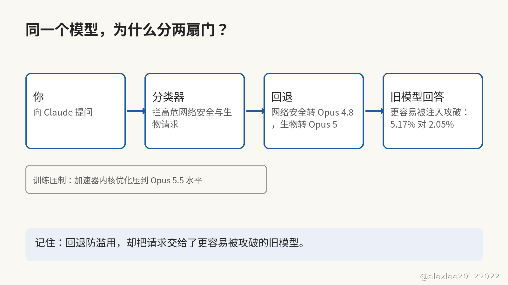

你有没有在 Claude Code 里见过一句话，说这次换了个模型来回答你？11 月 9 日，Anthropic 发了 Fable 5.2 和 Mythos 5.2，两个名字背后是同一个模型。

在 Anthropic 自己的 FrontierCode 2.0 评测里，Fable 5.2 写代码拿了 49.1%，上一代只有 32.4%，连 Opus 5.5 的 45.5% 也被它超过了。价格还降了两成，每百万 token 输入 8 美元、输出 40 美元，输出最多快了三成。

它不光会写代码，还能成群结队地一起上。Anthropic 说，约 1,000 个 Fable 5.2 agent 一起花了约 30 个小时，用 Lean 把费马大定理写成了机器能验算的证明。同一套设置下，Opus 5.5 在 18 小时后只完成了 26% 的证明。

可是这两个模型不是随便谁都能用的。Fable 5.2 对所有付费用户开放，Mythos 5.2 只给通过了网络安全验证计划或者生命科学验证计划的机构，因为 Mythos 身上的网络安全与生物限制放得更松。

同一个模型分两扇门，门槛并不是模型本身，而是你是谁、你能问什么。Fable 5.2 里装着分类器，专门拦高危的网络安全请求和多数研究生物学请求，拦下来的网络安全问题由 Opus 4.8 来回答，生物问题由 Opus 5 来回答。

回退的时候，Claude 会告诉你换了模型，而且回答上会标着是哪个模型答的。API 上只有你主动选加入才会回退，不然就直接拒绝，产品里默认开着自动切换，但是你可以在设置里把它关掉。

训练里还压着一道刹车，藏得更深。Anthropic 在训练里就压住了最能直接加速 AI 研发的那几项能力，其中一项是加速器内核优化，说白了就是写出让芯片跑得更快的底层代码。还有一项是语言模型架构，两项都被压到了 Opus 5.5 大致相当的水平。到了推理的时候，其中一些话题还要回退给 Opus 5。

与此同时，分类器拦错的请求比上一代少了约 55%，其中网络安全少了约 60%，生物少了约 40%。所以合法的安全研究和生物请求，被拦下来回退给旧模型的次数也跟着少了。

可是回退本身也会出问题，而且问题正好出在安全上。按系统卡里引用的 Gray Swan 测试，间接 prompt injection 试了 15 次之后，Fable 5.2 被攻破的概率是 4.09%。上一代只有 1.02%，而 Opus 5.5 是 0.96%。

差距主要是回退造成的，因为这 15 次尝试里有 53% 是由 Opus 4.8 来回答的。Fable 5.2 自己回答的时候，被攻破的概率是 2.05%，可是换成 Opus 4.8 回答，被攻破的概率就到了 5.17%。

也就是说，为了防滥用而设的回退，恰好把请求交给了更容易被注入攻破的旧模型。如果你让 agent 读邮件、跑别人仓库里的代码，这一点就直接关系到你，因为注入的指令就藏在 agent 要读的那些文字里。

METR 的报告说，Anthropic 内部的模型已经把 AI 研发提速了约 2 倍。所以实验室一边享受着这种加速，一边在训练里给新模型的能力划线，而且线划在明处，写进了系统卡。

线划在明处是好事，可是线划在哪里、线怎么执行，都是实验室自己定的。公众看得见线，看不见线后面的执行，这才是我不放心的那一点。

如果你天天用 Claude Code 写代码的话，那么你应该先去设置里看一眼，自动切换开没开。开着它，被拦的请求还能接着往下跑，可是回答你的是更弱的旧模型。关掉它，被拦的请求就直接拒绝，不会再回退。敏感的任务别交给会回退的流程，宁可让请求停下来，也别让流程悄悄换人。

如果这篇对你有用，请订阅或收藏这个博客。我会继续分享 AI、安全和开源方面自己动手查过、用过的东西。等下一个模型发布的时候，咱们再一起看它到底划了哪条线。

来源：Anthropic 官方公告，见 https://x.com/claudeai/status/2119867114450268322
