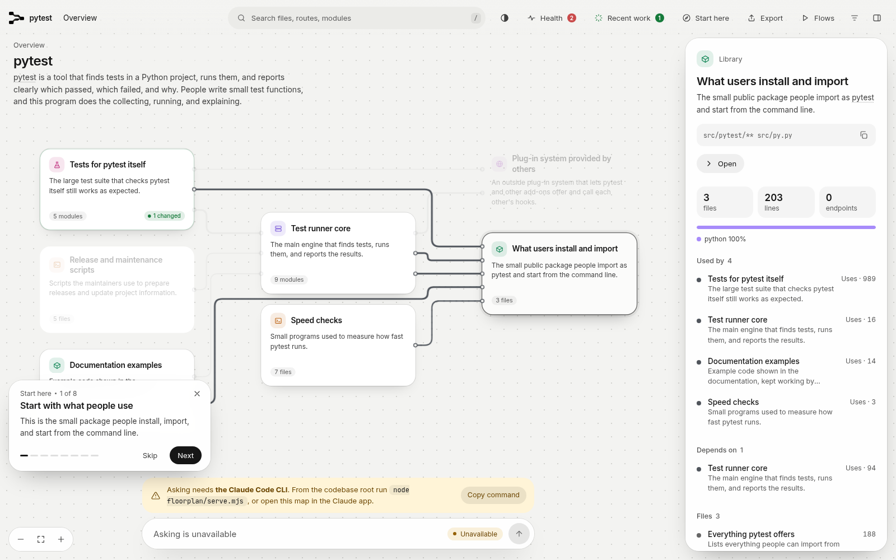
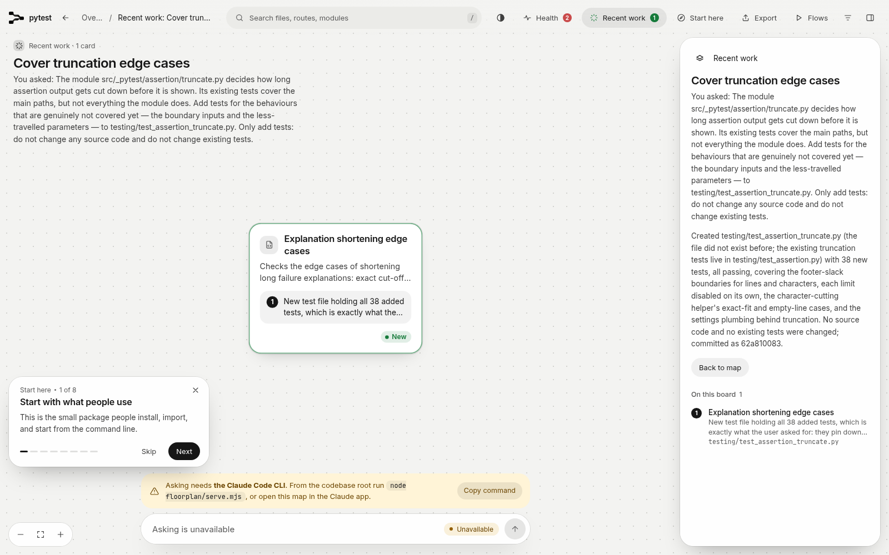
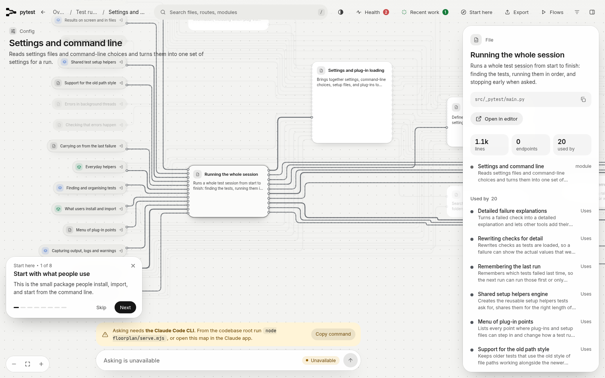
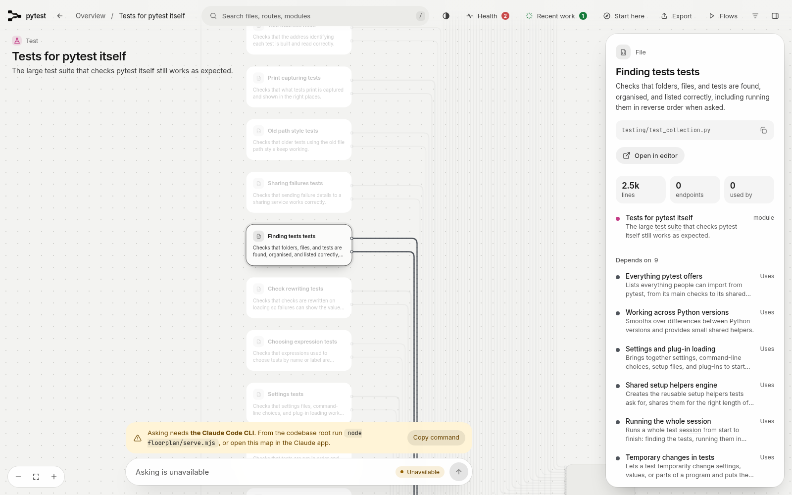
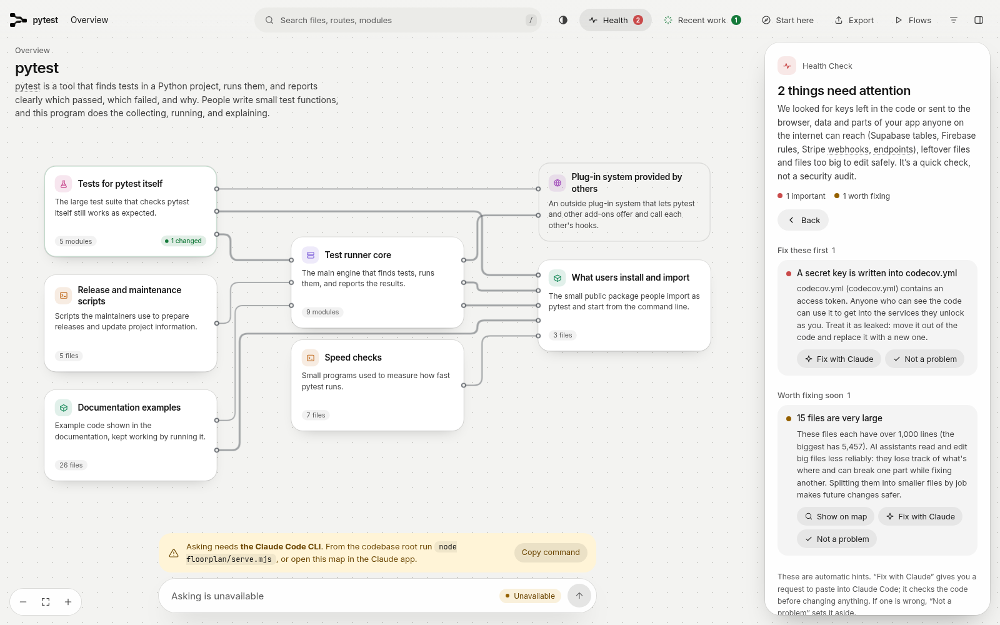

那天我把 pytest 自己的仓库交给几个 agent 会话轮流去改。因为我想看一看，像 floorplan 这种给仓库留记录的工具，到了晚上收工的时候，到底还能剩下多少账可以对。四件事做完之后，它完整记住的只有一件。

一个人同时能盯住的 agent 本来就只有 6 到 7 个，因为每个 agent 在改什么和改到了哪一步，还有哪一个该停下来，全都得记在自己的脑子里。所以等它们都改完之后，我常常已经说不清哪一处改动对应的是哪一个需求了。

也正是因为这个，我才想把记账这件事交给工具去做，好让自己晚上对账的时候，能有一份现成的记录可以直接查。

## floorplan 能做的事

floorplan 是一个给代码仓库画地图的插件。这个插件装在 Claude Code 或者 Codex 里面工作。它能做的事情有这么几件。

1. 它会给仓库里的每个文件都配一张卡片，并且在每张卡片上都写明了这个文件的大白话名字和一句话说明，而且卡片之间还连着引用关系，所以顺着卡片就能看出来哪些文件在互相调用。

2. 它有一块最近工作板，并且在这块工作板上记着刚刚结束的那个会话改动了哪些卡片，而且每张被改动的卡片旁边都写明了为什么改，所以回头看的时候就能知道这次改动是冲着哪个需求去的。

3. 它还会给仓库做体检，也就是把代码从头扫一遍，专门找硬编码写在代码里的密钥这一类问题。同时它也会把体积过大的文件先挑出来，再把它们列在一起提醒你注意。

厂方在 README 里承诺过，说每次 Claude 或者 Codex 改完代码之后，你都能确切地看到它动了哪些地方，而且还能看到它为什么要动那些地方。

我之所以拿 pytest 自己的仓库来测它，就是因为 pytest 是一个真的多子系统项目，其中配置、运行器和缓存这些部分都是实打实在用的代码。所以我要是想知道一个工具到底能不能把这种仓库的账记清楚，就得先在 pytest 这样的真项目上测过一遍，因为只有测出来的结果才算数。

## 测试当天的安排

那天的安排是这样的：我一共开了 4 个会话，而且这几个会话是一个接一个在同一个仓库上工作的。也就是说，前一个会话结束之后，后一个会话才开始。

因为后面的会话事先并不知道前面的会话做过什么，所以它们想了解前面发生了什么，就只能去看仓库本身的状态，再加上 floorplan 留下来的那些记录。几个会话领到的任务各不相同，具体是下面这几件。

1. 第一个会话先建出了整张地图，然后又给 pytest 加了一个新选项 --reverse-order。这个选项打开之后，收集到的测试会按跟原来相反的顺序运行，所以藏在执行顺序里的问题就能被翻出来。选项的注册和顺序翻转写在 src/_pytest/main.py 里，而证明顺序确实反过来了的测试，则写在 testing/test_collection.py 里。

2. 第二个会话接到的是一份故障报告，说 --lf 找不到先前的失败记录，害得每次都把全套重跑一遍。它先在地图里搜了 lastfailed，然后就直接落到了 src/_pytest/cacheprovider.py 上，接着顺着失败的测试往回查，最后查出来毛病只出在一个词上。

这个词是 cacheprovider.py 里管 --lf 的那个类 LFPlugin 在处理测试报告时要看的第一个分支条件里的词，而且它原本是 passed，后来被改成了 failed。这个条件看的是测试报告里记下来的结果，也就是这个测试到底是通过了还是失败了。它决定一个测试跑完之后，是清掉它旧的失败记录，还是把它的新失败写进 lastfailed。

第一个分支负责清掉旧记录，而它要等条件成立了才会走。原来的词是 passed，所以报告说这个测试通过了，条件就成立，它就走这个分支。如果报告说的是失败，条件不成立，就不走清记录的分支，所以失败就会被写进 lastfailed。

词被改成 failed 之后，这个条件看的就成了失败：报告说这个测试失败了，条件反而成立。所以一个测试真的失败时，它会先走清掉旧记录的那个分支。因为它先走了清记录的分支，所以这次失败就没有被写进去，所以 lastfailed 里的记录只会减少，不会增加，所以 --lf 后来就一直找不到先前的失败。

第二个会话只改了一行，就把 failed 改回了 passed，所以失败又能被正常记录了，而且 --lf 也跟着恢复了正常。

3. 第三个会话干的是一次重构，具体要动的是 src/_pytest/terminal.py，因为这个文件里有一段循环，负责把测试结果汇总成一行统计。它把那段循环抽出来，再放进一个新的私有方法里，而原来的汇总过程则改成调用这个新方法。因为这次只搬了代码的位置，并没有改变任何行为，所以它在改之前和改之后各跑了一遍同一批测试，而两次结果完全一样，这才确认原来的行为没有变。

4. 第四个会话给断言截断模块补测试，因为 src/_pytest/assertion/truncate.py 里有些边界以前没被测到，所以它新建了 testing/test_assertion_truncate.py 来测它们。它还发现，truncate.py 有个毛病：如果拿空列表去调用里面的一个私有截断函数，它就会当场报错。因为正常路径走不到这里，所以那个会话只记下这个毛病，没有顺手改掉它。

就这样，4 件事一件接着一件都做完了。而且每一件做完之后，会话都按 floorplan 的流程更新了地图，并且把自己这一轮的记录写进了前面说的那块最近工作板。

## 收工之后的对账

等到收工的时候，我另外开了一个全新的会话来当审计员，专门负责对账。因为这个审计员是我新开的一个 agent，而且白天的任何一个会话它都没有参加过，所以它对白天发生过什么一无所知。也正因为这样，我只让它看 floorplan 留下来的记录，同时明确不许它去翻代码的历史，也不许它去看别的东西。

因为它手里只有工具的记录，所以它能不能把白天的账对清楚，就正好能说明这份记录本身到底够不够用。结果它逐件去还原，最后能完整找回来的只有 1 件，也就是白天最后做的那件补测试的事。

加新功能的那件事留下来的记录只剩下了半份。这半份就是测试文件那张卡片上的一句提到反序运行的话，再加上符号表里 TestReverseOrder 这个名字。符号表是 floorplan 给整个仓库列的清单，专门记各文件里定义了哪些类。因为实现这个功能的那个文件，也就是 src/_pytest/main.py，它的卡片上从头到尾就没有提过这个新选项，而且卡片上的说明还是原来那一套讲会话怎么跑的内容。

与此同时，测试文件的那张卡片上倒是留下了一句提到反序运行的话，所以审计员只能从这一句话看出来，好像有人加过这么一个功能。可是它既看不到当时的任务标题，也看不到我当时提出的需求原话，更看不出这件事到底是那天才做的，还是早就存在于仓库里的。

修故障和做重构的那两件事则没有留下任何痕迹，因为它们既没有留下任务记录，也没有任何记录能让人把它们找回来。之所以会这样，是因为最近工作板在每次更新的时候，会把上一个会话写下的那份记录整份换掉，所以新记录一落盘，旧记录也就跟着消失了。

floorplan 自带的技能说明里就明明白白地写着，每次更新最近工作板的时候，都会把上一个会话留下的那份记录替换掉。也就是说，它从设计上就是只记最近的一次。

厂方承诺的那种回看，放在一个刚刚结束的会话身上是成立的，因为那个会话动过哪里又为什么动，全都写在最近工作板上。可是放到一整天身上就不成立了，因为前面的记录已经被后面的替换掉了。

所以到了晚上，当我想弄清楚哪一处改动对应的是哪一个需求的时候，我手里能用的就只剩下最后那个会话的记录了。白天前面做过的那些事，我还是得靠自己的脑子去回想，或者另外去翻别的记录。可惜，按照 floorplan 的设计，它无法完成我的这个需求。

## 它做得好的地方

1. 地图这一块的覆盖是全的，因为那天它一共覆盖了 284 个文件，而且一个文件都没有漏掉，所以后面几个会话想找东西的时候，至少不用担心地图本身缺了一角。

2. 定位这件事它也确实帮上了忙，因为修故障的那个会话在地图里搜了 lastfailed 之后，就直接落到了正确的文件上，而且它中间也没有在别的文件上浪费时间，所以后面的排查才接得上。

3. 它给单个会话写的那份记录本身写得很细，因为里面有这次任务的标题，也有我当时提出需求的原话。而且它每改动一张卡片，旁边都有一条说明，而说明里讲清楚了这次为什么要改这张卡片。所以只看这一份记录，就能把刚结束的这个会话交代明白。

4. 体检报出来的那条高危问题也是真的，因为 codecov.yml 第 5 行里确实躺着一串 token，而且这串 token 本身就是一个完整的 UUID，所以它不像是随手敲上去的占位内容。

5. 体检同时报出来的超大文件也没有冤枉谁，因为它一共点名了 15 个文件，而我后来逐个核对下来发现，这些文件确实都很大，所以这一类提醒同样是可以直接拿来用的。

## 实测里对不上的地方

除了记录会被替换之外，4 个会话先后在同一个仓库上工作时，前后一共触发了 4 次地图更新。而这 4 次更新报出来的变化，也全都是文件和类这一级的变化，因为它记录的粒度只到文件和类这一级。至于方法这一级改了什么，它根本就不往记录里写。

所以重构那次明明只动了 1 个文件，可是新抽出来的那个方法的名字，在它全部的记录里一共出现了 0 次，等于这次改动在记录这一侧根本就不存在。

地图里还凭空多出来了 3 条路由，可是 pytest 压根就没有服务器，所以它本来就不可能有什么路由。这几条假路由之所以会出现，是因为那个负责把仓库里的文件逐个读过去再建出地图的扫描器，把写在字符串里的示例代码中的 mock.patch 装饰器当真了。

这种装饰器在示例代码里写出来是这个样子：@mock.patch("os.path.abspath")。其中 patch 是这个装饰器名字的一部分，括号里那串带点的字符，是它要替换的那个函数的名字写成的字符串，也就是 os.path.abspath 这个函数名。

扫描器把这一行当成了一条路由声明：它把 patch 读成了 HTTP 方法 PATCH，又把括号里那串字符读成了网址的路径，方法和路径凑齐，一行就拼成了一条路由。地图上那几条路由，条条都是它这样拼出来的，所以从头到尾都是误读出来的。

类似的误读还出现在依赖关系上，因为地图把 warnings 和 pathlib 标成了仓库内部的依赖，可是它们两个其实都是 Python 自带的标准库，也和 pytest 自己写的模块没有关系。所以顺着地图去理解这个仓库的依赖关系时，在这种地方就得自己多留一个心眼。

行数这一块它也数得和真实情况对不上，因为它只数那些非空的行，所以仓库里行数最多的那个文件真实有 6326 行，可是在地图上却只写了 5457 行。如果有人拿着地图上的行数去判断一个文件到底有多大，那么他得出来的印象，就会比真实情况小上一截。

体检这一块也有它结构上就看不见的东西，因为它只做文本匹配，也就是拿代码里的文字去和一组事先定好的匹配样式逐字比对，其中就有专门找密钥字符串的样式，而且它从来不真的去运行代码，所以逻辑上写错了的地方，它是发现不了的。

那个把 --lf 弄坏的错词，从这次实测开始之前就一直待在 cacheprovider.py 里，直到那天才被修好。而在它待着的这段时间里，体检对这个文件始终没有给出过任何提示。再加上后来修好它的那次改动也没有在记录里留下痕迹，所以这一坏一修两件事，在 floorplan 那边就等于从来没有发生过。

## 它适合谁用

所以如果你平时一次只跑 1 个 agent，那么你就在每个会话一结束的时候，马上回头去检查它刚刚改过的东西。在这种用法下，floorplan 的地图加上那份刚写好的记录，对你来说就已经够用了，因为你要对的账正好就是它还记着的那一份。

可是如果你和我一样，也是一次放出好几个 agent 去做事，而且要等到晚上才坐下来统一对账，那么 floorplan 就回答不了你最想问的那个问题。而那个问题就是，哪一处改动到底对应着哪一个需求。

因为它的记录只留最后一次，所以你还是得另外准备一份能把账记全的东西。比如用 git 来记。每一处改动都单独提交一次，并且把改动的原因顺手写进提交说明里，这样到了晚上，你顺着提交记录就能把账一笔一笔对回来。

要是你不想把这件事全交给 git，那么你也可以自己随手记一份流水，也就是把每个需求和它引起的改动对应着写下来，这样至少不会到了晚上全靠回忆。

你平时让几个 agent 一起工作之后，到了晚上都是怎么对账的呢？是靠工具留下的记录，还是和我一样，最后还是得回到 git 的提交记录里一笔一笔地翻？

如果这篇实测对你有帮助，欢迎订阅这个博客，或者先收藏起来。我后面还会继续分享 AI、安全和开源方面的实测和干货，到时候咱们一起把这些工具先测明白了再用。

来源：floorplan 项目仓库，https://github.com/haydenschmitty/floorplan
