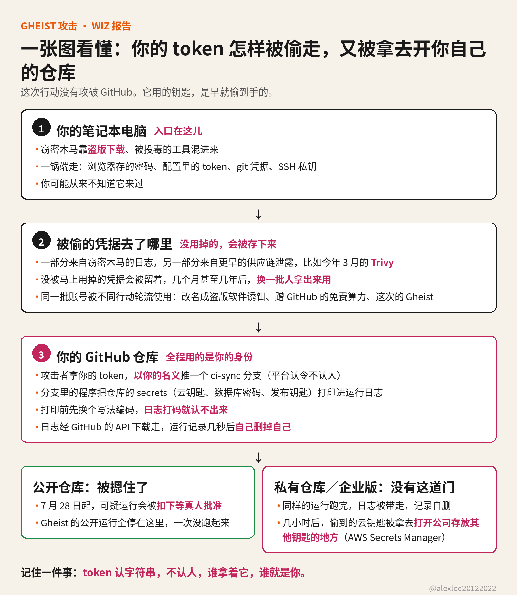

850 个 GitHub 账号的 token 被盗，13,500 个分支被植入了偷密钥的 workflow

从 9 月 15 日起，有人拿着被盗的 GitHub token，在 850 多个失陷账号能碰到的每个仓库里，推入一个专门打印仓库 secrets 的 workflow。Wiz 恢复出的植入分支超过 13,500 个。这件事里没有人攻破 GitHub，工具用的是偷来的钥匙，和平台本来就有的功能。

我自己维护开源项目。GitHub 账号对我不只是一个登录入口，它同时是我的名字和发布用的钥匙，所以我把 Wiz 这份报告从头读完了。读完之后，我的注意力不在手法上，手法并不复杂。我在意的是，这些 token 被偷走的时间，可能比这次行动早得多。

拿一个普通仓库为例。这个仓库的 Secrets 里存着一把云服务密钥，平时是部署流程在用。某天仓库里多出一个分支，名字是 ci-sync- 后面跟六个随机字符，里面多了一个叫 sync-check 的 workflow 文件，提交信息写的是 ci: sync config。

分支一推上去，workflow 就自动跑起来。它的活只有一件：把这个仓库能读到的 secrets 全部打印进自己的运行日志。跑完之后，工具通过 GitHub 的 API 把日志下载走，几秒钟后删掉这条运行记录。仓库主人回头去查，只看得到一个自己没建过的分支，运行记录已经没有了。

GitHub 对日志里的 secret 有打码，值原样出现时会被遮住。这个工具先把值做一遍 base32 编码，同一个值换一种写法写进日志，打码就认不出来了。数据从头到尾走的都是 GitHub 自己的 API，没有外部服务器可以封，也没有陌生域名会出现在代理日志里。

这个 workflow 里还写了一行 permissions: {}，看起来像是把自己的权限关小了。它限制的其实只是任务运行时临时领到的那张令牌，而攻击者根本不需要那张令牌。仓库里存着的 secrets 仍然可以照常读取，那行声明不影响它读 secrets。

如果仓库配了部署环境，工具会把环境逐个列出来，每个环境单独跑一个任务，环境里的 secrets 一起打印。团队放在环境里的通常是生产凭据，所以这一步碰到的，是能打开真实基础设施的钥匙。

这些 token 是从哪里来的，Wiz 追了能追到的部分。一部分来自窃密木马的日志。那种木马混在盗版下载和被投毒的工具里，装上之后会把浏览器存的密码、CLI 配置文件、git 凭据和 SSH 私钥一起打包带走。

另一部分来自更早的供应链事件，包括今年 3 月的 Trivy 失陷。那次泄露的凭据当时没有被用掉，而是被存了下来，几个月后换了一批人拿出来用。3 月新闻里的一次泄露，到秋天成了另一个行动手里现成的工具。

同一批失陷账号还出现在其他行动里。10 月 6 日，其中 391 个账号把名下约 1,461 个仓库改名成盗版软件的诱饵。这批账号里有 166 个从没在 Gheist 里出现过，说明失陷账号的总数比这个行动用掉的还要多。

10 月 18 日，25 个 Gheist 账号在九分钟内各建了一个 Windows RDP Runner 仓库，滥用 GitHub Actions 的免费算力。另有 57 个账号在 5 月就是另一个行动 Megalodon 的受害者，这批账号里另有受害者身上还带着 PolinRider 的痕迹。同一批账号被不同的行动轮流使用，这在 Wiz 的记录里有据可查。

token 的问题在于它只认字符串，不认人。Gheist 的提交没有签名，作者一栏写的是 token 的主人，GitHub 照常接受，因为这就是 token 的设计用途：谁拿着，谁就是你。没有设备核对，也不会多问一句。

对账号主人来说，这意味着失陷之后发生的事，平台记录里都记在他的名下。别人可以拿他的账号改仓库名、发东西、动他的项目，事后需要向用户解释的人是他，不是拿走 token 的人。

GitHub 今年有一个控制确实挡住了它。从 7 月 28 日起，公开仓库里被标记为可疑的 workflow 运行会被扣住，等协作者批准才执行。Wiz 检查过的公开仓库运行全部停在待批准状态，一次都没有跑起来。

但这个扣留只适用于公开仓库。私有仓库和 GitHub Enterprise Server 没有这道关，审计日志里能看到 ci-sync 分支的运行跑完，之后被删掉。而生产用的 secrets 大多在私有仓库里。

扣留机制在公开仓库里已经被证明有效，为什么不覆盖私有仓库和 Enterprise？这一问，GitHub 应该回答。这个问题不是要它发明新东西，而是问一个已经存在的控制，边界为什么划在这里。

在企业组织里，行动走得更深。Wiz 看到工具在几分钟内轮换使用同一家组织多个用户和自动化账号的 token，先克隆私有仓库，再植入 workflow。几个小时后，这家组织的云凭据被用来枚举 AWS Secrets Manager，那是存放其他系统钥匙的地方。

10 月 19 日，行动给自托管 runner 加了第二个任务。它在机器上搜 31 种 token 格式，包括各家 AI 服务的密钥，另外还有私钥、.env 文件、Terraform 状态和 shell 历史，再试图通过 Docker socket 到宿主机上继续搜。

这部分活干得并不好。它找错了 runner 的密钥文件，正则写坏了，想拿的 GCP 和 Azure token 也没有拿到。我的看法是，手法粗糙不等于危害小。到了这个规模，载荷做得糙一样收得走大量凭据，因为真正起作用的是偷来的 token 和平台的正常功能。

如果 ci-sync 分支在你的仓库里跑过，处理方式只有一个：这个仓库能碰到的 secrets 全部按已经泄露处理，仓库级、组织级、环境级的都算，还有这些 secrets 能打开的云资源。删掉分支没有用，日志在运行记录被删之前就已经被下载走了。

如果它跑在自托管 runner 上，要按宿主机和它的云角色一起失陷来处理。涉事账号里大约三分之二现在已经不在 GitHub 上了，Wiz 的判断是，这多半是处置的结果。账号不在了，不改变已经跑完的那些运行拿走了什么。

防御上先看你自己手里的 token。如果你在用经典的个人访问令牌，尤其是创建时间很久、权限给得很宽的那种，先换掉。换成会过期的细粒度令牌，权限只给到确实需要的仓库。或者把自动化改走 GitHub Apps，用应用自己的窄权限，不再借你的账号名义。

如果你的 CI 里存着长期云钥匙，值得换成 OIDC。它让每次运行临时换一张短期凭据，云那边会核对这次运行来自哪个仓库、哪个受保护的分支或环境。仓库里不再躺着一把长期有效的钥匙，配置文件被偷走，也换不出凭据。

放生产 secrets 的环境，前面加一位人工审批人，workflow 要用到那个环境时，先等人确认。自托管 runner 用一次性的，跑完就销毁，不给 Docker socket，也不让它随便访问云的元数据接口。

如果你的 token 本来就是短期的，Actions 里没有存长期 secrets，也没有自托管 runner，这次行动和你的关系不大。你要做的只是花几分钟确认一遍，账号上有没有忘了的旧令牌还挂着。

上面这些事实都来自 Wiz 的报告。到我写这篇的时候，GitHub 还没有发布它自己对这次行动的说明。私有仓库里到底有多少 secrets 真的被拿走，外面的人无法知道，因为运行记录被删掉了。13,500 是 Wiz 恢复出的分支数，是已经确认的下限，不是总数。

这次行动总会结束，账号会被清理，分支会被删掉。会留下来的问题是，token 这种东西，一串字符可以在几年里代表一个人，而且不需要本人在场。这个问题不是靠抓到这一伙人解决的。你我能控制的部分，是自己名下还留着多少把长期有效的钥匙。先从配置文件里那些查起，我的也在内。

来源：[Wiz 报告原文](https://www.wiz.io/blog/gheist-attempted-scaled-abuse-of-stolen-github-tokens-stumbles)
