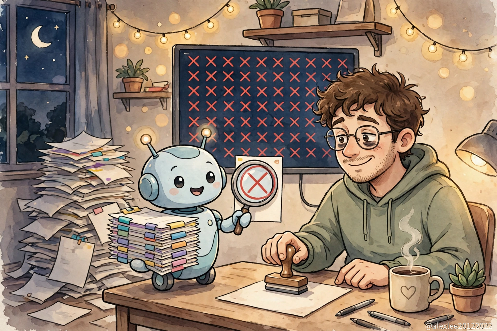

10 月 28 日，GitHub 把 Agentic Workflows 正式开放了。用法说起来很简单：你不用再亲手写 Actions 的 YAML 文件，换成写一个 Markdown 文件，用平时说话的话把要它做的事情写下来，GitHub 会把这个文件转成标准的 Actions 流程，agent 就在流程里面照着做。

它做的就是这些事：给新 issue 分流、读 CI 失败的日志、把文档保持在最新、起草测试。免费版、团队版、企业版都能用。如果流程用的是默认的 Copilot 引擎，还需要一份 Copilot 授权。

维护过小开源项目的人都知道一个星期的时间是怎么没的。写一个新功能，也许一个晚上就够了。剩下的时间都耗在没完没了的小事上：一个 PR 的检查没过，得有人打开日志去读；新 issue 一条条进来，没标签，信息还缺一半，每条都得先回一句，不然就凉在那里；CI 文件是两年前从别的项目抄的，运行镜像一换又挂了。

这些事虽然都不难，但是每周都来，从不间断。两三个人的小项目，一个星期就那么几个晚上，所以时间很快就全花在这上面了。

小项目多半就是这样慢慢凉下去的。虽然代码可能一直没有问题，但是维护会先停下来。一个星期没人看 CI 的失败记录，然后一个月，issue 攒着没人回。外面的人点进来，先看见红色的构建徽章，再看见四十条没人回的 issue，什么都不说就走了。一个没人打理的项目，从外面看就是已经放弃了的项目，别人也就按放弃了对待它。

Agentic Workflows 要接的正是这一摊小事。agent 的做法是先读，读完把草稿交给你。它读一份 CI 失败的日志，写清是哪一步挂的、报错指向什么。它读一条新 issue，想好该贴什么标签，把要问回去的话先拟出来。有改动没配上测试的，它先起草一套测试，交给维护者检查。

这些草稿本身不会改动任何东西，它们要等一个人看过点头。如果草稿大多数时候是对的，维护者一个星期的时间就不再花在读日志、看 issue 上面了，这些事有人先做了，剩下的只有检查和拍板，这本来就是该人来做的部分。

对刚起步的项目来说，除了省时间之外，还有一件事更要紧，就是习惯养不养得成。管 issue、给 CI 结果写摘要、保持文档更新，这些是习惯，大多数小项目从来没养成过。过去想把这些习惯变成自动流程，你得先会写 Actions YAML，能把习惯写进文件里，还得有纪律每周照着跑。刚开始维护项目的人，这两样通常都没有，所以习惯一直养不成，项目在代码出问题之前，先从外面看起来像没人管了。

现在把习惯用大白话写下来、做成一个流程，流程就会自己一遍遍跑下去，小项目也就有了大项目的样子：每条 issue 有人先回，每个挂掉的构建都附一句说得清的解释，文档不再悄悄过期。

上手这一步是容易的，因为要写的就是用自己的话写的 Markdown，比起学 Actions YAML 要求低得多，新手也写得出来。接下来要学的就不是怎么写文件了，而是两件事：把要求写得足够清楚，让第一次读到的 agent 不会理解偏；还有它交回来的东西，要像看一个还不熟悉的贡献者交回来的东西那样，带着核对的心态去读。

费用问题分为两块：首先，agent 每运行一次就按量收一次钱，好在 GitHub 给了一个 forecast 命令，让你先估一遍一个流程长期跑下去要花多少钱。其次，除了运行时的费用之外，默认引擎的 Copilot 授权也是一笔费用。

agent 每天读的是陌生人写的东西：issue、PR 的说明、评论。新手最需要先弄明白这一块，因为新手最容易把默认设置原样接受下来就往下走了，而 agent 每天读的东西，正是风险所在的地方。这些文字里面会混着指令，agent 得分清哪些指令是你给的，哪些只是它要读的材料的一部分，而这两样东西是混在同一批句子里一起到的。

GitHub 的安排是从谨慎那头起步的。agent 默认只读，能看你的仓库，不能改。它想改什么，改动先要过两道检查：一道是 safe outputs 的校验，一道是单独跑的威胁检测，都过了才会真正落下来。

它跑的时候待在一个沙箱容器里，前面有 Agent Workflow Firewall 这道防火墙挡着；它能碰哪些 GitHub 内容，有一道完整性过滤在管；涉及其他仓库的操作，还可以放进微虚拟机里，和其他东西隔开。

落到实际就是：陌生人 issue 里的一句被它读岔了的话，不能直接在你的项目里生效，它先变成一个提议，提议还要被检查一遍。在我自己的项目里，合并和发布这两件事，我仍然会留在人工点头之后，这是加在这些安排之上的。

GitHub 的公告里引了 Accenture 一位负责人 Ben Alton 的估计，说这套流程一周能给他自己的开发工作省下 29 个小时。这个数字我不会拿来做计划，因为一个一周总共只有 3 小时维护时间的项目，根本没有 29 个小时可省。那是他一个人在大公司里的一周，跟一个小仓库的情况不是一回事。

小项目实际能拿到的变化很具体：以前没人回的 issue 有人回了，CI 失败了有人把原因写清楚，文档也有人跟着更新，维护者不用再把晚上的时间耗在这些事上。

用之前和用之后，各记一记自己花在仓库上的时间。如果检查它的草稿花的时间，和自己动手差不多，那答案就是不值，这个答案从你自己的晚上就能看出来，不用看厂商的估计。我自己的做法，是先让它只做读和汇报的事，合并和发布留给人，用上一个月，看时间到底省没省下来再说。

你要是维护着一个小仓库，这几件事里面，你会先把哪件交给它：读 CI 失败的日志，还是回新 issue？又有哪件事，不管它做得多好，你都要自己留着？

觉得有用，可以收藏这个博客或者订阅更新。我会继续拿真实项目实测这类 AI 工具，把能用得上的部分写出来。

来源：[GitHub 官方公告，2026-10-28](https://github.blog/changelog/2026-10-28-github-agentic-workflows-generally-available/)
