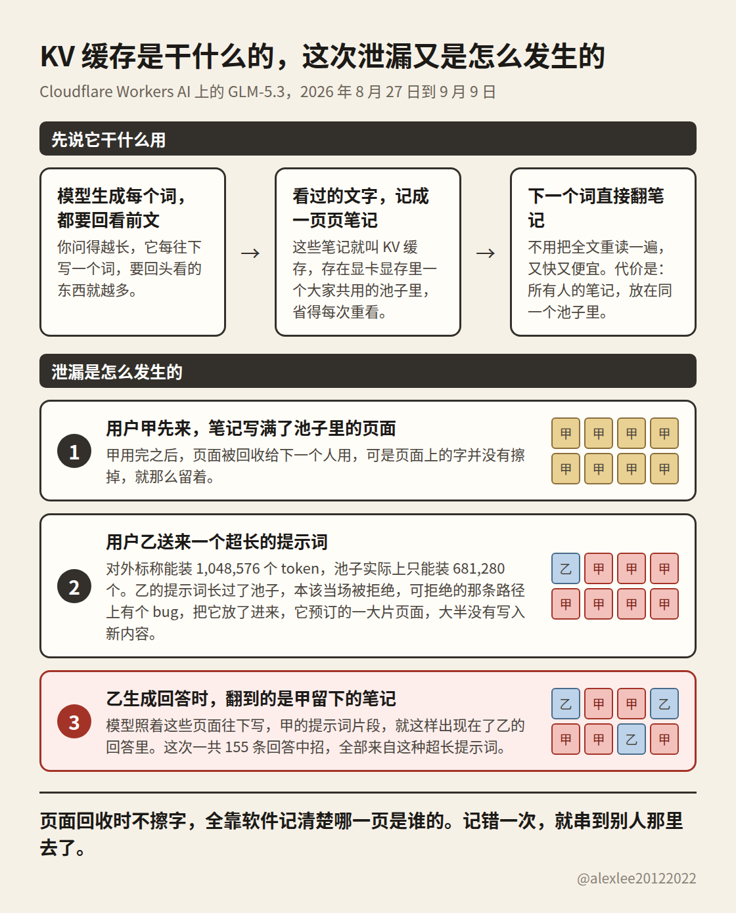
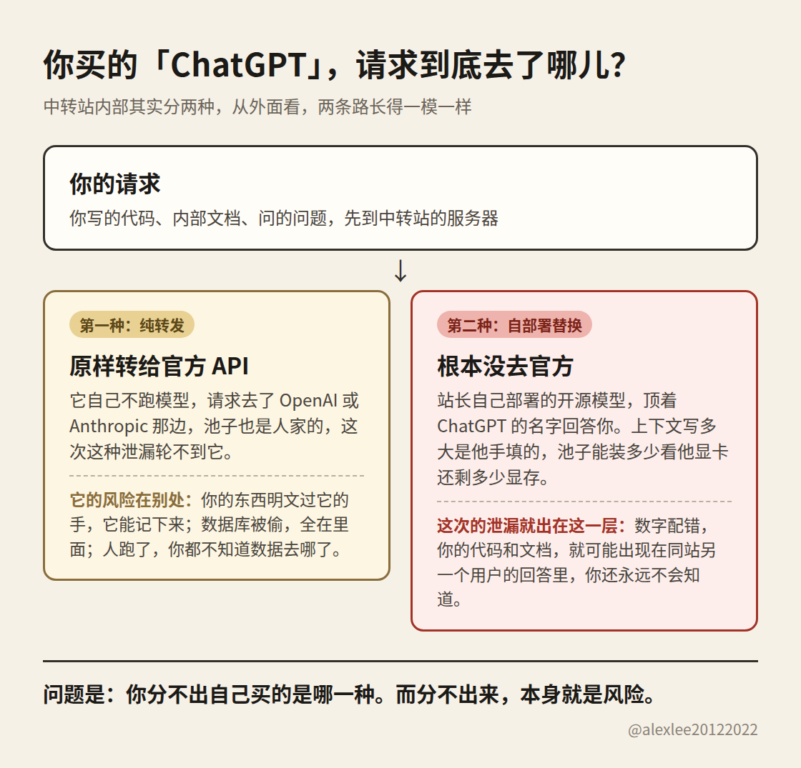

Cloudflare 10 月 26 日披露了一次泄漏，跑在它 Workers AI 上的 GLM-5.3，在差不多两个星期里，会把一个用户的提示词片段，带进另一个用户的回答里。这件事 9 月 9 日就修好了，前后中招的回答一共 155 条，你要问我这件事本身有多大，我说实话，不大。

我真正想讲的，是它顺手演示出来的另一件事：很多人买大模型走的是中转站，而中转站，恰恰是最容易出这种事的地方。你用的那家还安全么，我觉得值得你花三分钟想一想。

事情的经过其实不复杂。模型读你的提示词的时候，会把已经处理过的文字记成一份笔记，存在显存里，这样它往下生成的时候就不用把前面的活重做一遍，这份笔记行话叫 KV 缓存。为了同时服务很多人，这份笔记是大家共用一个池子存放的，隔离全靠软件把每个人的页面分清楚。

出事的配置是这样的：这个池子实际上只能装 681,280 个 token，可 GLM-5.3 对外标称的上下文长度是 1,048,576 个。你算一下，1,048,576 减 681,280，差了 367,296 个。

按道理，提示词长过了池子，就应该当场被拒绝掉，可是 SGLang 拒绝的那条路径上有个 bug，超长的请求没有被拦住，往下走到了生成回答的那一步，而那一步读到的显存页面里，还留着排在它前面的用户写下的笔记。155 条中招的回答，全部来自超过 681,280 个 token 的超长提示词，前面那些用户的提示词片段，就这样出现在了陌生人的回答里。

Cloudflare 在披露里承认了一件事，我看到的时候后背有点凉：这两个数字对不上，他们上线之前就知道，他们当时想的是，反正引擎会把超长的请求报错挡回去，先上吧。后来他们把池子扩到了能装下整个上下文，引擎的修复也跟上了，补丁一路发到 SGLang 0.5.22，还说没有发现有人故意利用这个漏洞的证据。

修是修好了，可你注意，栽跟头的是 Cloudflare，它有专门的安全团队，有人盯着这种事，还是在明知数字对不上的情况下先把服务放了出去。

那么这件事跟中转站有什么关系呢？关系就在「谁在运营那个池子」上。中转站这个行当，内部其实分两种，很多人一直不知道。

一种是纯转发的：它自己不跑模型，就是把你的请求原样转给官方的 API，模型在 OpenAI 或者 Anthropic 那边跑，池子也是人家那边的，隔离做得怎么样，轮不到中转站操心。

这一层的风险不在配置上，而在别的地方：你写的东西是明文从它的服务器上过的，它愿意记就能全记下来，它的数据库要是被人拖走了，你的提示词和代码就都在里面，老板哪天跑路了，你连自己的数据最后去了哪儿都不知道。

另一种是自己部署的：你在它店里买的名字叫 ChatGPT，价格比官方便宜一大截，可你的请求压根没有去过 OpenAI，是站长自己部署的一个开源模型，在后面顶着那个名字回答你。这一类，才是这次泄漏的正主。

为什么这么说，你听我把 Cloudflare 原文里的一句话翻译成人话：标称的上下文长度，是一个单独填的配置数字；而池子到底能装多少，根本不是谁填的，它是引擎启动的时候，拿显卡上装完模型权重之后剩下的显存现算的。这两个数字之间，没有任何机制保证它们一致，对不对得上，全靠运营的人自己去核对。

Cloudflare 核对漏了，而且是知道对不上还先上了线。一个自己租机器搭站的站长，定价页面上把上下文写成 1M，眼睛都不带眨的，他那张卡装完模型还剩多少显存，他核对过吗？

他用的 SGLang 又是什么版本呢？这次这个 bug，早在 7 月就有人给 SGLang 报过了，修复补丁到 10 月 19 日的 0.5.22 才算发齐，站长要是还跑着老版本，配置就算没有写错，超长的请求一样能把前面用户的内容带出来。

你送进去的都是什么呢？用中转站写代码的人，送进去的往往就是没发布的代码、内部的文档、整个项目的上下文。真漏出去，漏到同一个站的另一个用户那里，你这边不会有任何动静，日志里干干净净，你永远不会知道。

更麻烦的是，你在外面根本分不出自己买的到底是哪一种。API 的地址长得跟官方一样，返回的格式一样，你问模型它是谁，它还会一本正经地告诉你它就是 ChatGPT，这些全都能仿，替换这门生意本来就是靠你分不出来赚钱的。

价格低得离谱，是唯一能从外面看到的信号，可它也只是个信号，不是证据。所以标题里那个问题，你使用的中转站还安全么，对大多数人来说，诚实的答案是答不上来，因为你连它是哪一种都不知道。我把话说得再直白一点：你不知道它是哪一种，这件事本身，就是你正在承担的风险。

那怎么办，我给的建议都是你自己能动手做到的，不指望站长出什么证明，因为他证明不了，你也验不了。你要是有资格、也有条件直接买官方的 API，我的建议是别绕中转站这一手，这一层的风险直接就不存在了。

你要是确实只能用中转站，那就别按「它是个转发管道」来信任它，按「它背后可能就是一台我看不见的机器」来防：没有发布的代码、内部文档，不要整份往里面送，非送不可，先把名字、地址、密钥这些东西抹掉再送。

专门送长文档的人尤其要在意，这次收到别人内容的，全是超长提示词的回答，长文档正是最容易走到那一步的东西。

你要是只聊短对话，你不会在自己的回答里撞见别人的内容，可是你留下的笔记被后面某个超长请求读走的可能，跟你聊得长不长没有关系，该防的从来都是你送进去的东西本身。

定价低到明显不合常理的「官方模型」，你就先按替换货来算账，用它干点不疼不痒的活可以，把身家性命的东西交给它之前，先想一想这篇里说的事。

写到最后，我是真的有点好奇，想问问在用中转站的各位：你有没有在某一次回答里，隐隐觉得对面这个模型不像你买的那个？或者你其实早就怀疑过，只是没地方验证？评论区跟我说说，我想看看这种事到底有多普遍。

出处：[Cloudflare 官方披露](https://blog.cloudflare.com/kv-cache-exposure-remediation/)
