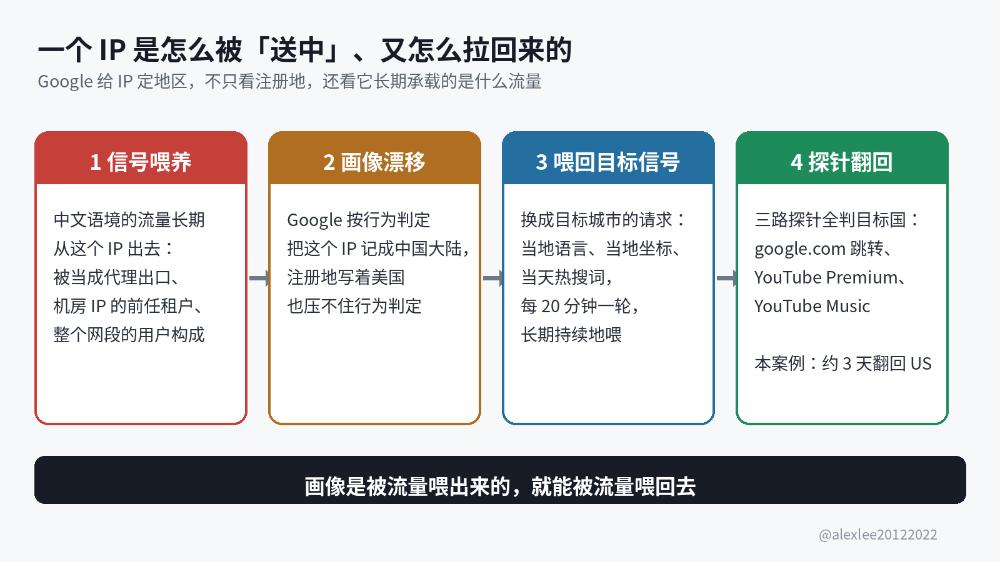
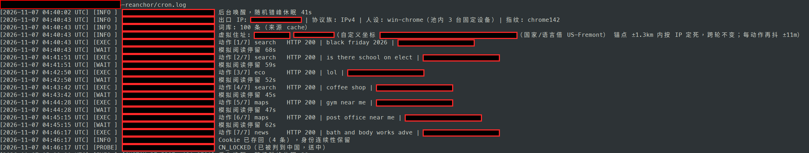
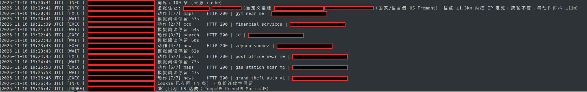

朋友的一台美国 VPS 在加州 Fremont，IP 也是美国的，可是 Google 把它判成了中国大陆。被判成中国大陆之后，Gemini 打开就是地区不支持，YouTube Premium 也订不了，Google Play 同样锁在中国区。你有没有碰到过这种事，VPS 明明买在美国，Google 却把你当成中国大陆用户？

这个判定是能改回来的。我写了一个小工具，用目标地区的流量把这个 IP 的区域画像一点一点喂回去。cron 每 20 分钟跑一轮，跑了大约 3 天之后，这个 IP 就被 Google 判回了美国。

## 送中是什么意思

「送中」是圈子里对这件事的叫法：一台数据中心或者 VPS 的 IP，物理位置在美国、日本这些地方，Google 却把它判给中国大陆。IP 的注册信息明明写着美国，但是 Google 的服务不认这个注册地。于是搜索、应用商店、订阅服务这些 Google 的服务，全按中国大陆的规矩来处理这个 IP。

## 被送中之后，具体坏在哪

出问题的不是某一个页面。这个 IP 在 Google 眼里的整个地区身份都是错的，所以凡是按地区放行的服务都会跟着出问题。具体是这样：

1. Gemini 用不了，打开就提示所在地区不受支持。
2. YouTube Premium 订不了，订阅的时候会被按中国大陆地区处理。
3. Google Play 锁在中国区，能装的应用和价格都跟着中国区走。
4. Google 搜索的结果和服务区域，全部按中国大陆来。
5. 其他按地区放行的 Google 服务，同样跟着这个判定走。

账号也会跟着受影响。短期借这个 IP 上一上网的话，坏的只是体验。可是如果你长期拿这个 IP 登录自己的 Google 账号，那么账号的常用地区也会跟着这个 IP 漂。时间长了，账号本身就多一层被判成异常地区的风险，所以这件事能处理就尽早处理。

## IP 为什么会被判到中国去

Google 给一个 IP 定地区画像的时候，不只看注册数据。注册信息只是底子，Google 还会看行为信号，也就是这个 IP 长期在发什么样的流量、它所在的网段是什么样的使用环境。

如果一个 IP 长期被拿去当代理或者 VPN 的出口，那么从它出去的流量大多是中文语境的，在 Google 眼里，它就是一个被中国大陆用户用着的地址。还有两种情况也很常见。一种是机房 IP 的前任租户留下的使用痕迹：那个 IP 的流量构成早就偏了。另一种是整个网段的用户本来就以中文用户为主，这个 IP 只是跟着网段一起被喂偏的。

这些信号喂得久了，行为画像就压过了注册信息。所以你去查 IP 数据库，就算上面写着美国，也没有用。Google 判地区的时候，看的主要是行为信号，注册信息反而排在后面。

## 拉回来的原理

既然画像是被流量一点一点喂偏的，那么拉回来的办法，就是用目标地区的流量一点一点喂回去。喂的内容要像当地居民真的在用网，所以语言要用目标城市通用的语言，定位也要落在目标城市的坐标上，搜的词也要是当地当天的热搜词。这样的请求持续发上一段时间，Google 的行为判定就会慢慢漂回目标地区。

怎么知道漂回去了没有？看三个探针就够了。所谓探针，就是拿三个能直接看到地区判定的入口去问 Google。第一个看 google.com 会把你跳转到哪个国家的域名。第二个看 YouTube Premium 显示哪个地区。第三个看 YouTube Music 显示哪个地区。三路都翻回目标国家，这个 IP 才算真的回来了。

还有一条官方的路，是给 Google 提交 IP 更正表单，把被判错的 IP 和它实际所在的国家填上去。但是 Google 自己在说明里写了，处理可能要一个月以上，而且不会单独回复你。所以这条路只能当保底，不能指望它来解决眼前的问题。



## 我把工具拆出来重写了一版

被送中的是朋友的机器。我帮他处理这件事的时候，找到了 hotyue 的 IP-Sentinel 这个项目，它的 Google 模块就是处理送中的。我把那个模块单独拆出来重写了一版，起名 ip-reanchor，开源在 GitHub 上：https://github.com/alexliyu7352/google_ip 。

这一版只做一件事，就是把被判到中国的 VPS IP，用目标地区的本土流量长期喂回来。每轮养护跑起来，是这么一套动作：

1. 人设先定死。工具先按出口 IP 算一个哈希，再用这个哈希固定对应到 3 台「家庭设备」，每轮从里面抽一台用。还有一处细节容易露馅：请求的 TLS 指纹要和声称的浏览器版本对得上，所以这一版用 curl_cffi 的 impersonate 功能，指纹按目标浏览器生成。这样 UA 写哪个版本，指纹就跟到哪个版本，两个版本始终绑在一起。

2. 住址也定死。工具同样按 IP 的哈希，在目标城市的中心坐标周围 1.3 公里以内定一个虚拟住址。住址定下来之后跨轮不变，每个动作只在这个住址附近再抖动 11 米，为的是模拟定位的自然漂移。原版的做法是每一轮在 3 公里范围里重新掷一个住址，那等于每 20 分钟搬一次家，真住户不会这样，所以这一版把这一点改掉了。

3. 词库每天更新。工具每天去拉 Google Trends 上目标国家当天的热搜词，再和自带的种子词库合并，最后保留 100 条。所以每一轮搜的词，都是当地人当天真的在搜的东西。

4. 一轮做 5 到 8 个动作。动作在 Google 搜索、Google News、Maps 坐标搜索、低风险的生态页面和平台连通性检查之间按权重抽。生态页面指的是 about.google、safety.google 这类 Google 自家的页面。每个动作之间隔 45 到 75 秒。相邻两个动作是同一类的时候，有 70% 的概率带上 Referer，看起来像在站内点来点去，而不是凭空敲网址。

5. Cookie 按 IP 存盘。每台设备用的 Cookie 都按出口 IP 存成文件，下一轮接着用。所以在 Google 眼里，来的是一个连续的老访客，而不是一批每次都从零开始的新面孔。

6. 每轮末尾自检。一轮跑完，工具把三路探针再查一遍，再把结果追加进 probe_history.jsonl 这个文件里。翻开这个记录，哪一路还是 CN、哪一天翻回了目标国，都看得见。

一轮跑完，大概要 6 到 10 分钟。这一版的形态也和原版不一样。原版有一套 Master-Agent 中枢程序，外加 Telegram 通知和远程执行，这一版就是单机上的一个文件。cron 定时跑，日志和探针记录也都留在本机，所以攻击面小很多。

还有一条链路，这一版没有保留。原版有一条「信用净化」的路，靠访问一批目标地区当地的白名单站点，主要是当地的新闻站点，去影响欺诈分数据库。我查不到证据能证明访问这些站点会影响那个数据库，所以没有把它搬过来，不做没有依据的动作。

它伪造不了登录用户的真实定位，也伪造不了安卓手机的 GPS 和 WiFi 定位数据。还有，如果这个 IP 现在还在给大量真实的中文用户当代理出口，那么真人的信号会把工具这点信号淹掉，效果就别指望了。

## 亲测：3 天，探针全部翻回美国

朋友的这台 VPS 在美国 Fremont，是一个 IPv4 地址。11 月 7 日，探针给出的结果是 CN_LOCKED，三路全判 CN。三路就是 google.com 跳转、YouTube Premium 和 YouTube Music，日志里分别记作 Jump、Prem 和 Music。确诊之后，当天就挂上了 cron，让它每 20 分钟跑一轮。

到 11 月 10 日，探针翻成了 OK。三路的结果记作 Jump=US、Prem=US、Music=US，全判美国。从确诊到翻回，前后大约 3 天。这个 3 天只是这一台机器这一次的结果：我在工具的说明里写的预期是按周观察，因为每台机器所在的网段环境都不一样，要喂多久也会跟着变。这一台 3 天就翻回来，说明它所在的网段环境对它比较有利。换一台机器，就未必还是 3 天。

养护首日（11 月 7 日）和翻回当天（11 月 10 日）的两张运行日志截图我放在下面，截图里的出口 IP 和经纬度都已经涂抹掉了。





## 怎么用

第一步，把代码拉下来装好，装在要养护的那台 VPS 上。

```bash
git clone https://github.com/alexliyu7352/google_ip.git && cd google_ip
uv sync
```

第二步，先体检，确诊了再动手。

```bash
uv run python reanchor.py probe --region US-Fremont
```

先跑一遍 uv run python reanchor.py regions，全部 67 个城市的代码就都能查到。上面 probe 命令里的 US-Fremont，就是从这张表里查出来的。

如果城市表里没有你要的点，或者你想精确锚到某个街区，那么就直接给经纬度，用 --lat 和 --lon 成对传。双栈的机器记得加 --ipv4 或者 --ipv6 来把要养的那个地址锁死。不然就会只养好 v4，v6 那个地址还留在错误判定里。

第三步，把官方更正表单提交掉，当保底：

这个表单在 Google 支持页面上就能找到，打开之后填被判错的 IP 和它实际所在的国家就行。提交完不要等它，因为 Google 的处理周期是一个月起步。这条线和脚本并行跑，哪条先到都行。

第四步，挂上 cron，每 20 分钟跑一轮。

```cron
*/20 * * * *  cd /path/to/google_ip && $HOME/.local/bin/uv run python reanchor.py run --region US-Fremont >/dev/null 2>&1
```

程序内部还有 0 到 180 秒的随机错峰，所以不用再自己加 sleep。一天跑 72 轮，地区判定要靠这样长期持续地喂才会慢慢变，而单独跑一轮看不出变化。

第五步，看趋势，不要看单日。

每轮的三路探针结果都追加在 probe_history.jsonl 里，隔几天翻一翻，看 YouTube 那两路的判定有没有从 CN 往目标国挪。我自己在说明里写的就是按周观察，所以一两天没动静是正常的，不要因为第一天没翻回来就断定没用。

## 两条注意事项，部署前先看

第一，手机绝对不要拿这个 IP 当 VPN 或者代理出口。安卓的 Google 框架会自己往 Google 发定位数据，它发出的这部分定位流量有可能不走 VPN 和代理的通道，你就算开了全局代理，它也一样有可能绕过去。手机的真实位置会绕开代理、顺着框架自己的通道源源不断地喂给这个 IP，而工具喂的信号压不过手机发出的定位信号，这个 IP 就拉不回来。

除非你在服务器端把 Google 框架的定位流量过滤掉，或者在手机上把 Google 框架的粗定位和精细定位都关掉，否则就别一边拿手机挂这个 IP，一边指望脚本把它拉回来。

第二，整个网段都送中的，拉不回来，所以别白费劲。先拿 probe 去探一探同网段的其他 IP，如果整个网段都判 CN，那就说明那个网段上有大量真实的中文语境流量在持续喂着这个判定。工具每 20 分钟一轮的信号量，和整个网段其他人的使用量完全不在一个量级，所以工具这点信号会被淹没，也就喂不出一个立得住的地区画像。这种情况直接换 IP，或者换机房，不要在这种网段上耗时间。

Google 给一个 IP 定地区，靠的是它平时发出的流量记录。它记着谁在用这个 IP，也记着这些人用的是哪里的语言、定位坐标落在哪里，然后从这些记录里判它属于哪里。也因为判定是这样一条一条记录累积出来的，所以它记错了也能改：只要目标地区的流量长期持续地喂回去，新的记录就会慢慢把判定带回来。前提还是那一条，就是这个 IP 所在的网段没有整个被送中。

如果这篇对你有用，请订阅或收藏这个博客。我会继续分享 AI、安全和开源方面自己动手查过、用过的东西。这个项目后面如果有新的实测结果，我再写一篇把数据补上。

