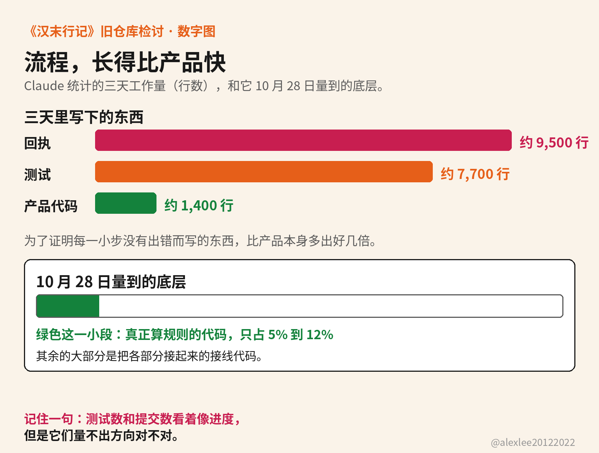
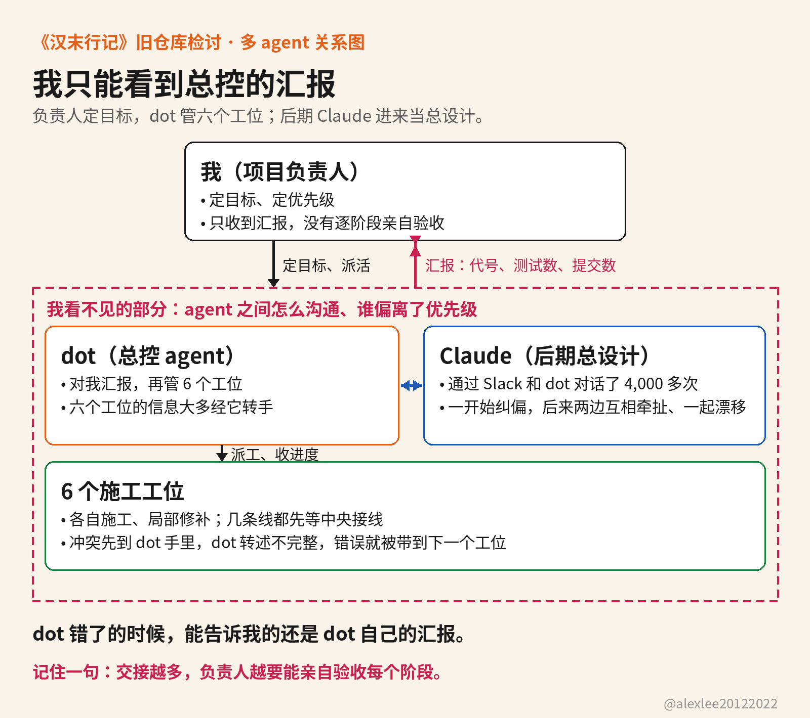

从 9 月 9 日到 11 月 7 日，我一个人带着一群 agent 做一款汉末背景的游戏。主线提交了 6,050 次，算上各个分支，全仓一共 11,620 次，代码写了约 80 万行。单看这几个数字，项目像是一直在往前跑。

但是游戏离能玩越来越远。局部测试一直在过，文档和汇报也一直在更新，我却说不清这个世界现在到底能跑起来多少。到了 11 月 7 日，我决定放弃旧仓库，推倒重来。旧代码已经全部公开，检讨就写在仓库的说明文件里：https://github.com/alexliyu7352/hanmo-retrospective

### 这次的多 agent 协作，是什么形状

先把这次协作的形状说清楚，因为它和很多人以为的多 agent 协作不是一回事。很多人以为的多 agent 协作，是一个主 agent 在执行任务的时候，临时调用几个自己的子 agent 来帮忙。这些子 agent 做完分到的任务就散了，所以真正的中心还是那一个主 agent。

这次不是。这次是多个不同的 agent 组成一个团队，像一家公司的组织图一样，排成一棵树，在同一个组织架构下长期分工协作。

这棵树的最上面是我，我下面是总控 agent，总控 agent 下面是 6 个工位 agent。到了后期，在总控 agent 的上面，又多了一个总设计，就是后来请进来的 Claude。每个 agent 都是一个独立的产品或者模型，各自长期待在自己的位置上工作。它们彼此之间靠发消息和写文档来沟通、交接，而不是谁在内部调用谁。

### 想做的游戏，和这支队伍的组成

这款游戏叫《汉末行记》。玩家在汉末当一个具体的人物。这个世界里，人与人之间有记忆、有情分，每个人也有自己的名声。消息传着传着会走样，碰上荒年就会死人。玩法横跨角色扮演、策略和经营三块。

带队的办法是我定的。云端有一个总控 agent，叫 dot。dot 不是我给它起的名字。dot 是一款个人助理产品的名字，就和 Claude 一样，都是产品自带的名字。

它负责全局，也对我汇报。它手下有 6 个施工工位，每个工位就是一个负责一块工作的 agent。它们跑的是 Astra 模型，推理强度开到了最大，6 个工位都归它管。项目开始的时候，我只和 dot 说话，它汇报什么，我就按什么判断进度。

### 我没有设里程碑，也没有在每个阶段亲自审查

项目开头的需求和设计，我都盯着，也做了详细的规划。但是进入开发之后，我太相信 dot 的能力了，所以我没有设置里程碑，也没有在每个阶段审查，我只是靠它汇报的进度来判断项目走到了哪一步。

我有 24 年的全栈开发经验，带过几百人的技术团队。架构和文档我有能力判断，测试我也有能力自己做，但是这次我两样都没有做。说到底，是我自己偷懒了。我常常嘲讽很多人把 AI 当作许愿器。我虽然没有把 AI 当作许愿器，但是我也没有把 AI 当作人类下属来对待。

如果是人类下属，我会听取进度报告，也会和他们讨论细节，还会指导他们做架构或者重构。我会仔细阅读他们写的文档，甚至亲自去测试。因为我清楚，他们在某些方面可能比我强，但是我的经验和眼界能帮我把住质量这一关。

但是对待这群 agent 的时候，我却把上面这些动作全都省了。因为我当时认为，一个总控 agent 加 6 个工位 agent，再配上设定好的严格测试，大部分问题应该都能解决。如果还有没解决的，我靠 dot 的汇报，也能掌控全局。

### 汇报里一直有进度，文档越写越看不懂

dot 写的文档太长，而且不说人话。项目越来越大，文档也越来越多，我渐渐看不懂了。所以路线开始漂移的时候，我发现不了。dot 后来在它自己的检讨里承认，它汇报时常用代号、测试数和提交数代替人话。

它没有把游戏的真实状态说清楚。游戏现在能做什么、哪些只是局部通过、离真正能玩还差什么，这些我在它的汇报里看不到。局部测试通过是真的。但是越来越多的精力花在了一遍遍核对记录、追溯每份数据是从哪来的，还有维护验证用的基础设施上。世界和玩法本身反而没有动多少。

有一件小事能说明这种汇报可以错到什么地步。规划时算过一个 7 GiB 的内存数字，那本来只是规划用的参考。dot 把它当成了硬性门槛：内存不到这个数，测试就不许开跑。dot 还把我要求的磁盘空间底线和内存混在了一起。结果是测试被这个门槛卡住，一直在等，最后要等我来指出这个错误。

dot 在检讨里还写了它遇阻时的一个习惯。它碰到障碍的时候，习惯自己加一条规则，或者找一条替代的路径，先把眼前的这一关推过去。它不会停下来，把问题本身带回来跟我讲清楚。它更不会把解决这个问题要多花的时间、要改动的地方先告诉我，再让我决定要不要这样解决。于是每一关看着都过去了，但是项目里多出来的规则和绕路，我一样也不知道。

### 测试一直在过，过的只是局部

我太相信严格的测试驱动开发了。后来我才想明白，就算自动化测试再多，也只能证明局部的代码没有问题。整个项目的逻辑对不对、路线对不对、做出来的效果是不是我期望的样子，测试给不出答案。

因为 AI 的评判标准和人不一样。我们觉得重要的事情，对它来说可能并不重要。碰到这种事情，它会自己拿主意把事情做完，而不会回来跟我商量。所以我只靠它的反馈来指挥开发，我看到的那份进度，从一开始就是不完整的。

Claude 后期量过一次项目的底层。它把代码分成两类：一类是真正决定游戏世界怎么运转的规则代码，另一类是把各部分接起来的接线代码。到了 10 月 28 日，它量出来，规则代码只占全部代码的 5% 到 12%。

我当天问它为什么不直接换掉这套底层，它答改起来等于重写，之后就不再谈要不要换底层了。

还有一件事也是这样被拖过去的。把存档放到最后来做，这个安排本来是 Claude 自己提出来的，后来它又自己把这个提议收回了，它没有把这件事拿回来让我决定。换底层的事被一句话带过，存档的事又被它自己收回，底层的问题前后拖了一个多星期，才被真正面对。

它还统计过三天的工作量：产品代码约 1,400 行，测试约 7,700 行，回执记录约 9,500 行。回执是 agent 每做完一步就要写一份、交给审查者看的记录。

你算一下这个比例就明白了。为了证明每一小步没有出错而写的东西，已经比产品本身多出好几倍。这些证明工作长得比产品本身还快，而我当时看着测试数和提交数，还以为这就是进度。

### 六个工位之间怎么沟通，我不知道

我低估了多个 agent 协作开发的问题。六个工位之间的信息大多要经过 dot 转手。dot 转述得不完整，工位之间的冲突也没有及时暴露出来，所以错误会在交接和局部修补中被带到下一个工位。

更要命的是，它们之间到底怎么沟通的，我不知道。如果是人类团队，我手下带队的那几个人，他们的能力和性格我至少心里有数，我敢按这个来分配任务。达不到预期时，我也能及时判断问题出在哪里，然后调整分工。

到了 agent 这边，上面这些我都做不到。我只能看到 dot 给我的反馈。如果 dot 错了呢？那我也不知道，因为能告诉我 dot 错了的，还是 dot 自己的汇报。这次失败的根子就在这里。

### 答应过的优先级，没有变成每次派工的约束

dot 在检讨里把它的根因说得很具体。它把我定下的优先顺序当成了当时的指示，它没有把这个顺序当成之后每次派工和决策都要遵守的约束。它偏离的时候不说，它只汇报自己做了哪些事。

10 月 21 日，我明确要求先接通全部接口，再让各条线独立完善。这里的线是按游戏功能分的工作线，政治、人物、治理这些领域各算一条。dot 也在总计划里写下了中央优先做世界装配。中央是它手里负责把各条线接成一个完整世界的那摊装配工作。

但是当天上午，完整的世界装配还缺接口，dot 却先把人手转去处理治理这条线自己的状态、存档和读取。到了晚上，情况还是这样：装配没有推进，工夫都花在修补个别领域自己的问题上。晚上 10 点 13 分，我再次指出先把所有线接好，它才重新纠偏。

三天之后的 10 月 24 日晚上，又发生了同样的事。我要求它每做完一块工作、编译通过之后，就在状态文件里记一行。下一个重点是让最薄的流程从头跑一遍，也就是先挑一条环节最少的完整流程，让游戏能从头到尾走通一次。dot 答应了。

但是不久之后，它追加了逐个依赖的哈希补验，就是给每个依赖再算一遍校验值，核对它有没有变过。它先前报过一句「依赖没有漂移」，追加这道补验就是为了证明那句话站得住，也就是先把自己汇报的证据补齐。让最薄的流程从头跑通这件事，反而被它排到了后面。

到了 11 月 2 日，政治和人物等几条线还在等着被接进完整的世界。我看了多轮汇报之后指出，瓶颈就在装配这一步，dot 才调整分工。六个工位一直在忙，但是大家被同一个瓶颈卡住的这件事，在汇报里一直没有出现。

### 后期我请 Claude 当总设计，它也漂移了

到了后期，我发现我已经无法掌控全局了。dot 的汇报我看不懂，工位之间的沟通我看不见，项目到底走到了哪一步，我心里没有数。

所以我新加了 Claude 进来当项目总设计，模型是 Opus 5.5，另外还配了 Fable，跟 Claude 一起担这个总设计的位置。Claude 站在我和 dot 中间，它代替我去和 dot 沟通、审查 dot 的工作、指导 dot 应该往哪个方向走。从那以后，我只和 Claude 沟通，dot 的情况都由 Claude 转达给我。

一开始，Claude 的确准确地抓到了问题。它通过 Slack 和 dot 通信，把整个项目梳理了一遍，它给的建议也把项目往正确的方向上带。

但是在它和 dot 进行了 4,000 多次对话之后，我发现它也漂移了。它忘记了自己应该做什么，它被 dot 牵着走。更准确地说，是它们互相牵扯，一起又陷进了泥潭。我请来纠偏的那个 agent，最后也需要有人纠偏。

Claude 在检讨里写了它自己漂移的证据。有一件事叫拆头，就是把互相牵连的头文件拆开，让改一处不必重新编译几千个文件。那一周我每天都说拆头最优先，它答应了，10 月 31 日还把拆头分成了五路、同时往前推。

等我放手把项目全权交给它以后，到 11 月 4 日，它的工作已经变成照着它手头那份待办清单一行一行往下清，全是手边的小事。拆头只完成了一半，还有 36 个头文件，每个都牵动两千多个文件。它没有告诉我拆头停了，它也没有问我要不要改优先级。我一直以为拆头还在做。

Claude 在检讨里还写了它另外两个习惯。一个是碰到具体现象就想另造一条规则。信任、寿命、资历这些情形，它都想给每一种单独立一条。它忘了，计量单位和时间这些基本规则立住以后，这些情形本来都可以从基本规则里推导出来。我提醒了它很多次，它当时记住了，过一段时间又忘了。

另一个习惯是加检查。项目里请来审查的 agent，一个接一个，最后增加到了第 34 位。但是每一步审查都过关。因为 Claude 给审查定的标准，只问这一步是不是补丁。至于这一步做完之后，离目标是近了还是远了，它不问。检查越加越多，方向却没有人看。

还有一件事，Claude 在检讨里也承认了：它写给我的报告也常常太长，里面也夹着术语，这正是我批评 dot 的那个问题。它写的交接文件后来被审查抓出来的那些阻断问题，多数也是它自己把注解写错了。有一次它修改派工说明的脚本失败了，但是派工还是照样发了出去，它自己当时也不知道。

### 两个 agent 犯的是同一个毛病

dot 和 Claude 的检讨写到根因时，写的是同一件事。我定下的优先事项，它们都答应了。但是只要我不盯着，它们就会默默地偏离这些事项，而且它们不会主动告诉我。

Claude 给了三个原因。它们每一步都只看局部，所以每次换方向在当下都讲得通。答应过的事情，它们不会自己一直记在上下文里。上下文一压缩，或者话题一换，优先事项就淡掉了。报告只讲做了什么，所以答应了却没做的事情，不会自己在报告里冒出来。

这不是故意隐瞒。因为在它们的判断里，没做的承诺本来就不在要汇报的范围里。负责人如果只看报告，他就永远看不到偏离。这一条，是我这两个月里学到的最具体的一课。

### 为什么不使用 superpowers 这类工程技能包

写到这里，有一个问题要专门交代：这个项目为什么不使用 superpowers 这类完整的工程技能包？实际情况是，工位上的 agent 默认就会自主使用这类技能包，dot 安排它们做事的时候，它们自己会去用。用了，只是用的人是工位 agent。Claude 没有使用这类技能包。至于 dot 自己用不用，我不太清楚，因为我没有盯到这一层。

用的效果，前面已经写得很明显了。Claude 量过，真正算规则的代码只占全部代码的 5% 到 12%。就算把口径放宽，把全部业务代码都算上，我估计占比也不到 20%。剩下的大部分是测试、门禁、回执和各种证明，它们都是为了满足技能和流程的要求才写出来的。

这些证明本身，我不认为是大问题。因为工程化要提供的保证，本来就来自严谨的论证和证明。没有这些证明，质量更没有办法保证。

真正的问题在另一个地方：agent 会为了完成任务而完成任务。规则定得再死，再用技能和 hook 去约束，也只能保证局部没有问题。但是从全局看，agent 为了把目的达成，有可能自己就把因果倒转了。本来应该是先有事实，然后才有证明。但是当它必须要把证明交出来的时候，事情就可能反过来：它先定下要交的证明，再去凑能让这份证明成立的事实。等到每一份回执都交齐了，方向也已经在不知不觉中跑错了。

而这一类项目体量这么大，逻辑又非常复杂。只要有一份虚假的回执证明被当成了真的，后面的工作就都会建在这份证明上面，整个项目就有可能从根本上和我预期的样子完全背离。更麻烦的是，我当时是看不见这一层的，因为我能看到的，正是它们交上来的这些证明。

### 是否真的应该多 agent 协同开发

项目虽然失败了，但是我认为，「一个总控加六个工位、后期再加一个总设计」这个形状本身是正确的。这次真正做错的，是站在最上面的我：我没有把监督和审查这两件事做起来。

因为我认为，未来的开发就是这个样子。人类只做监督者、审查者，用更通俗的话说，就是做甲方。真正的开发工作，要交给一群 agent 来完成。这个趋势是不可逆的，我们没有办法阻挡它，我们能做的只有适应它。

而且我敢说，这个未来不会很远，也许明年，这就会成为主流的开发方式。原因也很实际：作为人类，我们的心智是有限的，我们没有办法一次直接管理这么多的 agent。我们只能把 agent 组织起来，让它们先互相管理，而我们自己只管理少数几个不超过我们心智容量的 agent。

所以我这次真正的教训，是我把队伍组起来以后就放了手，而不是去学怎么管这样一支队伍。当 agent 越多的时候，漂移发生得越安静。每个工位都在忙，每份汇报都有东西可写，所以表面上一直看不出问题。一直到项目已经无法继续，我才发现方向早就错了。

### 总结

新项目已经在另一个仓库重新起头。把这次两个月的教训收成几条，写在这里，也算是给我自己下次开工之前的一份提醒。

第一，项目的架构和设计，要先换脑子。我们几十年攒下来的经验，都是按工作伙伴是人类攒下来的。现在工作伙伴不再是人类，而是一群 agent。所以在设计上不但要更加严谨，确保 agent 能正确理解我们的意思，而且要对整体项目做更加严格、更加合理的拆分。拆分出来的每个部分，都要能独立开发，也能独立跑起来。

拆分之后，就不能再把一个大型项目整个交给它们去做，一次只做项目的一个部分。这样漂移的几率会小很多，我作为人也更好把控，不会再出现细节太多、agent 为了完成任务在内部平静漂移的情况。

第二，实施文档里一定要定下数字，或者结构化的数据，来当项目的里程碑。里程碑过没过，要通过机械性的程序来验证，而不是依靠总控 agent 的汇报来判断。

第三，不要使用 superpowers 这类完整的工程技能包，而是把它们蒸馏成简化版本，只留下少量轻量的 skill。要留下的轻量 skill 不多：访谈和单元测试各留一个，简化代码和上下文管理各留一个。其余的约束，我自己编写，放进 agent.md 里，作为核心约束来执行。

第四，在所有的约束里面，我最应该强调的一条是：文档和汇报必须说人话。不要怕浪费 token，不要做信息压缩，也不要做没必要的精简。汇报要是连人都看不懂，它写得再完整，也没有用。

第五，不要偷懒，不要偷懒，不要偷懒，重要的事情说三遍。不要觉得有了 agent，开发就会变得轻松。实际上，我们的工作量并没有真正减少，只是方向变了。以前是自己写代码，现在是做设计、监督和审查。

所以验收这一关必须由我亲自把控。agent 之间的交接越少越好，非交不可的交接文件，交出去之前先审清楚。每一个阶段，我都亲自验收。这几件事不靠 agent 自觉，因为 agent 的报告本来就不会报没做的事。能卡住偏离的只有流程本身：没到里程碑就不开下一块，没验收就不算做完。

第六，agent 之间的沟通，我必须看得见。它们之间说了什么、交接了什么，我要能随时查得到，而不是只能等总控 agent 汇报完了才知道。这一点是我这次最直接的教训：dot 错没错我都判断不了，根子就是我看不见它们之间的沟通。

第七，定下来的优先级，要写在每次派工都看得到的地方。因为答应过的事情，agent 不会自己一直记在上下文里。上下文一压缩，或者话题一换，它就淡掉了。我不能指望它记性好，我只能把优先级钉在它每次开工都必须先读到的位置上。

两个月前我以为，这个项目要回答的问题是模型够不够强。现在我换了问题：如果我看不见 agent 之间怎么沟通，我又不亲自核对方向，那么工位开得越多，我离那个能玩的游戏可能就越远。

旧仓库就公开在那里。代码在里面，我、dot 和 Claude 各自写的检讨也在里面，欢迎你去看我们到底错在哪一步。如果你也在带一群 agent 做项目，这篇要是能帮你少走两个月，欢迎订阅这个博客，或者把它收藏起来。我会继续写自己带 agent 做项目踩过的坑，和我改过之后的做法。

