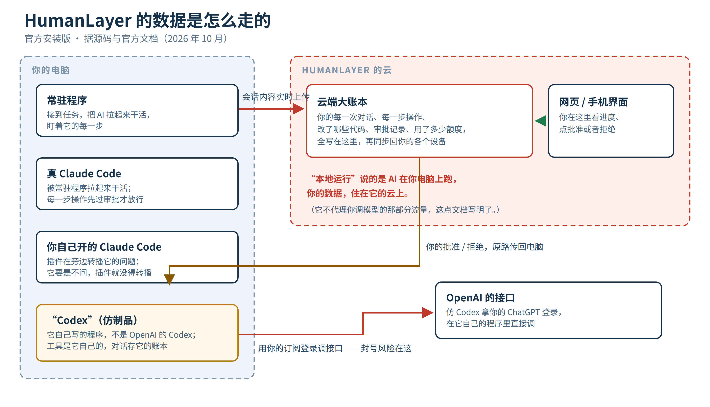
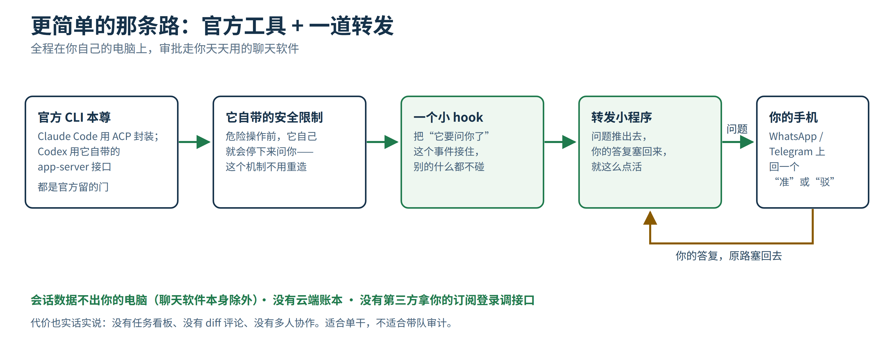

HumanLayer 前几天把整套系统开源了。11.8k star，Apache 2.0，官方说云上跑的也是同一套代码。它做的这件事，恰好是现在很多人想要的：让 AI 编程助手自己干活，危险操作先停下来问人。

仓库两千多万字节，我先通读了一遍，关键文件又对着官方文档核了一轮。工程是真工程，思路也对。但它比看上去重得多，有几个问题，官方博客里是不会主动提的。

## 它卖的是什么

你让 Claude Code 或者 Codex 自己写代码，它就会自己跑命令、改文件、装依赖。快是真快。问题是你不可能一直盯着屏幕，它删错一个目录、跑错一条命令，往往就一秒钟的事。

HumanLayer 卖的就是一个审批层。AI 每想干一件有风险的事，先停下来，把这件事推到你的网页或手机上。你点了批准它才继续；点拒绝，它就收手，拒绝的理由它还看得见。你不在电脑前，也能远程看着它干活、远程批。

听起来简单。真做起来，它分了三种接法，性质完全不一样。

## 第一种：它自己当司机

你在它的网页上下一个任务，你电脑上装的那个常驻程序接到活，自己把真正的 Claude Code 拉起来干。

因为进程是它拉起来的，每一道关都攥在它手里。只有少数几个动作（搜代码、查文件、调用技能）自动放行，其他操作先在云端记一条“待审批”，程序就地卡住，等你那边的结果。你批了，它放行；你拒了，它把你的原话转给 AI 看。

这一种是真拦截。因为方向盘在它手里。

## 第二种：你自己开车，它在旁边转播

你习惯自己在终端里开 Claude Code，它有个插件可以装。Claude Code 本来要停下来问你的时候，插件把这个问题同步一份到网页，你在网页上点同意也算数。终端弹窗和网页同时在，谁先答算谁的。

听着挺聪明。但有个天花板，它自己的说明文档写得也算坦白：如果你的 Claude Code 设的是“别问我，直接干”，那它根本不产生问题，插件就没东西可转播了，只剩记录，没有拦截。插件靠的还是 Claude Code 一个比较新的内部接口，官方哪天改版，它就得跟着追。

## 第三种：它那个“Codex”，是它自己写的

这是我拆源码时最意外的一处。

你在 HumanLayer 里选 Codex 这个选项，跑起来的是它自研的一个程序，拿你的 ChatGPT 登录去调 OpenAI 的接口，工具是它自己实现的，对话存在它自己的数据库里。它文档里那句“Codex 会话由 HumanLayer 保存”，就是这么来的。

顺便交代另外两个：OpenCode 的接法是第二种转播；Pi 的那个插件只有转播，连审批都没有，它自己的 README 写了，Pi 不问就全跑。

## 你的数据到底在哪

这是我最想提醒的一段。

官方装法是云为中心的。你电脑上那个程序只负责干活，账本在云上。你的每一次对话、每一步操作、改了哪些代码、任务文件、用了多少额度，统统写进 HumanLayer 云上的数据库，再同步回你的各个设备。

它文档里明确写了，它不代理你调模型的那部分流量，这点是好的。但会话内容本身，就是在人家的云上躺着的。

它也给了自建的路。自己从源码编译、自己部署，官方说不回传任何数据，那些统计和上报的开关都在配置里，没设就是关的。这条我认。但自建现在很毛坯，好几个第三方服务的密钥不填，服务起都起不来，官方指南还写着“在写了”。还有个小瑕疵：它最核心的那两个包，包文件里没写许可证字段。代码是公开的，但这种细节，做过开源的都懂，差一口气。

## 再说封号风险，这个最少有人提

用订阅账号的登录，去第三方工具里调模型，这件事 Anthropic 在 2026 年初已经划过线了：文档写明不许，技术上堵过，账号真封过一批，后来解封了些。理由也简单，订阅是按官方客户端定的价格，你拿去喂第三方程序，用量对不上，人家不认。

对照着看 HumanLayer。它的 Claude 路径走官方工具链拉起真 Claude，相对还在框里。但它那个自研的“Codex”，拿的是你的 ChatGPT 登录，在它自己的程序里直调接口。这正好是各家在收紧的那种用法。现在 OpenAI 还没照着 Anthropic 的剧本走完，但线已经摆在那了。哪天真收紧，先疼的是你的账号。

这类工具帮你省的是订阅的钱，你押上的是账号本身。这笔账得自己算。

还有一层是体量。两千多万字节的代码，功能越全，面越大。开源是加分项，但开源不等于有人审过。11.8k star 里，真正把审批那条链读完的没几个。判断一个工具值不值得托付，我的老办法是看它把数据放在哪、把关卡设在哪，剩下的都是宣传。

## 说回我的看法：这事被做复杂了

我做了 24 年全栈。当年带团队，最大的教训之一就是系统越重，你要托付的东西越多。

HumanLayer 这套，云端账本、实时同步、多端界面、任务系统、评论系统，全套下来是给团队用的：多人协作、留痕审计、几个 AI 并行干活，这些场景它确实值。但如果你是个个人开发者，想要的只是“AI 干活我看得见、危险操作先问我、我不在电脑前也能批”，为这一个功能把全部会话交给一个云，账算不过来。

而且这事官方自己留了门，根本不用绕这么大圈子。

Codex 本身就带一个叫 app-server 的标准接口。OpenAI 自家的编辑器插件和 App，都是走它跟 Codex 对话的。这个协议里天生就有“请求用户批准”这一环，还是开源的。Claude Code 这边，有个叫 ACP 的开放协议，Zed 牵头做的，也能把它封装起来，权限请求在协议里是一等公民，现成的适配器就有。两条路走的都是官方工具、官方接口，工具自带的安全限制照常生效，它本来就会在危险操作前停下来问。

剩下的活就小得多了。写一个转发小程序，用 hook 把“它要问你了”这个事件接住，把问题推到你的 WhatsApp 或者 Telegram。你在聊天里回个“准”或者“驳”，小程序把你的话原样塞回去。会话数据不出你的电脑（聊天软件本身除外），没有云端账本，没有谁拿你的订阅登录去别的地方调接口。代码量跟上面那一整套比，不是一个数量级。

丑话说前面：转发这条路糙。界面就是聊天窗口，任务看板、diff 评论、多人协作这些都没有。你要是带团队、正经做审计，那类重家伙该买买、该建建。我这条路适合单干图省事的。它还有个隐藏好处：哪天官方改了政策，你断的是自己写的小程序，修起来一个下午；押在别人整套平台上的，迁移成本是另一回事。

我打算自己先把这条转发链做出来试试。好不好用，做完再来汇报。

源码与出处：HumanLayer 仓库 github.com/humanlayer/humanlayer；官方开源公告 hlyr.dev/blog/open-sourcing-humanlayer；文中架构细节均出自该仓库源码与自带文档，封号政策部分据 Anthropic 2026 年公开文档与说明整理。
