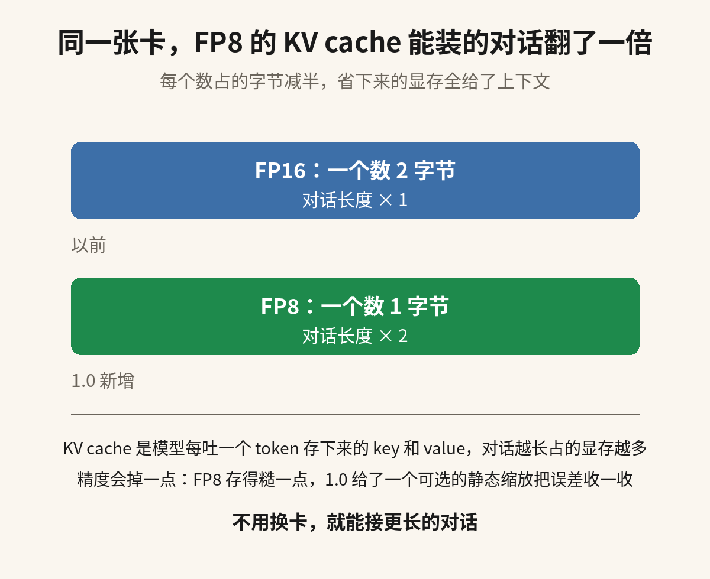

11 月 13 日，llama.cpp 发了 1.0.0（发布页：https://github.com/ggerganov/llama.cpp/releases）。自家 API 一次删掉了 35 个废弃函数。warmup 函数和 defrag 选项不在这 35 个之内，是另外拿掉的。

同一个版本里，推测解码的 NextN API 从扩展头文件升进了正式的 llama.h。删旧函数和升正推测解码放在同一个版本里，1.0 这个版本号的意思就清楚了：它不是功能清单变长了，而是公开 API 从此有了合约。

## 删掉的 API

0.x 的时候，API 是可以随便动的。维护者先把函数标上废弃，然后留着不删，最后让调用者慢慢换。

1.0 把这些留着不删的废弃函数一次结清了。

如果你的程序调了这些函数，升级之后编译直接失败，而且不会有过渡期，也不会先给警告顶着。

废弃函数留着，所以维护者要替新写法和旧的废弃写法两套背书。文档也要写两份。而且新人进来先看到的就是过时的写法。要改的只有调用这一处：所有直接调这些函数的程序，升级之前必须先把调用改掉。改完这一次调用，之后就不用再为这 35 个函数改了。

## FP8 的 KV cache

1.0 另一个改动在显存上。模型每吐一个 token，都要把算这个 token 时用的 key 和 value 存下来，为的是下一个 token 接着算的时候，不用把前面的话重算一遍。这份存下来的东西就叫 KV cache。对话越长，KV cache 占的显存就越多。

以前 KV cache 按 FP16 存，也就是一个数占两个字节。1.0 加了 FP8 的选项，也就是一个数只占一个字节。按字节算，同样一张卡，FP8 的 KV cache 能装的量比 FP16 翻了一倍。对话能拉的长度也跟着翻倍。

FP8 存得糙一点，所以精度会掉一点。不过发布页给了一个可选的静态缩放：给每个张量单独配一把尺，存之前先按这把尺把数值缩到 FP8 装得下的范围里，误差就收得更小。

这笔账对跑本地模型的人最实在。显存不够的时候，瓶颈常常不是模型本身有多大，而是对话一长，KV cache 就先于模型把卡塞满了。

FP8 等于让同一张卡装下两倍长的对话，所以不用换卡，就能接更长的对话。

## 升正的推测解码

推测解码是另一件从扩展升成正式 API 的东西。做法是让一个小模型先往前猜几个 token，再让大模型一次验过。猜对的，大模型就直接收下；要是猜错了，大模型只重算错的那一个 token。猜比算便宜，所以同一个请求花的时间就少了。

以前这套 API 放在 llama-ext.h 里，是扩展。1.0 把它升进 llama.h，成了正式公开 API 的一部分。扩展和正式 API 的区别只有一个，就是能不能随便改：扩展可以改，而正式 API 不能随便改。升正的意思就是，推测解码以后是 llama.cpp 保证不会随便改的用法，不再是扩展头文件里那个随时能改的东西了。

## 加固的 server

1.0 还修了 llama-server 的安全问题。修掉的包括三样：一个是 CORS 配置的洞，一个是 DNS rebinding，还有一个是经由 CORS 中转的 SSRF。MCP 工具调用也在这一版改了：客户端一断开或者超时，llama-server 就把调用取消，还会告诉 MCP server，调用已经取消了。

这些修补没有一个是新功能，但是它们修的都是 server 跑在网上的部分。有人把 llama-server 挂在局域网里跑，有的甚至挂到公网上。模型本身跑得再好，服务器端留一个 SSRF 的洞，别人还是能拿这台服务器去探内网。这一版等于把门先关上，再谈别的。

## 1MB 的桌面 App

同一个版本还发了一个 1MB 的桌面 App，叫 llama.app（https://llama.app）。离线能跑，也就是不用联网，而且不用按月付费。想在自己机器上跑模型的人，门槛又低了一级。

## 升级之前先查什么

所以 1.0 的升级顺序应该是这样。先查自己的程序有没有调那 35 个被删的函数，有就先改掉。再看自己的对话长不长，长就试试 FP8 的 KV cache。最后看 llama-server 是不是挂在网上跑，挂着就升这一版。按这个顺序升，升级之后就不用再回头改调用了。

如果你也在自己机器上跑模型，升级之前先把那 35 个函数查一遍，查完再升。这篇要是能帮你少返一次工，麻烦收藏一下，再订阅这个博客。我会继续写自己动手查过和测过的东西。
