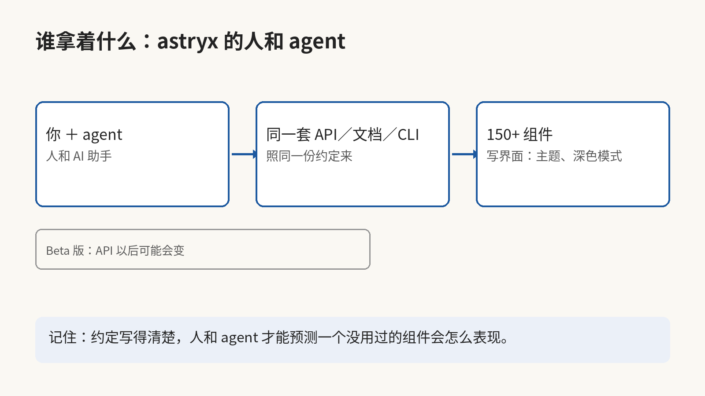
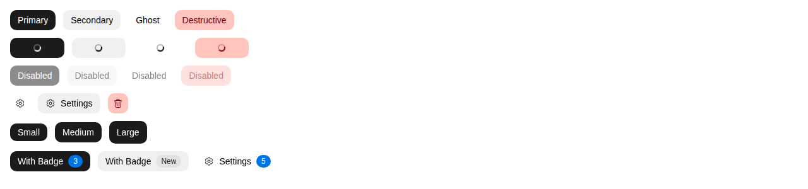
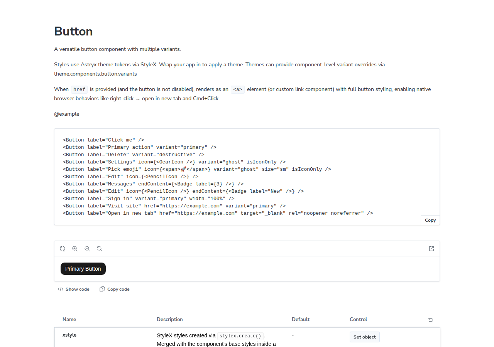

你上次让 agent 写一个页面，它一次就写对了吗？Meta 刚把一个设计系统开源出来，名字叫 Astryx，它在 Meta 内部用了八年，支撑着 13,000 多个应用。它真正特别的地方不是组件多，而是人和 agent 用同一套东西写界面。

这个项目在 GitHub 上叫 meta/astryx，MIT 授权，基于 React 19 和 StyleX。它带着 150 多个无障碍组件、7 套现成主题、深色模式和一个 CLI。11 月 9 日的 GitHub Trending 日榜上，它排在总榜第二，当天多了 3,324 颗星，总数到了 18,670 颗。

它的设计方式是把 API、文档和 CLI 放在一起设计，照着同一份约定来。人和 AI 助手写界面的时候，走的是同一条路，查的也是同一份参考。它的原则里写了一句话：每一次让 Astryx 对 AI 更友好的改动，也让它对人更友好了。



约定是这套系统的底子。每个组件都照同一套命名、属性和组合规则来，而且每一个都有完整的文档。人和 agent 学会几个之后，对没用过的组件也能预判它会怎么表现。

拿 Button 举例，它的 props 定义就写在源文件里。每个字段旁边都配着注释，把每个字段的含义写明了，有的还标了默认取值。

```tsx
export interface ButtonProps extends BaseProps<HTMLButtonElement> {
  /** Ref forwarded to the root element */
  ref?: React.Ref<HTMLButtonElement>;
  /** HTML button type attribute. @default 'button' */
  type?: 'button' | 'submit' | 'reset';
  /** HTML name attribute for form submission. */
  name?: string;
  /** HTML value attribute for form submission. */
  value?: string | number | ReadonlyArray<string>;
  /** Associates the button with a form element by ID. */
  form?: string;
  /**
   * Accessible label for the button (required for accessibility).
   * Rendered as visible text by default. When `isIconOnly` is true,
   * used as aria-label instead.
   */
  label: string;
  /**
   * The visual style variant of the button.
   * @default 'secondary'
   */
  variant?: ButtonVariant;
  /**
   * The size of the button.
   * @default 'md'
   */
  size?: ButtonSize;
```

（astryx 仓库 packages/core/src/Button/Button.tsx，ButtonProps 定义节选）



组件也不锁死：组成它的零件都是直接对外开放的。想改得深一点的话，你就可以用 swizzle 命令把一个组件的完整源码弹出来，再放到你自己的项目里自己持有。主题就是一组 CSS 自定义属性的覆写，所以设计师不用 fork、不用再包一层，就能给整套界面换一套配色和样式。



UI 组件库的下一场竞争，不在谁的组件更好看。agent 已经在替人写界面了，所以一个库能不能被 agent 一次写对，比它自带多少组件更要紧。往这个方向看，评一个组件库的新标准正在成形：约定写得够不够清楚、文档够不够让 agent 照着做、CLI 能不能让 agent 直接调用。

Astryx 现在还是 Beta 版，所以它的 API 以后可能会变。我的建议是，拿一个真的页面让 agent 照着 Astryx 写一遍，再看 agent 改几次能写对，这比读文档更能验出这个库是不是真为 agent 准备的。如果你的项目现在就要一个长期稳定的版本，那就再等它稳定下来。

以后你挑组件库，第一个问题可能不再是这个库好不好看，而是 agent 照着它写一页，能不能一次写对。你上次让 agent 写界面，它改了几次才写对？如果这篇对你有用，请订阅或收藏这个博客。我会继续分享 AI、安全和开源方面自己动手查过、用过的东西。等下一个被 agent 拿来写界面的库出现，我再写一篇，看 agent 用它写得对不对。

来源：Meta Astryx 仓库 https://github.com/meta/astryx
