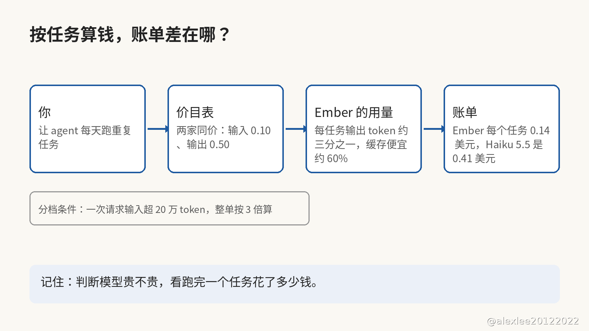

你给 agent 挑模型的时候，是先看每百万 token 的价目表，还是先算一个任务跑完要花多少钱？这两个问法只差一句话，可是算出来的贵贱能差出好几倍。

11 月 9 日，Meta 发布了 Muse Ember。它是从 Muse Wonder Full 蒸馏出来的，专门给 agent 每天重复跑的任务用，像工具调用、编码子任务和长文解析这一类。

Ember 的价目表是这样的：一次请求输入不超过 20 万 token 的时候，输入和输出分别是每百万 0.10 美元和 0.50 美元、缓存输入是每百万 0.004 美元。可是 Haiku 5.5 的输入和输出价钱和它一模一样，输入也是 0.10 美元、输出也是 0.50 美元。所以，只看价目表的话，两个模型一样贵。

Artificial Analysis 换了一个量法：它不看价目表，而是让每个模型把同一批任务真的跑一遍，再记下每个任务实际花了多少钱。

在它的智力指数上，Ember 和 Haiku 5.5 都是 36 分，可是每个任务的价钱差了三倍：Ember 是 0.14 美元、Haiku 5.5 是 0.41 美元。Muse 家自己的 Spark 1.3 分数更高一点（37 分），可是它每个任务要花 2.39 美元，相当于 Ember 的 17 倍。

既然价目表是同一张，账单为什么能差出三倍？因为账单不是照着价目表的单价收的，而是照着你实际用掉多少 token 收的，而两个模型用掉的量又不一样。差别先出在输出上：Ember 每个任务写出的 token 只有 Haiku 5.5 的三分之一左右，而输出的单价又是输入的五倍，所以光是往外写的这一部分，账单就能差出一大截。

输出之外，账单还差在缓存这一项上。重复的任务每跑一遍，都要把同一份上下文再读一遍，如果这份上下文已经缓存住了，再读就按缓存输入的价钱算。Ember 缓存输入的价钱，比 Haiku 5.5 缓存输入的价钱便宜约 60%，所以一个任务重复的次数越多，缓存在账单上省下的就越多。

假定一个 agent 每天把同一个任务跑 1,000 次，再把每个任务的价钱乘上这个次数：Ember 一天是 140 美元、Haiku 5.5 是 410 美元，而 Spark 1.3 是 2,390 美元。这笔账是我自己乘出来的，不是任何一家公布的账单。

Meta 在发布文里还引用了一组 AutomationBench 的数字。这个评测考的是模型能不能把一整套业务流程从头跑到尾，百分数就是跑通的流程占多少：Ember 跑通了 37.8%，Haiku 5.5 只跑通了 13.9%（这是 Meta 在发布文里引用的、我没自己复跑的数字）。两个模型跑的是同一批流程，Ember 跑通的比例反而更高，所以它每个任务更便宜，不是因为它每个任务的工作量更少。

不过，这份便宜是有条件的：条件就写在价目表的分档里。Ember 的上下文能装下 100 万 token，可是装得下不等于一直便宜。如果一次请求的输入超过 20 万 token，那么整单就改按三倍的价钱收：输入每百万 0.30 美元、输出 1.50 美元、缓存输入 0.012 美元。

所以不要把整个代码仓库一次塞进一个请求里，先把材料切小了再喂。因为超线之后，整单都按三倍算，前面那 20 万 token 也跟着一起涨。真要喂长上下文，先算一算这一单涨三倍之后还值不值得。

agent 的搭法也该跟着变了：两类任务要分开搭。每天重复跑的任务，就交给 Ember 这种按任务算便宜的模型，因为这类任务量大，而且每天都要跑很多遍，所以哪怕单件只省一点，攒起来也是大头。真正难的判断一年也遇不上几次，遇上了就留给 Wonder 或者 Spark 这种更强的模型，因为如果判断错一次，损失比省下的那点 token 钱大得多。

我的建议是，先不要急着换。你先挑一个自己天天在跑的重复任务，再让 Ember 和你现在用的模型各跑一遍。两个模型都跑完之后，你再比一比两边各花了多少钱，比完之后才决定换不换。因为价目表只能告诉你每个 token 多少钱，而你真正要付多少钱，要等任务跑完了才知道。

如果这篇对你有用，请订阅或收藏这个博客。我会继续分享 AI、安全和开源方面自己动手查过、用过的东西。以后再有新模型发布，我还是先算它跑完一个任务要多少钱，再回头看它的价目表。

来源：Meta 官方发布，见 https://x.com/finkd/status/2119851180948152590
