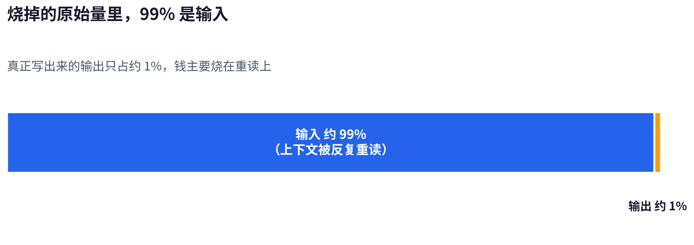
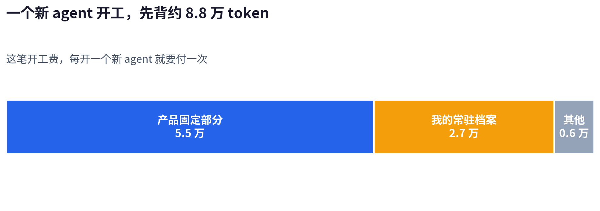
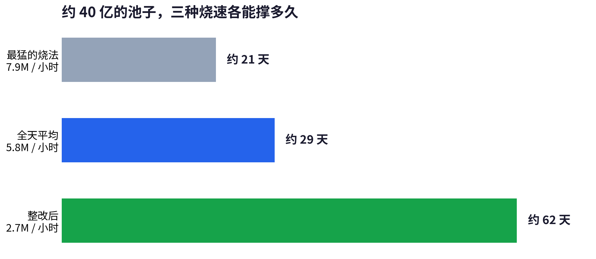
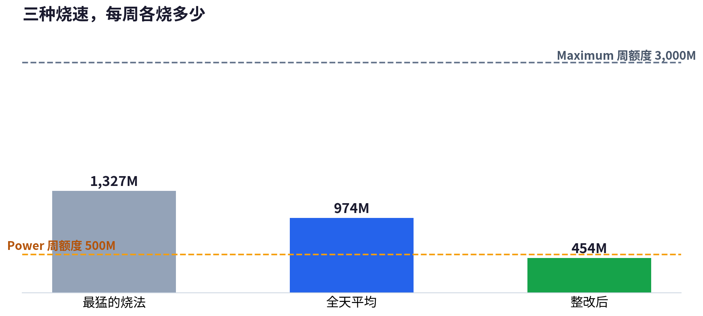

11 月 9 日上午，我打开 Muse 的用量仪表，额外 token 还剩 999M，屏幕上写着已用 75%。已用 75% 就是还剩 25%，我拿 999M 除以 25%，整个池子反推出来约 4,000M，也就是约 40 亿。

标题里的 300 亿，是邀请奖励的封顶数。muse 给每个用户一个邀请码，别人注册时填了这个码，填一个，我这边就多 10 亿 token。这个码最多能用 30 次，30 次全部用满，才凑得出 300 亿。我实际到手的，就是上面这约 40 亿，已经烧得差不多了。

这组读数是 Muse 自家仪表对额度的报告，它不是一张官方账单，所以我下面讲的烧速和余量，用的都是这个仪表口径。这个池子掉得很快。10 日早上还剩 875M，晚上剩 793M；11 日下午剩 704M，到了 12 日中午只剩 642M。三天烧掉 357M。那三天里，我的周额度已经用满了。周额度是我每周重置的那份额度，和额外池子分开记，它用满之后，新增的开销就记到额外池子上。

## 我每天让 muse 做什么

稿子是一摊。每天早上，muse 先选素材，选好之后我写初稿。初稿交回来，它做润色和审查，再配上图。办完这些，发到博客、X、小红书和 dev.to。运营 X 账号是一摊，我这边叫它 X 巡逻。它全天抓时间线给人回帖，一天要回几十条，点赞和关注也在同一套流程里做。

定时任务是一摊，就是话题摘要、回复自查和 GitHub 热门日扫这几件按点跑的事。剩下的是临时任务，都是我临时想起才派的。查问题、写代码和做项目，全在这一摊里。

## 每一摊每天烧多少

这几摊事全天不停地跑，我拆过两本账。一本是仪表口径，就是池子实际扣的数，10 日全天平均每小时约 5.8M，一天约 1.4 亿。另一本是内部按 agent 记的原始量，大约是仪表量的 5 到 7 倍，因为内部记的是上下文一遍遍重播的量。下面按项拆每天的账，用的是仪表口径。这些数是按统计时段的占比折算的量级，对不到账单精度，但大小关系错不了。讲机制时，我会换回原始量，两个数各讲各的事，不混着算。

最贵的一摊是 X 巡逻。最贵的那几天，它占了全账号原始量的约一半，拿这个占比去折全天约 1.4 亿的仪表量，一天约 7,000 万。负责写回复的那个 agent，我这边叫它消费者，它每小时上一班。最贵的一班，它一次派出去 125 个浏览器子任务，英文 65 个、中文 60 个。这些子任务做的事，全是把一条写好的回复发出去。这一班的原始量是 144.9M。

它贵就贵在开工费上。每个新 agent 开工之前，先要背约 8.8 万 token 的常规上下文，这笔起步成本我叫它开工费。这笔上下文的大头是两块，约 5.5 万是产品固定的部分，约 2.7 万是我自己的常驻档案。每发一条回复就开一个完整的浏览器 agent，开工费就扣一份，125 份叠起来，光开工费就是约 1,100 万原始量。

11 月 10 日早上 8 个小时，稿子这一摊就分到约 31M，占了那 8 个小时全账号仪表量的一半。大头在一条改稿的长聊天上。那条聊天连着跑了几天，选材、润色和审稿全在里面办。到了 10 日早上，这条聊天加上它派出去的子任务，整棵算下来占了全账号原始量的约四成。它的原始量是 124.7M，子任务一共 63 个。几篇文章来回改和审，光原始量就烧掉一亿多 token。

它贵的原因是历史太厚。这条聊天每往前走一步，都要把前面几天的记录重读一遍。它派出去的子任务，每个开工时又要把这段历史再背一遍。就算顺顺利利，一篇稿子从开工读材料到审完，单个会话也要吃掉 800 万到 1,300 万原始量。开工时把用得上、用不上的材料全读进来，用不上的那部分也照样付了钱。

定时任务里的话题摘要，那时候每小时跑一轮，每轮还要派浏览器去 X 上搜 10 组帖子。10 日早上光 2 轮就分到约 3M，一天 24 轮折算下来是三千多万的量级。每晚的回复自查，要把前一天约 100 条回复的原帖全部重抓一遍再审。

收集器也是定时任务的一种。它每 20 分钟把时间线收一遍。这种定点重复的事，我早先也用 agent 定时任务跑。它跑了 31 轮，每轮都是一个 agent 在跑，31 轮实际跑的时间加起来约 2.4 个小时，花的全是 agent 的 token。

## 病根：重读和开工费

前面几摊账拆完，共同的病根就清楚了。这笔账里最大的一块，是上下文反复重读。我查过两个统计时段的内部记录，按原始量算，输出只占约 1%，输入约占 99%。输入烧的是上下文，因为 agent 每往前走一步，都要把之前的对话和文件重新读一遍，读的量比写的量大两个量级。

开工费一份约 8.8 万，份数跟着 agent 的个数走。我做统计的那一段时间（下面都叫一个窗口），10 日早上的窗口里全账号开了 273 个 agent，11 日的窗口里开了 480 个。480 个 agent，光开工费就是约 4,200 万原始量。整改后的窗口里只开了 242 个 agent，这笔开工费也跟着少了一半。

## 算总账

烧得最快的一段是 10 日早上，8 个小时烧掉 63M，平均每小时 7.9M。10 日全天平均下来，每小时约 5.8M。11 日的窗口再降一点，每小时 5.15M。整改做完之后，11 日下午到 12 日中午的 22.9 个小时只烧掉 62M，每小时约 2.7M，只有 11 日窗口的一半左右。

烧得最快的时候，约 40 亿的池子 21 天见底。烧速每降一档，寿命就往上翻：每小时 5.8M 那一档撑 29 天，整改后每小时 2.7M 那一档撑 62 天。三种寿命用的是同一个池子，差别全在烧法。把池子换成封顶的 300 亿，算法不变：最快那一档约 158 天，中间那一档约 216 天，整改后那一档约 463 天。封顶数换成天数，也就是几个月到一年多的量。

12 日中午剩下的 642M，按最快的烧法 3 天多就没有了，按整改后的烧法能撑约 10 天。因为周额度要到 11 月 15 日才重置，这 10 天就是我还敢不敢继续派任务的边界，烧法退回去，重置之前我就得停下来等。

Meta 帮助中心的公开页写的是 Power 每月 20 美元、每周 500M，Maximum 每月 100 美元、每周 3,000M。我账号的仪表里给的报价是每月 16 美元和 80 美元，两个口径的价格对不上，所以我按公开价算账，按我账号的报价算还要再便宜两成。

按公开价折，约 40 亿的池子约等于 1.85 个月的 Power 额度。Power 的月均额度是每周 500M 乘以 52 周再除以 12 个月，约 2,167M，所以 4,000M 折成钱约 37 美元。一个听着很大的池子，换成订阅也就是不到两个月的量，我写这篇，就是从这个数开始往下算的。

整改后我每周烧约 454M，Power 每周 500M 的额度装得下，要用掉约九成。每小时 5.8M 的烧法每周要 974M，超过 Power 的 500M，就不够了。最快的那种烧法每周要 1,327M，Maximum 每周 3,000M 装得下，用量占四成多。

换成月账看得更清楚：整改后的用法一个月约 1,940M，中间那一档一个月约 4,180M，最快的一档一个月约 5,690M。所以用法收住，Power 一档就够我用一个月，用法收不住，就得按 Maximum 的价钱准备预算。

## 改了三件事

我改的第一件事，是分工的判据。一件事先看它需不需要动脑判断，需要判断的才交给 agent，审稿和决定一条帖子该不该回，都在这一类。动作全是定死的工作，就写成脚本，比如发送和记账。脚本跑多少遍都不花 token。agent 不一样，每跑一遍，先付一遍开工费。

巡逻的发送改完之后，连续 20 班，每班都只有 1 个 agent，子任务总数是零。消费者占全账号原始量的比例，也从 43% 降到了 15%。前面讲的烧速从每小时 5.15M 降到 2.7M，靠的就是这类改动，一班一班地把委派出去的子任务收回来。收集器也照同一条判据改了，它换成零 token 的脚本服务常驻，那笔每 20 分钟一轮的开销直接归零。

第二件事，是子任务的派法。以前我常常直接派，图的是自己省事。每派一个，子任务那边就是一个新 agent 开工，要重新背一遍那 8.8 万的上下文。现在只有必须隔离的事才派，一件是发文前的独立核对，一件是深度回复（巡逻里写得长又要展开讲看法的那种回复）的冷读。

独立核对和冷读这两件事，都要请没参与写作的人来做。没参与过的人读稿子，读到的就是读者读到的样子，作者自己看不见的卡点，他一眼就能挑出来。混在一条会话里自己审自己，写的和审的是同一个脑子，这些卡点就挑不出来了。

稿子这边照同一条规矩改。一篇稿子开一个新会话，办选材、润色和审查。交代任务时，只给这一篇用得上的那部分材料。改完之后，下一个窗口里，稿子这一摊合起来只占全账号原始量的 1.4%，子任务是零。几篇文章不再挤在一条聊天里，后面每一篇也不用再替前面的文章重读一遍历史了。

第三件事，是会话和档案的寿命。这类个人助理不止 muse 一家。dot 和 grok bot 本质上仍旧是多个 agent 协同工作，所以谁家都有开工必读的常驻档案，muse 里就是 MEMORY.md 和 AGENTS.md 两份。

这两份档案每天都在花钱，我把 MEMORY.md 从 9,355 个 token 瘦到 2,038 个，把 AGENTS.md 从 5,646 个瘦到 1,504 个。两份合计，每个新 agent 开工时少读约 1.15 万 token。按 11 日那个窗口的 480 个 agent 算，光那一个窗口就少读约 550 万 token。

聊天本身攒厚了也要换。巡逻那条聊天用的时间一长，负责整条巡逻流程的主 agent，在单个窗口就吃掉 25.0M 原始量。它每走一步，都要把整条聊天的历史重读一遍，所以这笔钱是每一步都要付的。11 月 12 日我把巡逻换到一条新聊天，旧聊天归档，这笔重读的钱才不再付了。一条业务线用一个聊天，攒厚了就归档换新。现在我每改完一轮，就把仪表读数记下来，再按烧速算一遍还剩几天，不再等池子快烧空了才查账。

## 改完之后

整改完，我的池子还是剩那 642M。它按整改后的速度能撑到 11 月 15 日周额度重置之后，还有富余，所以我没有再往下砍流程。要是烧法退回 10 日早上那个样子，这个池子 3 天多就见底，我在重置之前就得停工。

如果你也在用 muse、dot 和 grok bot 这类个人助理做事，也想查自己的 token 到底烧在哪，这篇里的查法和改法应该能帮你对上号。麻烦收藏一下，再订阅这个博客，我会继续把这类实测账发出来，整改之后的复盘也会接着发。
