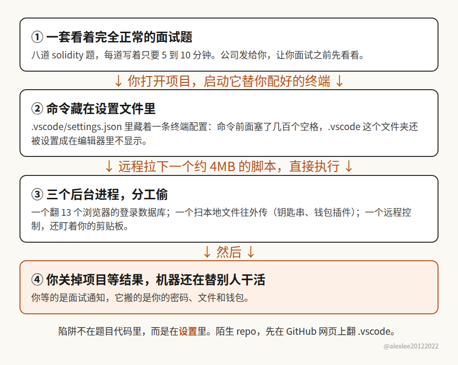

一个面试 repo 里藏了后门，这事听起来挺小的，范围好像也就到找工作的程序员为止，和其他人没多大关系。我一开始就是这么看的，但是再想一下就发现，它真正戳中的是一个挺别扭的常识问题：开源项目的代码虽然摆在那里，谁都能看，但摆在那里，跟有人认认真真审过，完全是两回事。

这个仓库叫 sol-live，slowmist 上周披露的。它表面上是一套 solidity 面试题，一共八道题，每道题还很体贴地标了只需要五到十分钟。陷阱不在题目代码里，而是在 .vscode 这个文件夹里的一份设置文件里面。vscode 这类编辑器会读项目自带的设置，这个项目就在设置里藏了一套终端配置。你在项目里启动它配好的终端，藏着的命令就跟着跑起来了。它还给 .vscode 加了排除规则，让这个文件夹在编辑器的侧栏里不显示，你就算想翻，也翻不到。命令跑起来之后，会从远程拉一个大约 4mb 的混淆脚本下来执行，再开三个后台进程，一个翻 13 个 chromium 系浏览器的登录数据库，一个扫本地文件、mac 的钥匙串和钱包插件存的东西往外传，第三个做远程控制，顺便盯着剪贴板。slowmist 这份分析是离线重建代码得出的，他们没有公布受害人数，windows 的那条攻击路径也没有证实。用同一套路做出来的仓库，他们还找到了另外 8 个。

我们平时为什么会觉得开源软件更安全？道理说起来很顺：代码是公开的，任何人都可以读，都可以审，藏了后门早晚会被人发现，所以它应该比看不见源码的闭源软件更透明，也更让人放心。这个道理我以前也是信的，我自己就是做开源的，到现在还在维护项目。问题就出在这里：你把这段话拆开看就会发现，里面偷偷换了一个概念。开源保证的是你有资格去审，代码就放在那里，等着人去看。它根本保证不了已经有人看过，更保证不了看的那个人看懂了，也看全了。一个仓库的 github 页面上，不会挂一块牌子，上面写着这个项目前后被几个人完整审过，.vscode 这种配置文件又有几个人翻过。通常一般是没有的。没有人审，和审过没发现问题，页面上看起来一模一样，都是一个干干净净的仓库摆在那里。

那么实际上到底有几个人会去审呢？没几个。一个有点名气的项目，背后有维护团队，有一堆公司在用，出一点事马上有人盯着，那种项目确实有很多双眼睛在看。我说的不是它们。我说的是我们每天真正会碰到的大量小项目：作者你不认识，star 没几个，fork 也没几个，你是在搜某个问题的时候搜到它，readme 写得挺像样，你就 clone 下来了。这种项目从头到尾，可能除了作者本人，就没有第二个人完整读过它的代码。用户不会审，用户是来解决问题的，把项目跑起来，能用就接着往下干了。偶尔有人点开几个文件看一眼，看的也是主要功能写得对不对，.vscode 这种放编辑器设置的文件夹，绝大多数人根本不会点开，因为在大家的印象里，那里面放的是个人习惯，不是会偷东西的代码。攻击者这次就是钻了这个空子。你以为要审的是题目代码，人家把后门放在了你觉得不用审的地方。

你再把闭源软件拿过来比一下，这个对比就更别扭了。闭源软件当然也可能有问题，它可以偷偷收集你的数据，可以有没修的漏洞，厂商真黑起心来，也不是做不出坏事。但是它背后好歹站着一家有名字的公司，公司要靠招牌吃饭，出了事用户能找上门，律师也能找上门，真要是往软件里明目张胆塞一个偷浏览器密码、偷钱包的程序，公司等于把自己的招牌和法律责任一起押上了，通常犯不上，也不敢这么干。你再看这种假的开源项目，它背后可能就是一个随手注册的账号，仓库是假的，招聘的人也是假的，偷完就跑，账号扔掉就完了，没有招牌要保，也没有一家公司在那里等着你去告。说白了，约束闭源厂商的还真不是它心善，是它跑不掉。约束这种一次性假项目的又是什么呢？几乎没有。这个地方我是觉得挺反常识的：我们一直拿透明当开源的安全保证，可真到了这种没名气的小项目上，透明只是一个摆在那里的可能性，真正起作用的约束，它反而比闭源那边还少。

这种项目以后只会更多，不会更少。以前要把一个假项目做得像模像样，你得自己写题目，写代码，写 readme，还要把后门藏好，是要花些功夫的。现在有 AI 了，一个下午批量做出来几个版本，根本不算什么事，题目像真的，说明像真的，提交记录也能做得像真的。门槛降下来以后，遭殃的就不是面试这一个场景了。今天它能伪装成面试题，明天就能伪装成一个你正好需要的小工具，一个模板，一个练手项目。你在网上搜到，觉得正好对路，clone 下来打开，流程和你平时干的一模一样，区别只在于这一次，对面是冲着你主力机来的。你主力机上有什么呢？邮箱、github、银行、主密码，还有钱包，基本都在那一台机器上。这个习惯要是不改，等于我们每个人都在拿自己的主力机，替网上的陌生仓库做第一次安全审查，审查的方法就是亲自跑一遍，跑出问题就是中招了。

所以我的建议也很具体，主要是说给和我一样，天天要碰开源项目的人。任何一个项目，尤其是 star 和 fork 都不多、作者你也不认识的项目，你打算在主力机上跑，或者打算拿它做二次开发的底子，就不要急着用编辑器打开它。先在 github 网页上把文件翻一遍，别的先不说，.vscode 这个文件夹一定要点开看看，顺便留意那些会自动运行的设置和脚本。然后让你的本地 agent 帮你把整个仓库静态审一遍，就是只读代码，不运行，先看看它想在你机器上干什么。这一步现在花不了多少时间，AI 把造假项目的门槛拉低了，好歹也把审查的门槛拉低了，不用白不用。真要把项目跑起来验证，用虚拟机或者一次性的环境，别直接在存着钱包和主密码的主力机上跑。要是你已经打开过来路不明的仓库，还开过它配的终端，那就别抱侥幸了，按 slowmist 给的顺序来：把那台机器先隔离开，用另一台你信得过的设备把钱包里的资产转走，然后该改的密码挨个改掉。没什么好说的，赶紧处理，越拖丢的东西越多。

你回想一下，上一次你把一个没名气的小项目 clone 下来，在主力机上打开之前，你翻过它的 .vscode 吗？

出处：SlowMist《Threat Intelligence: Beware Web3 Interview Questions Conceal a Data-Stealing Backdoor》，2026 年 10 月 23 日，https://slowmist.medium.com/threat-intelligence-beware-web3-interview-questions-conceal-a-data-stealing-backdoor-615cebdcb21c
