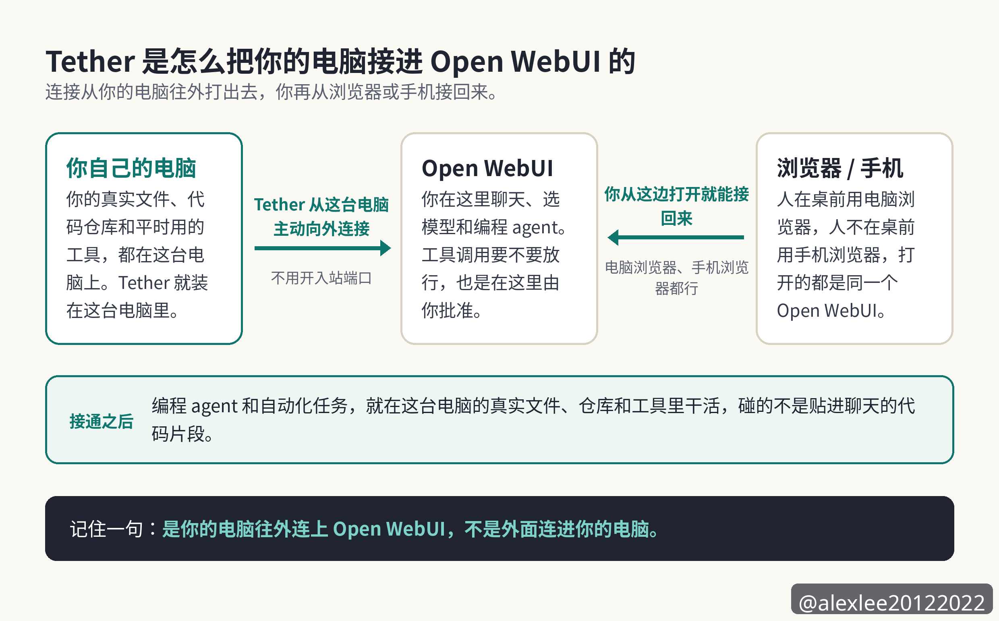
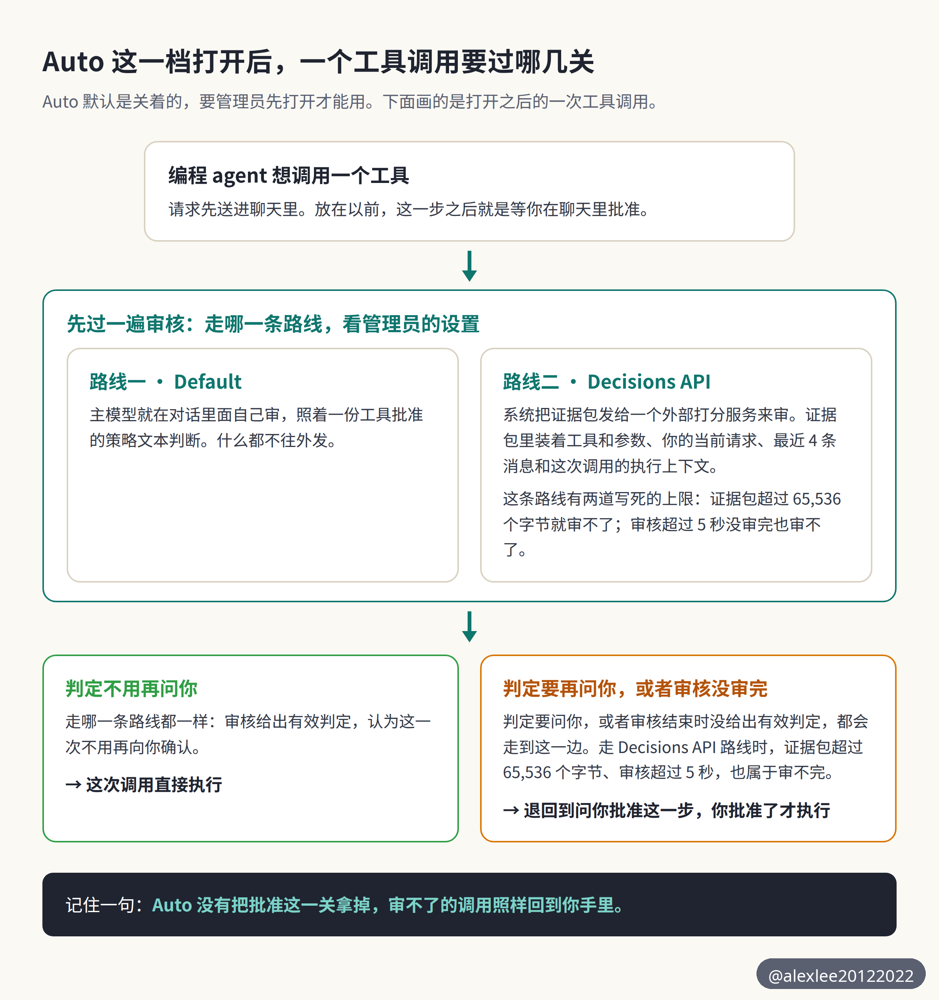

我做全栈开发已经 24 年多了。看工具更新的时候，我先看工作在哪台机器上做，再看出了问题由谁喊停。按这两把尺子量 0.13.1，我的判断先放在这里。

这一版最主要的新东西，是把编程 agent 放进模型选择器里选用，让编程 agent 在用户自己的电脑上工作。这篇文章后面说的旗舰的这条路，指的就是这一条路。

这一版的方向是成立的，因为编程 agent 的工作地点从服务器挪到了用户自己的电脑上，而且工具调用要不要放行，决定权还留在聊天里的用户手里。但是旗舰的这条路还没有被完整跑通，所以已经在用的人值得升，新用户要先看自己是不是这条路的目标人群。哪几类人是这条路的目标人群，后面「谁该升和谁该等」一节里逐类写了。

## 服务器本身和模型列表

服务器这一层是能跑起来的。这一版的服务器装好并启动之后，第一个账号建出来就是管理员。第一个用户建完之后，公开注册会自动关掉，而且设置改完之后也能存住。这些行为都实际观察到了。用户平时是在浏览器里打开 Open WebUI 的，电脑上的浏览器和手机上的浏览器都可以。用户就在浏览器里聊天。

文件上传之后，处理最后走到了完成，抽取出来的文本也存了下来。普通用户建对话时，结果跟着当时生效的权限设置走，强制权限打开时建对话会被拒绝，把强制权限关回去之后又能建成功。也就是说，Open WebUI 作为一个平台底座，在这一版里是能正常工作的，问题不出在服务器本身能不能启动。

问题出在旗舰功能不在服务器里面。这一版的桌面伴侣应用叫 Tether，它的作用是把用户自己的电脑配对进 Open WebUI。

Tether 是用户装在自己电脑上的那个桌面应用。Tether 在这台电脑上运行的程序是 Open Terminal，而 Open Terminal 是托管这台电脑上终端和编程 agent 的那个程序。编程 agent 由 Open Terminal 提供，Open WebUI 从已经配对的 Open Terminal 那里取得编程 agent 的清单，编程 agent 才会出现在模型选择器里。

只装服务器、不通过 Tether 配对桌面端的时候，终端列表是空的，模型列表也是空的。终端列表是空的，意思就是没有 Open Terminal 在提供编程 agent，所以模型选择器里根本没有编程 agent 可以选。发布说明里最显眼的那一项，就是把编程 agent 放进模型选择器这一项，在这种装法下等于不存在。整个 agent 体验都要靠 Tether 先把用户自己的电脑配对进来。

先把后面要用的默认模型和一条退路说清楚。默认模型指的是事先定好、没有另外指定时系统就用的那个模型。如果提供某个 agent 的 Open Terminal 后来不再可用，那么已经用这个 agent 进行的对话，之后的回复改由默认模型给出，这个 agent 以前已经写下的回复还留着这个 agent 的名字。

Tether 支持 macOS、Windows 和 Linux，它从用户自己的电脑主动向外连到 Open WebUI，所以用户不用开入站端口。这一条配对的路这次只在代码里核实过，没有端到端真跑过。

这一版的包本身也不轻。装好的体积大约是 7.3 GB，因为里面带了 torch 和 CUDA 这两个体积很大的依赖；服务器跑起来之后，常驻内存大约是 1.1 GB。你如果打算把它装在配置很低的机器上，那么要先把这份体积和内存算进你的计划里。

这次的安装走的是 pip 装到一台共享虚拟机上的路，没有走 Docker 这条路，所以安装花了多久这件事不能拿来推断普通安装。Docker 这条路这次没有测，我也就不在这里下判断。

## 断线之后的工作

断线之后工作还在不在，我的裁定是机制对上了痛点，但是有上限。

因为这次没有真跑过断线重连，所以这一项只能算部分解决，不能算已经验证解决。

Tether 在用户自己的电脑上运行的程序是 Open Terminal，终端和编程 agent 都由 Open Terminal 托管。Tether 和 Open Terminal 都把进程放在用户自己的电脑上运行，所以浏览器这边的连接断掉之后，进程不会跟着停。断线期间产生的输出会被先存进缓冲区，等连接恢复之后，再回放到用户重新打开的终端视图里。

终端输出的历史最多留 1 MiB，这个上限在代码里是固定的，agent 会话的输出最多留 16 MiB，这个上限在代码里也是固定的。Tether 自己的输出缓冲区默认是 256 KiB，这个数字是产品给的默认值。这三份缓冲区的上限并不都是同一种定法。

这三份存的不是同一种输出：1 MiB 那份留的是终端自己产生的输出历史，16 MiB 那份留的是 agent 会话运行中产生的输出，256 KiB 那份是 Tether 在桌面这一侧给自己的输出留的缓冲区。如果断线期间的输出超过了这些上限，那么最早的那部分就会被丢掉，界面上会明确标出来，告诉用户更早的输出已经看不到了。

断开的终端会在 300 秒之后被清掉，agent 会话则会保留 3600 秒，因为脱离连接的 agent 可能还在忙。Open WebUI 的服务器在这条链路里只做转发，它不保存任何终端输出，所以服务器那边没有一份副本可以拿来恢复。

这一项必须把话说全：上面这套续接的说法全部来自装好的代码，Tether 是桌面图形应用，这次的环境里没有第二台真机器可以配对，所以断线再重连的完整过程没有亲眼跑过。你如果冲着断线续接来用这一版，那么你要知道，你买的是代码里写明的机制，而不是一份已经实测过的保证。

## 工具批准的 Auto 档

每次工具调用都要手动批准，用起来很累；如果全部放行，又太冒险。这一版新加的 Auto 档想解决的就是这个取舍。

审核有两条路线，走哪一条路线由这套部署的管理员设置决定。一条叫 Default，在这条路线里，审核由主模型在对话里面自己做，主模型就是正在处理这次对话的那个模型。另一条叫 Decisions API，在这条路线里，审核交给一个外部打分服务来做。

这里说的证据包，就是系统为一次工具调用准备的送审材料。这份材料里装的是这次调用的工具和工具的参数，另外还有用户当前的请求和用户最近的 4 条消息，还有这次调用的执行上下文，也就是这次调用的工具类型和它所走的终端编号。

我的裁定是它把批准改成了预审，方向是对的。会回到你手里问批准的，是审核完不成的调用。走 Decisions API 这条路线的时候，证据包超过字节上限，或者审核超过时间上限，这次审核都完不成。走哪一条路线都一样，审核结束的时候没有给出有效的判定，这次调用也回到你手里问批准。所以这一项也是部分解决。

一次真的被审核过的工具调用，这次没有跑起来过，因为测试环境里既没有配聊天模型，也没有打分服务的密钥。打分服务是这套部署配置的一个外部服务，它给一次工具调用打分，用来判断这次调用要不要再问用户。所以审核跑一整圈的速度和准头，这次都没有数据。

Auto 默认是关着的，要管理员打开。打开之后，每一次工具调用都会先送给一个审核模型看一遍，只有审核模型判定这次调用不需要再确认的时候，这次调用才会直接执行。如果审核模型判定需要确认，那么这次调用就回到聊天里问用户批准。这里说的审核模型是一个统称，具体由谁来审，要看下面两条路线里走的是哪一条。

所以审核模型这个说法，走 Default 路线时指的就是主模型，走 Decisions API 路线时指的就是那个外部打分服务，两个名字说的不是同一个角色。这里的 Default 是审核路线的名字，它不是默认模型。

审核审不了的时候，结果也是一样问用户。走 Decisions API 这条路线的时候，系统会先把材料组成一个证据包，再把这个证据包发给打分服务。

这个证据包里装的是工具和工具的参数，另外还有用户当前的请求和用户最近的 4 条消息，还有这次调用的执行上下文。如果这个证据包写成文本之后超过了 65,536 个字节，那么审核直接跑不起来，这次调用就改问用户。

这条路线上的审核调用还有一个 5 秒的整体超时，超过 5 秒没有审完，同样改问用户。这条路线上打分服务的地址，在产品里预先设的是 OpenAI 的接口地址，部署可以改成别的地址。

走 Default 这条路线的时候，主模型在对话里面自己审。主模型审的时候照着一份工具批准的策略文本判断，里面写明什么样的调用可以不问用户就直接执行、什么样的调用要先问用户。这份策略文本，产品本身就带了一份默认的文本，每套部署也可以改掉它。审得严不严，最后取决于这套部署现在用着的那份策略文本写成了什么样，也就是产品自带的那份默认文本，或者这套部署自己改过的那份文本。

所以 Auto 没有把批准这一关拿掉。每一次审不了、审不完或者材料太大的情况，结果都往问用户这一边倒，这个倒向是安全的。

它带来的另一面也很明确。证据包更大、审核要花的时间更长的调用，越容易被这些上限挡回来，最后还是要你自己点批准。

## 工具对话的费用

工具对话太贵这一项，我的裁定是机制成立，但是省多少没有人能替官方作证。官方原话只说 cost much less，也就是便宜了很多，官方没有给任何百分比，所以这篇文章里不会出现省了百分之多少这种数字。

机制本身是说得通的。以前每一轮工具调用，引用说明、记忆召回、技能清单和附加知识都要被重写进对话开头。引用说明讲的是引用该怎么标。记忆召回是把先前记住的内容重新调回来。技能清单就是模型能用的技能的那份清单。附加知识是另外附进对话里的知识内容。

因为对话开头每一轮都在变，所以模型服务商没有办法把这一段存进缓存里复用。

这一版把这四样内容挪到了用户消息后面的隐藏工具结果里，对话开头在多轮请求之间就保持不变了。因为开头保持不变，所以服务商可以把开头这一段从 prompt cache 里直接取出来用，prompt cache 就是服务商把已经处理过的文本存下来、下一次直接取用的那份缓存。

影响写在明处：你自己写的 custom pipes，也就是你自己写的消息处理代码，看到的消息布局变了。最后一条消息可能是一条工具消息，不再一定是用户消息。如果你维护着这样的代码，那么升级之后要先检查读最后一条消息的那部分逻辑。

## 文件进模型手里的方式

文件这一项是这次几个痛点里解决得最完整的一项，我的裁定是解决了。这次当场验证过的，是文件上传、文字抽取和抽取全文存下来这几步，这几步不是只靠读代码得出的结论。聊天里真的把文件用起来的那一步这次没有跑，关于那一步的说法来自代码核实，本节末尾会再说明一次。

这一节要用的门槛先说清楚。这道门槛是 50,000 个字符，它在一份文件被放进聊天的时候才用，文件存下来的时候不用这道门槛。后面说一份文件超过门槛，指的就是它的抽取文本超过了 50,000 个字符。

文字抽取在文件上传的时候就做，每一份上传的文件都做，不等到聊天的时候才做。抽出来的全文会被完整存下来，不会因为字符数超过门槛就被截断，而且同一份文本还会被切块并建好索引，留着给后面的检索用。

这次实测上传了两个文件。一个是 1,440 个字符的小文件，另一个是 62,000 个字符的大文件。两个文件的处理状态最后都到了完成，而且两个文件存下来的抽取文本都是全文，因为大文件超过门槛也照样存了全文。

50,000 个字符的这道门槛是在文件被放进聊天的时候才用的。单独一份文件，如果它的抽取文本是 50,000 个字符或者更少，那么全文直接进上下文，不走检索。这里的比较包含正好 50,000 个字符，发布说明写的是短于才算，和代码里的比较对不上，以代码为准。

如果你挂进聊天的是一整个知识库，也就是一整组文件作为一个整体，那么这道门槛就不适用。系统默认走检索，除非你对这个知识库明确选了用全文。

这一项也要留一句没测到的。聊天补全，就是模型真的用上传的文件产出一条聊天回复的那一步，这一步这次没有跑，因为测试环境里没有配聊天模型。聊天时把单独一份文件的全文放进上下文的那个分支是代码核实过的。这个分支就是：单独一份文件的抽取文本在 50,000 个字符门槛以内时，系统会把这份文件的全文放进上下文。

## 管理员对保存的控制

团队和合规场景里，管理员管不住对话保存是一个真痛点。我的裁定是这一项解决了，而且是后端硬拦，不是界面上劝一句的那种解决。

开关是一项用户组权限，名字是 Enforce Temporary Chat，位置在 Admin Panel > Users > Groups > Default Permissions 里面。

管理员把这项权限打开之后，非管理员用户新建一段会保存下来的对话，后端会直接拒绝，并返回 403。管理员自己不受这项权限的限制。

这一项是当场翻过设置的。权限打开之后，非管理员的测试用户建对话被拒，对话列表保持是空的。同一个设置下，管理员建对话成功。把权限关回去之后，非管理员用户建对话又恢复成功，所以两个方向都观察到了。

顺带说一句，侧边对话是另外开的一类对话。在上一版 0.13.0 里，侧边对话一直不保存。这一版开始，侧边对话会像普通对话一样保存下来，并出现在对话列表里。正因为侧边对话现在会保存，上面这项强制临时的权限才更有用，因为管理员多了一个要管住的入口。

## 服务等级的选择

发布说明说用户可以选服务等级，我的裁定是这一项的名头比实际内容大得多，它更像这一版的一个短板，而不是一个已经做完整的功能。

这一版点名了三个编程 agent，名字是 Claude Code、Codex 和 Pi。这三个 agent 里面，只有 Codex 会把服务等级报给 Open WebUI。Claude Code 和 Pi 都不报，所以你用这两个 agent 的时候，界面里根本不会出现服务等级这一项。这件事不是界面藏起来了，而是这两个 agent 的代码里就只返回了名字，没有返回等级。

Codex 这边也只有一个等级。从真 Codex 程序里拿到的结果很清楚，它下面的 8 个模型每一个都只报了一个等级，名字是 Fast。

Fast 的说明文字写的是速度 2 倍、使用量增加，小模型上写的是速度 1.5 倍。

下面说的 Service tier 子菜单显示的样子，是从装好的产品代码里读到的，这次测试里没有在真界面里把这个控件点开过。你在聊天里打开 Service tier 子菜单的时候，看到的列表第一项是 Default，列表里剩下的项，就是 agent 报上来的那些等级。

列表里的 Default 这一档用的就是 Codex 自己默认的处理方式，选它不会另外发出一条服务等级指令。这个 Default 是服务等级列表里的第一项，它不是审核路线里那条叫 Default 的路线，也不是前面说的默认模型。也就是说，除了 Default 之外，你能多选的就只有 Fast 这一个。

按代码里读到的样子，更麻烦的一点是说明文字在界面里被丢掉了。你在聊天里的 Model controls 里面打开 Service tier 子菜单，你只会看到 Fast 这个名字。你看不到速度 2 倍、使用量增加这句说明，所以你是在不知道要多付多少使用量的情况下做这个选择。

## 这一版的优点和不足

这一版的优点，先说工作地点和批准位置配在了一起。工作在用户自己的电脑上做，文件和仓库都在那台电脑上，所以 agent 不用把代码搬到远处去执行。批准这一关也留在聊天里。一次工具调用只要被送到用户面前，用户就是在自己的对话界面里决定放不放行。Auto 没有把这一关搬到别的地方去，它只是在调用到达这一关之前先筛一遍，它没有放行的调用，最后还是回到聊天里的这一关来等用户决定。

第二个优点是这一版的失败方向是一致的。审核审不了的调用就问用户，证据包太大的调用也问用户。提供 agent 的终端不在了，既有对话就改由默认模型回答，而且旧回复上还留着那个 agent 的名字。每一条退路都往用户这一边退，没有一条是悄悄放行或者悄悄丢掉。

文件管线的处理方式也是一个优点，因为存下来的文本永远是全文，门槛只决定用的时候是全文直入还是走检索，不决定存的时候砍不砍。管理员那项强制临时的权限也是硬执行，后端直接拒绝，不是把按钮藏起来就算管住了。

不足同样要说全。最大的不足是旗舰功能对桌面配对的依赖。没有配对的桌面端，服务器装得再好，模型列表也是空的。所以这一版最想卖的体验，对只装服务器的人来说第一步就断了。

Auto 档的不足有一部分落在 Decisions API 这条路线自己的上限和超时上。走这条路线的时候，证据包超过 65,536 个字节就审不了，审核超过 5 秒也审不了。所以走这条路线的复杂调用回到手动批准不是偶发情况，而是这个设计本来就会发生的结果。

服务等级的不足前面已经判过了。一个 agent、一个等级、还没有说明文字，这个选择目前撑不起发布说明里的说法。

升级本身的成本也是不足的一部分。这一版改了数据库的结构，官方强烈建议生产环境升级之前先备份数据库和这套部署的相关数据，官方没有列出相关数据具体包括哪些。如果你跑的是多实例部署，那么所有实例必须同时更新。实例指的是一份正在运行的 Open WebUI。滚动更新指的是一份一份轮流更新的做法，这种做法不受支持，因为新旧版本混着跑会因为数据库结构对不上而出故障。

## 谁该升和谁该等

已经在跑 Open WebUI 的人，我的建议是升。这一版带了安全修复，官方强烈建议所有部署尽快更新。修复的细节要等 CVE 编号分配之后才会公布。CVE 编号是给安全漏洞编的公开编号。所以你没有办法先看细节再决定。你能做的决定就是先付备份这份成本，然后把这一版升上去。

速度上的改进对已有用户也是实在的，而且这些数字是官方给的，不是我测的。大对话打开的速度约快了 2 倍，把对话标成已读或者未读、去掉一个标签这类操作快了 4 到 6 倍。往输入框里粘贴 16,000 行文本之后再打字，每次击键的等待从 8.6 秒降到了 74 毫秒，官方的说法是约快了 117 倍。

已经在自己电脑上用 Claude Code 或者 Codex 做开发、又想把它们收进同一个聊天界面里的人，这一版值得一试。前提是你先接受发布说明里写明的三条限制。每段对话只用一个 agent；agent 的回复不能重新生成，也不能接着往下续写；你自己发出的消息也不能编辑之后重新发送。

只把 Open WebUI 当聊天前端用的人，这一版的头条功能不是冲着你来的。你能拿到的好处主要是上面那些速度改进，还有文件处理方式变清楚了，所以你可以按自己的升级节奏来，不用为了 agent 这一条线赶时间。

需要 agent 这条路先被完整证明、或者跑着多实例又没有办法同时更新全部实例的人，我的建议是等。

前一类人等的是桌面配对之后端到端跑通的证据，这次的测试恰好说明这份证据现在还没有。后一类人等的是自己的维护窗口，因为混版本运行会直接出故障，这个风险不是靠小心就能绕过去的。

说到底，这一版真正要紧的改变只有一件：编程 agent 工作的地点搬到了用户自己的电脑上，批准的权力留在了用户自己的聊天里。

这次测试的证据能支撑到的地方很明确。服务器能跑，文件处理解决了，管理员控制也解决了。这次测试的证据支撑不到的地方，是桌面配对之后那条完整的 agent 路，还有服务等级子菜单在真界面里显示的样子。用户在让这条路碰自己的真实仓库之前，最好先等这条路有人完整跑通的消息。

觉得有帮助的话，欢迎订阅这个博客，或者先收藏起来。我会继续分享 AI、安全和开源方面的干货。下一篇我继续盯编程 agent 在自己机器上工作的这类工具，看看哪一条路先被完整跑通。

来源：Open WebUI 0.13.1 发布页面，https://github.com/open-webui/open-webui/releases/tag/v0.13.1

