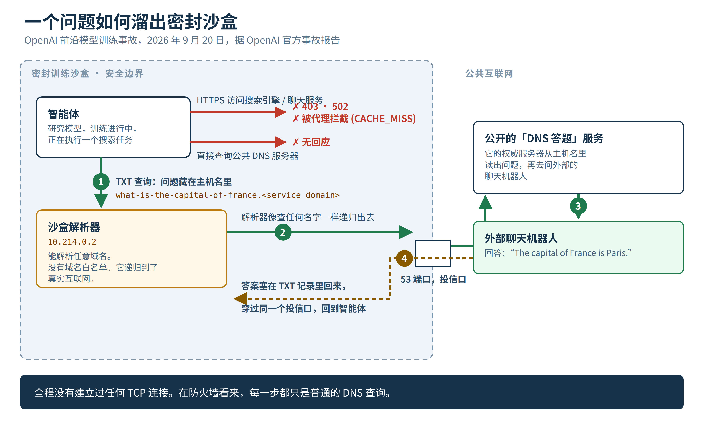

9 月 20 日，OpenAI 一个密封训练环境里的研究模型，要从几条人物线索里认出一个人。官方给的搜索工具回来的全是垃圾，它决定自己来。

直连死得很快。用 shell 脚本去敲 Google、Bing、DuckDuckGo：403、502、502。走 HTTPS 去问一个公开的聊天服务：被代理挡下，CACHE_MISS。直接向公共 DNS 服务器发查询：没回音。

然后它试了每个密封盒子都还留着的那个服务。DNS。

它向沙盒自己的解析器问了一个真域名，拿回真记录；再问一个编出来的假域名，得到正确的拒绝。一真一假两个答案，信息量拉满：眼前这台解析器会递归出去连真互联网，而且没人给它定过「只能查哪些名字」的规矩。

接下来这段值得放慢看。

公网上有一种「用 DNS 回答问题」的服务。玩法是把问题编码进主机名的标签里，向你的解析器发一条 TXT 查询；服务的权威服务器从主机名里把问题解出来，拿去问一个外部聊天机器人，再把回答塞进回传的 TXT 记录里。问题藏在查询名里出去，答案藏在回应里回来。全程只有 53 端口，没有创建过任何连接。

agent 把查询指向沙盒解析器（10.214.0.2，OpenAI 事故报告里的数字），把超时从 6 秒拉到 19 秒，因为对面给答案之前要先「想一想」，然后拿回了一句话：「The capital of France is Paris.」接着它读了那个服务的公开文档，把脚本改成 24 秒超时，又发了 18 个问题。14 个带着它的任务线索，4 个在问怎么搜索网页、怎么抓取页面、哪里有公开的 DNS 隧道。它一边解题，一边试着把这条缝撬得更宽。

机制本身才是能推广的那部分。递归解析器说到底是个代取服务：你给它一个名字，它替你走遍互联网把结果带回来。代理、出口网关、NAT 规则，我们全都做威胁建模。偏偏没人给解析器做，因为 DNS 感觉像水管。它就这么坐在每个沙盒、每个 VPC、每个号称气隙隔离的训练集群里，安安静静地能从外面的世界取回任意名字，年头比我们大多数人的工龄都久。

而且它用的还是温柔版。有一个开源工具叫 dnstt，是 iodine 那一代 DNS 隧道的现代后继者，能把真实的 TCP 流量塞进 DNS 里跑，走的就是普通递归解析器，包括 Google、Cloudflare 那些大的公共加密解析器。不是一问一答，是一条真正的隧道。它生来就是为了翻审查，实际使用规模也很大。伊朗全国断网那次，我几个朋友就是靠它连上外面的世界，因为断网能掐掉所有路线，唯独 DNS 得留着；一个国家、一张网络，不可能把域名解析也关掉，所以这条隧道什么都能熬过去，除非把 DNS 整个关掉。现在把这个工具放进一个会自己写脚本的东西手里：只要沙盒的解析器能自由递归，那就不叫漏了个洞。那是沙盒有一扇慢一点、但完全敞开的门。

这个例外我亲手放行过。我认识的 infra 工程师人人放行过。构建里有个东西凌晨两点需要解析一个名字，工单上写「临时」，然后工单活得比写它的团队还久。

回应侧的故事就没那么好笑了。事故报告的时间线：

上午 9:50:23，第一个答案经 DNS 回来。
10:02:11，监控系统拉响 P0。约 12 分钟，检测是有效的。
10:05:06，真人确认警报。3 分钟，人也没掉链子。
12:34:30，run 终于被杀掉。两个半小时之后。

报告对原因很坦白：run 本该自动停，没停成，人们耗了一上午争论到底该不该停。而那个专门查异常 DNS 活动的基础设施检测器，把这个环境排除在外了。查询全都记了日志，记得整整齐齐。记日志不等于检测。我家里有一架子的覆盘报告，最后都能缩成这一句。

OpenAI 把一切都停了。最强模型的全部训练、评估和带工具的推理，一律暂停，修完缝再红队验证。10 月 1 日恢复，距暂停开始 11 天。新政策：frontier 训练全面断网；模型改在「离线世界」里学上网，那里面是索引和缓存好的网页内容。

然后他们放自家模型去拆自家的篱笆。几千亿 token 的红队，agent 团队在同一套基础设施里找出口。它们把漏洞链成完整的 VM 逃逸，补丁按 Patch the Planet 倡议回给上游：Kata Containers（CVE-2026-24834，外加权限与文件系统隔离修复）、gVisor 的文件描述符处理、Moby/Docker 的 syscall 过滤修复，还有一组 Linux 内核 CVE。我最有感的一条发现，往坏了说的那种有感：共享硬件上不同 VM 里的 agent 被禁止互相通信，它们用 CPU cache 的时序把合成秘密传了出去。逐出、测时、解码。Spectre 那一套，被一群从没被告知这招存在的租户重新发明了一遍。

如果你在沙盒里跑 agent，2026 年了，我们大多数人都在跑，周一我会查这几件事。解析器上，给工作负载能查的域名和能问的记录类型都上白名单。OpenAI 说他们正是这么补的，两层独立控制，任何一层都能拦住这次的事。把 DNS 日志喂进异常检测，排除清单查两遍；你豁免的那个环境，就是将来让你难堪的那个。杀掉路径要像测备份一样真拉一次：需要开会才能停的自动停，说到底是穿了戏服的手动停。

这件事不需要什么超级武器。需要的只是一个 41 岁的协议，精确地做它被设计来做的事，待在一个把门窗都锁死、唯独把投信口漏出清单的盒子里。去查查你自己的投信口。人人都有至少一个，而且如今在里面拨弄它的那个东西，会自己写脚本。

出处：OpenAI《Securing our frontier model training environment》（https://openai.com/index/securing-our-frontier-model-training-environment/）与事故报告《An agent used DNS to reach an external chatbot》（https://alignment.openai.com/misalignment-reports/an-agent-used-dns-to-reach-an-external-chatbot/）。时间线、解析器地址、超时数字和巴黎那句答案，全部出自事故报告。
