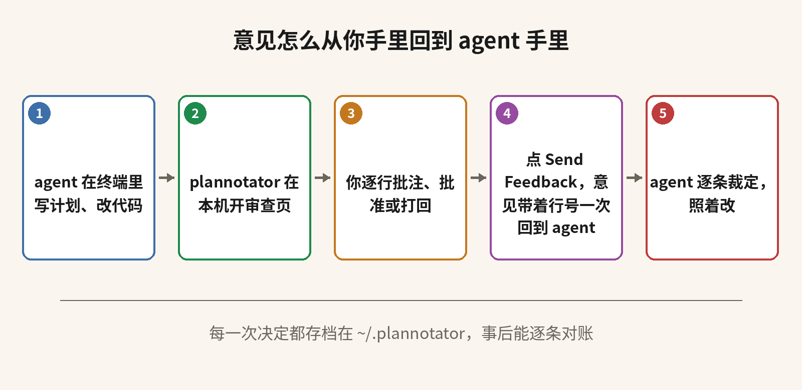
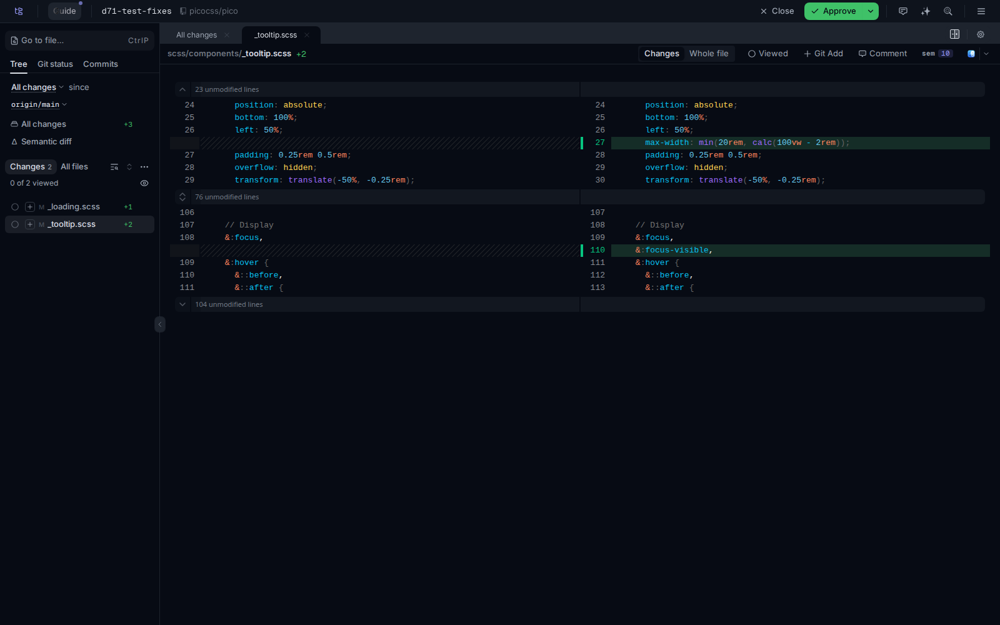
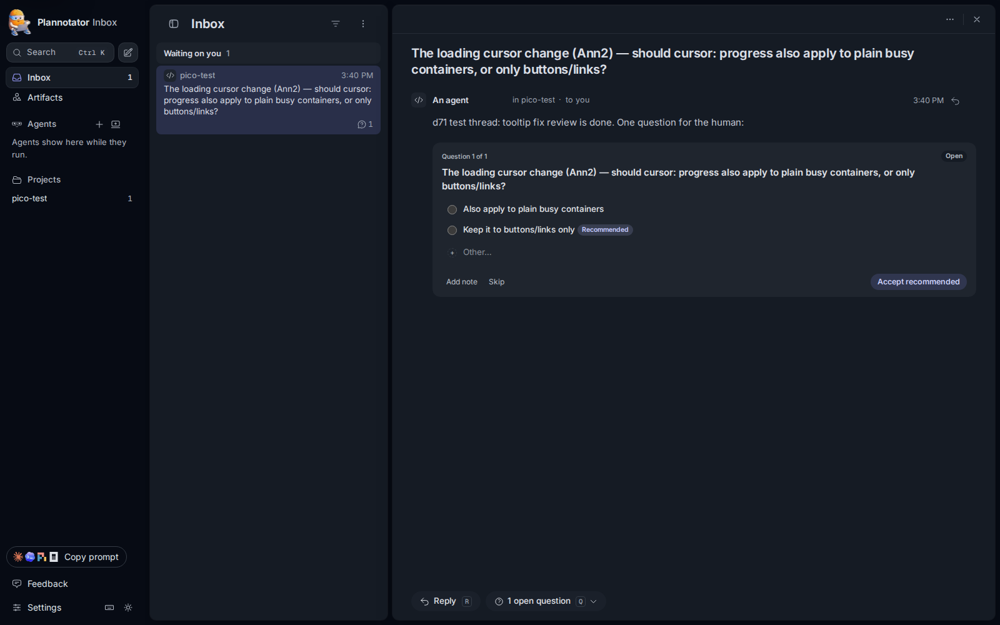

我在 Pico CSS 的仓库里改了 3 行代码，又用 plannotator 落了 2 条逐行批注；一次发回之后，agent 照着第 1 条改对了，我也复核过它的改动。意见带行号送达、决定留档，这两件事它做到了。

但是它的招牌功能，Codex 和 Claude 的桌面版都有内建版，所以只用一家桌面版的人多数不用多装它。而它多出来的有三样：能批注代码以外的文件、多家 agent 共用的 Inbox、给脚本用的批准闸门，都落在桌面版管不到的地方。

## 它是什么，怎么装

plannotator 是一个装在本机的浏览器审查工作台，这一轮装到的版本是 v0.28.64。agent 写完计划或者改完代码之后，它就在本机开一个网页；你在网页里逐行批注、批准或者打回，写下的意见会带着文件、行号和那一行的原文回到 agent 手里，然后 agent 再接着按意见改。

仓库：[github.com/backnotprop/plannotator](https://github.com/backnotprop/plannotator)

我注意到它，是因为它在我看的 GitHub 热榜摘要里一天涨了 412 颗星，在连续十轮的摘要记录里第一次排到总榜第 1。我自己动手查的时候，它的星数已经到了 10,775 颗。星多只能说明围观的人多，东西到底行不行，还得装上跑过才算数。

装它只有一条命令，从它的官网拉一个脚本下来跑。脚本把一个 205 MB 的 binary 装到你自己电脑的 ~/.local/bin 里，这就是它的本体。安装命令加上 --minimal 之后，它就只装这一个文件，别的配置一律不动。

完整安装动的配置就多了。这一轮它改了我的 ~/.codex/config.toml，在文件末尾加了一段打开 hooks 的配置，又新建了 ~/.codex/hooks.json，里面是一个 Stop hook。agent 每次停下来，这个 hook 就有机会先把审查页递到我面前。

它还往 ~/.agents/skills 和 ~/.claude/skills 里各装了 5 个技能，给 OpenCode 放了 4 个命令文件，另外下载了一个 67 MB 的 sem 侧车，负责算语义 diff。这些改动装完都能逐项查到，安装器没有藏，但是你装之前得知道，它接的正是 agent 和你之间的那道关口。

## 审代码这一轮

试验田是 picocss/pico，我在它的本地分支上改了两个文件，一共 3 行：给 tooltip 的样式加一行宽度的上限，给它的显示触发补一行 &:focus-visible，键盘聚焦时也能显示，再给 loading 样式里的按钮和链接加一行进度光标。改的都是这个仓库里真实存在的缺口，改完先编译过一遍，确认没把样式弄坏。

改完我在仓库里跑 plannotator review，这条命令会一直等在那里，直到审查结束才退出。这一轮跑的是命令行手动启动的审查面，因为测试机上的 Codex 没有登录，我没能拿真会话验过 plannotator 靠 hook 自动接上的那条路。浏览器里打开的是分屏 diff，文件树写着 2 个文件、新增 3 行，跟我自己用 git diff 看到的完全对得上。

第 1 条批注，我落在 _tooltip.scss 第 27 行，就是我新加的那一行 max-width 上。毛病不在这一行本身，而在它跟同一条规则里的老设置打架：那条规则里本来就写着 white-space: nowrap，不许文本换行，还配了 text-overflow: ellipsis，装不下的部分直接截断成省略号。

我只给气泡封了一个宽度上限，但是换行还是不许，长 tooltip 最后只会被截断成一串省略号，用户读不到全文。我的批注就写这一件事：要么放开换行，要么别加这个宽度上限，两个设置不能同时留着。

第 2 条批注落在 _loading.scss 第 44 行，是我加的那一行 cursor: progress。我写的要求是，进度光标只落在了按钮和链接上，_loading.scss 里通用规则的普通 busy 容器也应该一并加上，省得同一个页面上忙起来的样子不一致。两条批注都写完之后，我点顶栏的 Send Feedback 一次发完；命令随即退出，意见就变成了它的标准输出，格式是 JSON。

回到 agent 手里的意见，带着文件路径、行号，而且行号还分新旧两侧，被批注那一行的原文也在，前后各两行上下文也在。意见末尾还附了一段它自动拼上的规矩：agent 要先逐条给出裁定、附上代码证据，裁定谈完之前不许改代码，而且只许处理这几条意见，不许自己扩大审查范围。

agent 先裁定再动手。第 1 条它判 Confirmed，因为证据就在同一条规则里：max-width、nowrap 和 ellipsis 三样同时在场，长文本被截断躲不掉。

它给的改法是把 white-space: nowrap 改成 normal，放开换行。改完之后我重新编译了一遍，产物里那条规则已经是 white-space: normal，再看 git diff，已经变成 2 个文件、新增 4 行、删掉 1 行。这一条批注从写下到改对，我全程对得上账。

第 2 条它判了 Partly，理由是普通容器不是交互元素，进度光标只在鼠标悬停到它上面的时候才出现，收益有限。这个问题后来在 Inbox 里正式问到了我头上，我选的是只保留按钮和链接，所以这一条就按已经裁定过的搁置项留着，没有再改。

## Inbox 异步问答

Inbox 是用 plannotator inbox --background 起的常驻服务，agent 可以随时往里面留消息，也可以留带选项的结构化问题。这一轮它留给我的就是刚才那个光标问题：一道单选题，两个选项，其中一个标着 Recommended，问题挂在页面的「Waiting on you」下面等我处理。

我点了一下 Accept recommended，但是选好的答案这时还只是一条草稿，并没有真的发出去，我再点一次 Send 才算提交。提交之后我从 agent 那一侧把线程读回来核对：问题已经标成已回答，我的答案作为一条新消息进了线程，正文是结构化的答复格式，agent 下一轮直接就能读到。

这条流解决的是等人的问题。agent 把问题留下就接着做它自己的事，不用停在原地等我回复，我也不用守着某一个会话窗口，几个问题攒在一起答也行。等到好几家 agent 同时跑起来的时候，问题是散在各自对话里，还是集中在一个箱子里，找起来完全是两回事。

## 跟桌面版逐项对完之后

计划批准这一项，两家桌面版都有原生做法。桌面版这一侧，我查的是两家的官方文档，没有亲手装来实测；文档里写有，也不等于我验过它实际用起来怎么样。Codex 桌面版有 plan mode，动手之前先把任务拆成一串能审的步骤，遇到不清楚的地方它会追问，你批准之后它才执行。

Claude 桌面版有 Plan 权限模式，还有一个 Plan 窗格。那个模式下它只读文件、只跑命令探查，并不动你的代码；等你看完计划，把模式切到执行，它才接着往下走。两家的计划都摆在对话里面，没有逐行批注，你想纠正计划，只能在对话里打字说给它听。

逐行批注这一项，Claude 桌面版的内建版本跟 plannotator 的逐行批注几乎是同一个形状。在 Claude 桌面版的 diff 视图里，你把鼠标停在某一行上，点那个 + 号就能写评论，好几行都写完之后，一次全部提交，它的官方文档原话是，Claude 读完你的评论就会照着改。点行、写意见、一次发回、agent 照改，这个循环桌面版已经内置了。

Codex 桌面版在审查这一块铺得更宽。它有 review pane，你能对着 diff 留言，也能暂存改动，还能按块接受或者回退；桌面 App 里还内置了 Code Review 插件，PR 的描述、改动文件、评论和检查状态摆在同一屏，插件里还有一个 PR 收件箱，能按负责人、团队过滤，也能只看我写的 PR。

审完点 Submit review，Comment、Approve 或者 Request changes 就直接发到 GitHub 上，它另外还有云端的自动审查。所以两个招牌功能摆在一起比，桌面版用户并没有缺什么。你就在 Codex 或者 Claude 桌面版里写代码，再装一个 205 MB 的 binary，还要让它改你 agent 的 hook 配置，换来的计划批准和逐行批注，你已经有了。

它真正多出来的有三样，桌面版的官方文档里都找不到对应功能。第一样是批注代码以外的东西：agent 写的计划文件、说明文档能打开来逐段批注再发回去。plannotator 说，网页和 agent 上一条回复也能拿来批注，但是那两样我这一轮没有测。

这一轮试的那份计划文件叫 plan-tooltip-loading.md，写的是 tooltip 和 loading 两处改法，还列了一节风险，第 18 行是风险节的第一条，批注就落在那一条上。批注标的行号跟文件里的实际行号一致，发回去的反馈里写的行号也还是这个行号。

第二样是 Inbox，而且它不挑厂商。这一轮同一次安装，把 Codex、Claude 和 OpenCode 三家都接到了同一个 binary 上，用同一套批注格式（Claude 那一侧我只验到安装层，没有跑它的真会话）。Codex 和 Claude 两家桌面版的会话管理和收件箱都只管自家的 agent，几家 agent 共用一个审查面和一个问题箱，目前只有 plannotator 在做。

第三样是给脚本用的批准闸门。

annotate 命令加上 --gate，页面顶栏会多出一个 Approve 按钮，再配上 --require-approval 和 --result-file，批准这个动作就变成了一个有凭据的结果：我这一轮点了 Approve，result 文件当场写好，命令的退出码是 0。这样一来，流水线里的脚本直接看命令的退出码，就能判断人批准了没有，不用再靠人回想自己当时批过没有。

## 没跑通的和硌人的地方

计划审查的自动触发，是它的招牌功能之一，这一轮我没有跑通。按它自己的设计，agent 退出 plan mode 的时候，hook 应该自动把审查页弹出来，人不用敲任何命令。

但是真会话这条路断在登录上，因为测试机上的 Codex 没有登录。所以我改用手工办法，照着 Codex 的 Stop 事件格式造了一份数据，再喂给 plannotator 的 hook 入口，想看看 plannotator 认不认。

它给我的回应是什么都没有：退出码 0，没有任何输出，也没有新会话，就这么静默地放行了。更麻烦的是没地方查原因，~/.plannotator 下面连一个日志目录都没有，我没法分辨是那份数据的格式不对，还是 plannotator 对什么算一份计划这件事另有一套判断标准。顺带说一句，它给会话贴的来源标签也不准，这一轮所有会话都是裸命令启动的，记录里一律写着 claude-code。

第一次打开审查页，也得先做一番清理才能开始审。新用户面前一共有四层弹窗：一层让你选计划的显示样式，一层推一个实验功能，还有一层介绍 Guided Reviews；剩下的一层是 Inbox 的推广，上面还带着影片。换一个会话，它们还会换个顺序再出现。弹窗清完，主区域默认还是空的，你得先去左侧文件树里点中一个文件，diff 才加载出来。

remote 模式的风险是这一轮实测真查到的问题。打开 PLANNOTATOR_REMOTE=1 之后，它就把服务绑在 0.0.0.0 的 19432 端口上；我试着在本机不带任何口令打开审查页，服务器直接返回 200，页面上也没有任何登录校验。它同时会生成一条带长令牌的分享链接，diff 就打包在链接里面，所以链接一旦泄露，泄露的就是你的代码改动。

所以在远程机器上用它，正确的做法是把端口放进 SSH 隧道里，或者用它自带的 tailscale 方式，不要把 19432 直接对着不可信的网络开。tailscale 这一路我这轮没有测通，因为这台机器上的 tailscale 也没有登录，但是 plannotator 走这一路失败的时候报错很干净，直接告诉你 tailscale 没有登录、退回本地模式怎么跑。

还有两个小账。一个是 annotate 的存档保真度：存档里被批注的那段原文会被截断，断在半个词的位置上，日后想靠存档把批注定位回原文，只能靠段落编号和上下文补。另一个是团队分享，它有 guide share 能把批注做成链接发给队友，但是这一轮我没有测，因为生成链接要把内容传到外面去，它实际用起来怎么样，我这里没有结论。

## 谁该装，谁不用装

如果你只用一家桌面版，不管是 Codex 还是 Claude，我的建议都是不用装，除非你明确想要前面那三样里的至少一样：批注计划和文档、拿 Inbox 攒问题、或者把批准做成脚本能验的闸门。三样都用不上，就不要给自己多加这一层，而且它的短板也很清楚，它替代不了桌面版那一整套 PR、CI 检查和自动合并的生态。

如果你主要在终端里用 CLI 写代码，或者你手上同时有好几家 agent 在跑，那么这一层就该装上。它给的是 CLI 世界里原来缺的东西：一页正经的分屏 diff，意见带着行号和原文准确送回 agent，而且审查和批注的决定都在 ~/.plannotator 里留两份存档，一份 JSONL 一份 Markdown。gate 的批准则只在总账里留一行。

这一轮的 2 条批注、1 次 gate 批准和 Inbox 的全部问答，我逐条对过账，文件、行号、内容都没有错位。它没有解决的那件事也得说在前面：agent 写得对不对，它不替你判断。批注写得准不准、审查时看不看得仔细，到头来还是人的事，它能保证的只有两件，意见送得准，还有意见留得住。你要是已经不逐行看 agent 的改动了，那么再好的审查工具摆在面前，也不会有人去点开它。

我自己的用法已经定了：几家 agent 同时跑的场合，我会把问题都攒进它的 Inbox，计划文件先过一遍 gate 再放行；只用一家桌面版的会话，我就不再绕这一层，直接在桌面版里审。这篇要是帮你省下一次装上又卸掉的来回，麻烦收藏一下，再订阅这个博客，我会接着真装真跑这类给 agent 用的工具，跑通的和跑不通的都照实写。

