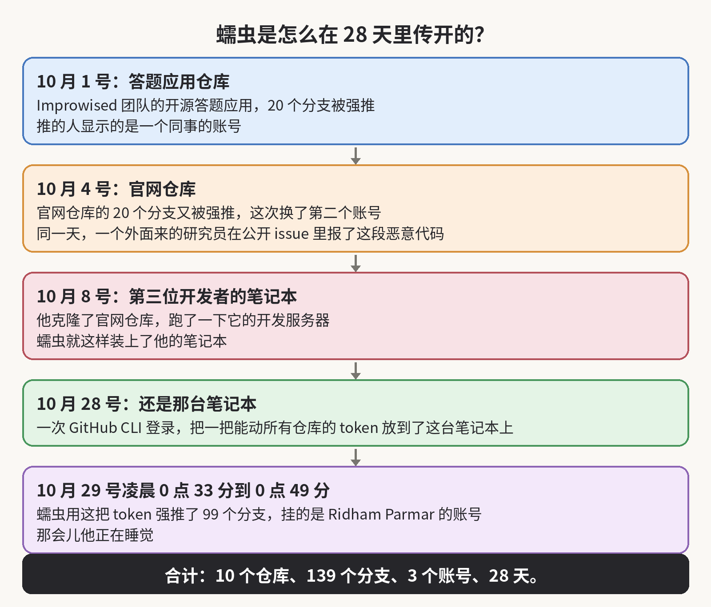
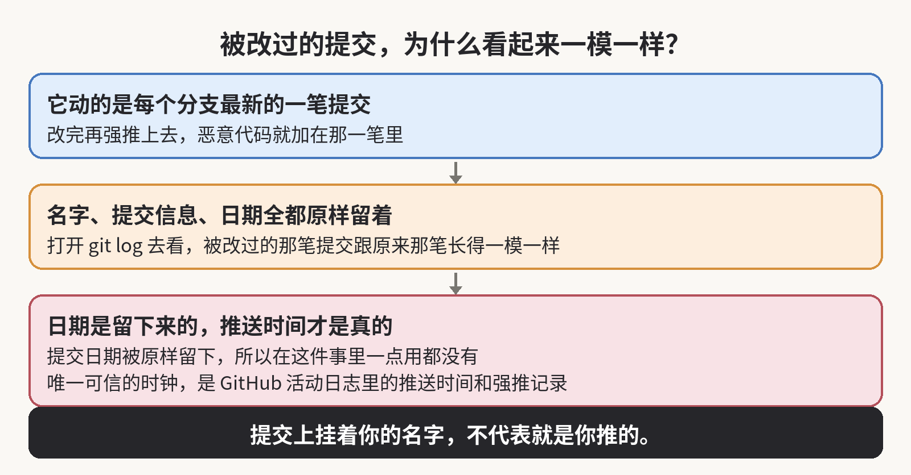
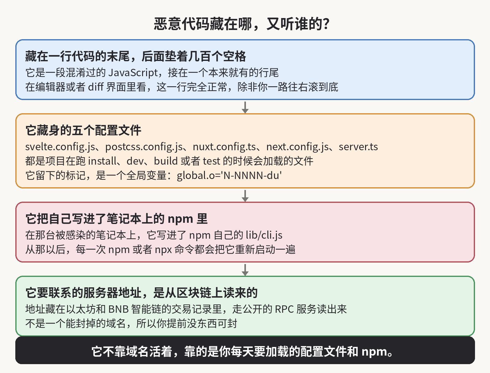
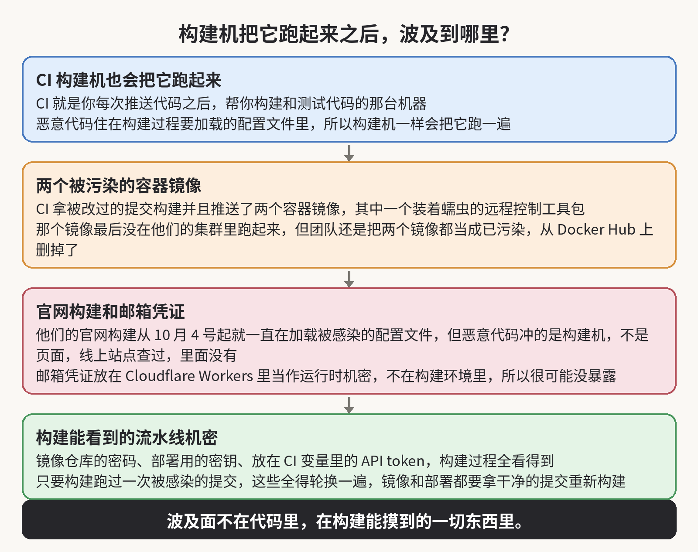

10 月 29 号早上，一个叫 Ridham Parmar 的工程师打开 GitHub，发现自己的账号在一夜之间往 9 个仓库里强推了 99 个分支。推送发生在凌晨 0 点 33 分到 0 点 49 分之间，那会儿他正在睡觉。每一笔提交都留着他的名字、他写的提交信息和原来的日期。你上一次检查自己的账号有没有替你推过你没推过的东西，是什么时候？

这个蠕虫叫 PolinRider。被它打中的团队叫 Improwised，他们在 10 月 31 号把整个经过写了出来。我写这篇，就是因为他们肯把时间线原原本本贴出来，而不是藏起来，所以别人能顺着事情发生的顺序学到东西。

## 入侵时间线

事情是从 10 月 1 号开始的。那一天，他们那个开源答题应用的 20 个分支先被强推了一遍，推的人显示的是一个同事的账号。

到了 10 月 4 号，第二个账号又往他们官网仓库的 20 个分支强推了一遍。也是在同一天，一个外面来的研究员在公开 issue 里报了这个恶意代码，因为他们公司的安全邮箱根本收不进他那封邮件。研究员随后又提了一个 PR，想把恶意代码删掉，但是这个 PR 当天就被关了，没有合进去。

10 月 8 号，第三个开发者克隆了官网仓库，还跑了一下它的开发服务器，蠕虫就这样装到了他的笔记本上。

到了 10 月 28 号，一次 GitHub CLI 登录把一把能动所有仓库的 token 放到了那台已经被感染的笔记本上。第二天凌晨，蠕虫就用这把 token 把那 99 个分支强推了一遍。

总共算下来，10 个仓库里的 139 个分支，都是从 3 个开发者的账号推出去的，而蠕虫在他们的仓库里待了 28 天。就他们目前所知，还没有客户的系统和数据受到影响。

## 蠕虫留下的痕迹

139 个分支听起来就是整件事，但是先别盯着这个数看。比起这个数，我读完他们的文章之后忘不掉的，是这个蠕虫留下的痕迹有多么少。

它改的是每个分支上最新的一笔提交，改完再强推上去，而提交信息、作者和日期全都原样留着。所以你打开 git log 去看，被改过的那笔提交跟原来那笔长得一模一样。

提交日期在这里一点用都没有，因为蠕虫把原来的日期也留下来了。所以唯一可信的时钟是服务器那边的推送时间，得去 GitHub 的活动日志和强推记录里查。

## 恶意代码的藏身处

恶意代码本身就藏在明处。它是一段混淆过的 JavaScript 代码，接在一个本来就有的行尾后面，前面垫了几百个空格。

它藏的地方，是项目在跑 install、dev、build 或者 test 的时候会加载的那几个配置文件。文件名一共五个：svelte.config.js、postcss.config.js、nuxt.config.ts，还有 next.config.js 和 server.ts。

在编辑器或者 diff 界面里看，这一行看着完全正常，除非你一路往右滚到底。

## 命令通道与常驻

它要联系的那个服务器地址，也不是一个能封掉的域名，因为恶意代码是从以太坊和 BNB 智能链的交易记录里读出这个地址的，走的是公开的 RPC 服务，所以你提前没东西可封。

它还骑在你每天要跑上百次的工具上。在一个开发者的笔记本上，恶意代码把自己写进了 npm 自己的 lib/cli.js。所以从那以后，每一次 npm 或者 npx 命令都会把它重新启动一遍，那个开机自启的工具也不例外。这就是为什么他们给团队的第一条指令是先别再跑 npm。

## CI 构建机

你的构建机器也会把这个东西跑起来，而这一层是大多数团队从来没想过的。恶意代码就住在构建过程要加载的配置文件里，所以只要有一次提交是被感染的，那一次的 CI 构建就会在构建机器上把它跑一遍。静态站点的构建也一样，因为它加载的是同一批配置文件。

CI 就是你每次推送代码之后，帮你构建和测试代码的那台机器。在这件事里，CI 拿被改过的提交构建并且推送了两个容器镜像，其中一个里面就装着蠕虫的远程控制工具包。

那个镜像最后没在他们的集群里跑起来，因为那个容器只用 nginx 提供静态文件，但是他们还是把两个镜像都当成已经被污染处理，直接从 Docker Hub 上删掉了。

他们的官网构建从 10 月 4 号开始就一直在加载被感染的配置文件。但是恶意代码是冲着构建机器去的，不是冲着页面去的，所以他们检查了线上站点，里面确实没有。邮箱的凭证也很可能没暴露，因为这些凭证放在 Cloudflare Workers 里当作运行时机密，而不是放在构建环境里。

## 被波及的流水线机密

所以这件事的波及面比代码本身大得多。因为蠕虫是骑着构建过程走的，而构建过程能看到你流水线里的所有机密：镜像仓库的密码、部署用的密钥、放在 CI 变量里的 API token。

只要你的构建跑过一次被感染的提交，那么这些东西就全得轮换一遍，而且所有的镜像和部署都要拿干净的提交重新构建。

## 错过的机会

他们其实有三次机会可以早点抓住它，而且他们都老老实实写出来了。10 月 4 号，那个外面来的研究员就已经在公开 issue 里，把他们 10 月 29 号才拼出来的大部分结论交到他们手里了，整整早了 25 天。可是那个想删掉恶意代码的 PR，同一天就被关了。

到了 10 月 13 号，一个升级依赖的 PR 把恶意代码从一个项目的一个分支里删掉了。但是没有人接着问下去，这段代码是怎么进来的、是哪个账号推的，还有哪些分支也有。他们自己对这次修复的说法是，它给他们争取了 16 天。

你要是发现了被注入的代码，那么就别把它当成一个 bug 来修，而要把它当成一次事件来处理：先找到推它的那个账号，然后再去找这个账号还能推到的所有地方。

## 第一条规矩

这是我会给任何一个团队立的第一条规矩。一笔提交挂着你的名字，不代表就是你写的，因为蠕虫会把名字、提交信息和日期都原样留下来。而主分支干干净净，也说明不了其他分支没事，因为蠕虫会碰它能推到的每一个分支。

蠕虫能在他们的仓库里待 28 天，是因为该跟的线索一次都没有人跟到底。10 月 4 号那次，关掉的是一个能删掉恶意代码的 PR。10 月 13 号那次，删掉的是一个分支上的一段代码。两次都没有人顺着账号往下跟。

## 自己动手的三项检查

我自己这周也会从账号这条线查起。第一件，查活动日志，而不是提交日志。去找团队里没有人记得的强推记录，而且要看推送时间，因为提交日期是伪造的。

第二件，查那些特别长的行。去配置文件里搜行尾垫了 150 个以上空格的代码，还要搜恶意代码留下的标记，也就是一个被设成 global.o='N-NNNN-du' 这种样子的全局变量。

第三件，查进程。看 npm 命令跑完之后，是不是还挂着一个脱离出来的 node -e 进程，还要看那些在你不认识的推送之后开始失败的 CI 构建。

他们把一个只读的扫描器开源了出来。它会检查一台机器上的每一个分支、标签和暂存区，也会检查进程和网络连接。它不会运行它扫到的任何代码。

## 本该早做的防范

而那些本来可以在第一天就拦住它的改动，都是些无聊的东西，所以才一直没人去做。在默认分支和发布分支上禁止强推。把审计日志里的强推事件接上告警，这样一次大规模推送当天夜里就会有人被叫起来，而不是等到第二天早上再发现。在受保护的分支上要求提交签名。

把那些能推所有地方的长期 token 和 SSH 密钥换掉，改成短期的、权限收得很窄的 token。拿不准的代码只放在一次性的虚拟机里跑，永远别放在工作用的机器上，面试题和别人让你「随便看一眼」的仓库也一样算。

机器要是已经中了，就别在原地清理。先把它断开，再从另一台干净的机器上，把这台机器存过的所有凭证都轮换一遍。最后把整台机器重装。

## 幕后归因

知道是谁干的，对查案的人有帮助，但是对你没什么用，因为这个办法换谁来抄都管用。这个蠕虫是 OpenSourceMalware 团队认定跟朝鲜有关的，而且跟「Contagious Interview」那种假面试的骗局活动连在一起。

我写了 24 年代码，这种事看得多了。这件事里最让我在意的，是每一次强推其实都记在 GitHub 的活动日志里，第一天夜里就记下了，可是 28 天里没有人去翻过那个日志。要是那些强推事件接了告警，10 月 1 号那天夜里就会有人被叫起来。

要是这篇让你去翻了自己的活动日志，欢迎订阅这个博客，或者先收藏起来。我会接着写 AI、安全和开源这几块的实事，下一篇还是一个你能自己动手查的东西。

来源：Improwised 的事件文章 https://www.improwised.com/blog/polinrider-malware-infection-cleanup/ ；扫描器 https://github.com/Improwised/polinrider-scanner

