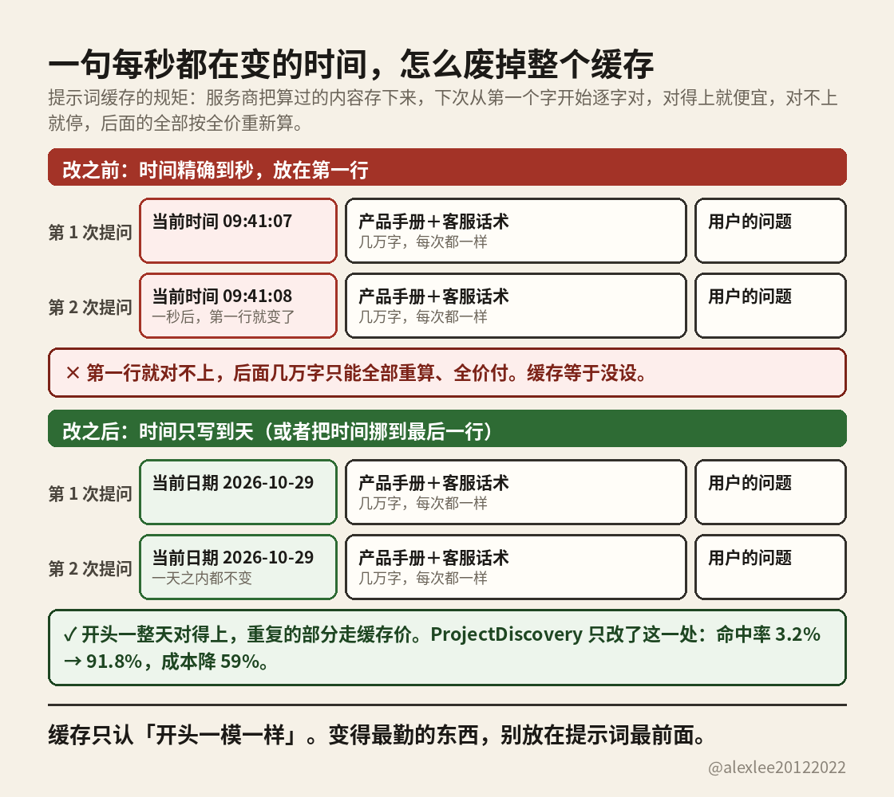

提示词里那个时钟，正在悄悄废掉你的缓存

先举个例子，你就明白了。假设你做了个问答机器人，每次有人提问，你发给模型的提示词都长这样：第一行是「当前时间：2026-10-29 09:41:07」，后面跟着一大段固定内容，产品手册、客服话术，几万字，每次都一模一样，最后才是用户真正的问题。

缓存就是为这种重复准备的。模型处理提示词要花钱，而开头这几万字每次都一样，服务商就把算过的结果存下来：下次再来，从第一个字开始逐字对，对得上的部分直接拿存好的用，便宜得多，这就叫缓存命中。

问题就出在第一行那个时间上。它每秒都在变：上一条还是 09:41:07，下一条就成了 09:41:08。对暗号第一行还没对完就断了，而断点后面的内容，不管跟上次多一样，都只能当全新的重新算、全价付。结果就是，几万字的手册每一笔都在重复付全价，缓存等于白设。

ProjectDiscovery 就踩了这个坑。他们只改了一处：时间不再精确到秒，只写到天。一天之内，那一行不变，开头一整天都对得上。命中率从 3.2% 涨到 91.8%，LLM 成本降了 59%。数字是他们自己公布的案例，我没有独立核过。

一条原则就够了：变得最勤的东西，别放在提示词最前面。时间非要精确到秒，就把它挪到最后一行。下次账单贵，先别急着骂模型贵，翻一遍自己的提示词，看第一行有没有一个每秒都在跳的时钟。

案例来源：ProjectDiscovery 公布的案例，经由[这条帖子](https://x.com/sugoyona/status/2115757471579222525)分享。
