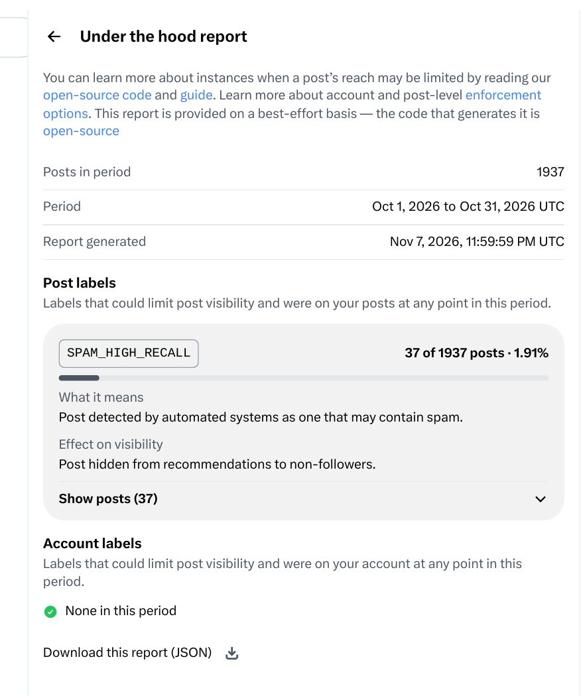
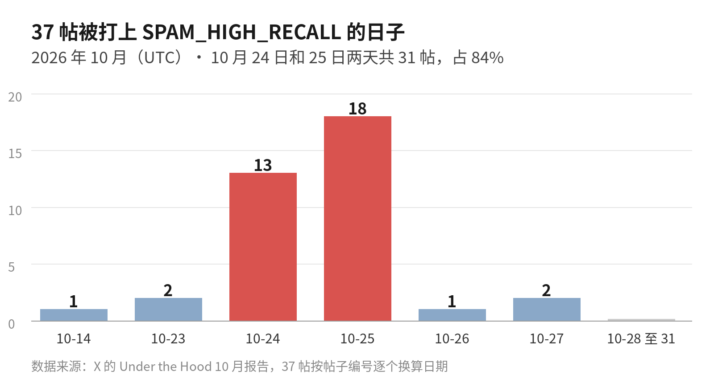

X 的限制标签分两种，一种打在整个账号上，一种打在单个帖子上。我 10 月的账号报告里，打在账号上的那种是 0 个。但是我那个月发的 1,937 帖里，有 37 帖被打上了垃圾标签，而且打标的原因，和我这一个月的涨粉打法直接相关。

## 这一个月，机器人具体做了什么

10 月中，我审计了一遍这个账号。当时它只有 15 个粉丝、112 帖，关注了 58 个人。10 月 21 日，我把定位和主页改完。两天之后的 10 月 23 日，我运营账号的机器人程序上线了。

它主要由两个部分组成：一个是脚本，它按定死的步骤重复做事。另一个是 agent，负责读帖子、做判断、逐条写回复。重复的机械动作都是脚本在干。回复要像人写的才有用，判读和写作这两步只能交给 agent。

它所有的工作中，做得最多的就是增加粉丝数量这一件。具体来说：首先，它通过脚本自动找到蓝 V 用户公开发的征集帖，也就是帖子里明说想认识新朋友、想互关的那种。然后做三件事：点赞、留一条评论、点关注。这三件事算一组，一组里有一条评论，每天最多做 120 组。评论由 agent 逐条写，规矩是我定的：先对帖子里的内容说一句实在话，再带上自我介绍，请对方回关。

交友之外，它还回复同行的帖子，中英文都有。脚本把时间线收回来，筛完数完，一条一条交给 agent 读，读完逐条写回复发出去。点赞是单独的一件小事。脚本在收集的时候看到同行写得好的帖，就顺手点一个赞。一天点几十个，不评论，也不关注。

规矩是我定的，它每天给我一份汇总，我晚上还会抽查当天发出去的回复写得怎么样。到了 11 月，连发送回复这一步也改成了脚本执行，因为发送本身只是机械动作，没有必要每发一条都开一个 agent。

光看交友这一件事，10 月 23 日到 31 日这 9 天，记录里一共发出去 741 条交友评论。10 月 24 日、25 日和 26 日这三天，每天的交友评论都顶到了 120 条的上限。

## 粉丝从 15 涨到了 4,000

粉丝是跟着交友涨起来的。到了 11 月 6 日，粉丝是 2,923 个。再到 11 月 12 日晚上，我决定改玩法的时候，粉丝已经到了 4,000 个。我写这篇的时候又看了一眼，11 月 13 日，粉丝是 4,175 个。

不到一个月，粉丝从 15 个涨到了 4,000 个，这个速度主要就是交友堆出来的。互关的玩法很直接，你关注对方、给对方评论，对方回关你的比例并不低。但是这种涨法本身就有问题。后面报告里被打标的那批帖，就是这个涨法发出去的。

## 异常是这样被发现的

10 月底，我先注意到的是一些回复的浏览量不对劲。有几条回复发出去很久，浏览量还是 1。正常发出去的回复，就算没人点赞和回复，也会有一些基础的浏览，所以浏览量长期停在 1，这件事本身就不正常。

后来我才知道，X 有一个给账号本人看的页面，叫 Under the Hood，地址是 https://x.com/i/jf/under_the_hood/report 。你打开这个页面，它会按月给你一份报告，写清楚这一个月里你的账号和你的帖子有没有被打上限制推荐的标签。11 月 7 日，10 月的报告生成出来了，我就把这份报告从头到尾看了一遍。

报告页面上写了，生成报告的代码是开源的，放在 https://github.com/xai-org/x-algorithm/tree/main/under-the-hood 。每个标签是什么意思、有什么后果，报告里都写着，你也可以自己去代码里对着看。

## 报告里到底写了什么

账号级标签是 0 个，页面上写的是 None in this period。X 没有给整个账号打任何限制标签。

帖子级标签这一栏，37 帖被打标，占 10 月全部 1,937 帖的 1.91%，而且 37 帖的标签只有一种，叫 SPAM_HIGH_RECALL。X 给这个标签的解释是，帖子被自动系统检测为可能含有垃圾内容。

这个标签的后果，报告里也写得很具体，只有一条：这帖不会被推荐给非粉丝。已经关注我的人照常能看到这帖，我的其他帖子也不受这帖的影响。所以这件事的性质是 37 帖各自被限制了推荐，而不是整个账号被限流。

这 37 帖出现的日子挤得很密。我把报告给出的 37 个帖子编号逐个换算成了发帖日期。10 月 14 日 1 帖，23 日 2 帖。24 日 13 帖，25 日 18 帖。26 日 1 帖，27 日 2 帖，28 日到 31 日一帖都没有。光是 24 日和 25 日两天就占了 31 帖，占全部 37 帖的 84%。剩下的 6 帖零散地分布在另外四天里。

## 我抽查了三帖，原文都还留着

报告只给编号，不给原因，所以我抽了三帖出来看原文。

10 月 24 日的第一帖，原文是：「开通蓝V第10天还在坚持更推，这份持续力挺不容易的，已经关注你了，方便的话回关一下，我是 24 年全栈老兵，现在学 AI，平常分享开源跟 AI 干货，之后多交流！ #蓝V互关」。这帖的浏览量是 1，链接是 https://x.com/alexlee20122022/status/2114071398297522245 。

第二帖是 10 月 25 日发的，同样是交友评论，里面有这么一句：「已经关注你了，之后多互动，方便的话也回关一下 #蓝V互关」。这帖的浏览量也是 1，链接是 https://x.com/alexlee20122022/status/2114435103732731906 。

第三帖和前两帖不是一类问题。它是我 10 月 14 日发的一帖邀请码，原文是：「现在muse还能免费用, 趁早注册一个.如果可以,请填写我的邀请码, 大家都能得到十亿token，Code: C4TPPK」。这帖的浏览量是 20，链接是 https://x.com/alexlee20122022/status/2110394977910141374 。

这帖是这个月 37 帖里唯一一帖不是互关类的。

## 为什么偏偏是这批帖被打标

被打标的主要是交友评论，原因我看下来有三个，都出在这批评论的打法上。

第一个问题是量。交友 10 月 23 日才开始，第一天只发了 18 条，因为那天下午回复两次撞上平台的软限流，晚上 7 点起我把评论先停了，第二天早上 7 点才恢复。恢复的当天就直接顶到 120 条，25 日和 26 日也都是 120 条。开始的头几天，交友评论几乎天天顶格在发。

第二个问题是话术。这批评论的骨架都差不多：先夸对方一句，再说自己已经关注了，然后请对方回关。标签也都一样，带同一个 #蓝V互关。

第三个问题是内容。它通篇都在求一次关注，没有回应对方帖子里说的任何具体事情。

SPAM_HIGH_RECALL 这个名字里有 HIGH_RECALL，意思是高召回。我的理解是，这类检测宁可多抓一些，也不想漏掉。所以只要一批帖子在发送速度、重复程度和内容目的上都像垃圾帖，它就会成批地打标。这个理解是我根据标签名和报告做的推断，X 没有在报告里逐帖写明触发原因。

时间也能对上。被打标的帖子集中在 24 日和 25 日，而交友评论冲量的正是这几天。到了 28 日之后，报告里一帖被打标的都没有了。我只能把这件事记成一个观察，因为这段时间里发帖的量和节奏也在变，我没有证据把这个零归到某一个单独的原因上。

## 报告没写的：我对曝光的两个怀疑

我怀疑的第一点，是推荐算法里没公开的那部分权重。我把 X 公开的推荐算法代码逐行读过一遍，写成全文放在我的博客上，地址是 https://blog.go5.si/posts/zh/x-algorithm-teardown/ 。后来我把里面的结论蒸馏成了技能库，叫 For You Skills，地址是 https://github.com/alexliyu7352/for-you-skills 。

这个技能库是给 Claude Code、Codex、Cursor 这类支持 Skills 的工具用的。装上之后，你可以直接问你自己的 agent，某个运营说法在代码里到底有没有依据。

公开代码里，我没有找到一条说用机器人运营账号就会被限流。但是线上真正跑的模型，不等于公开的这份代码，没公开的权重里完全可能有这类判定。把这个怀疑和我 11 月的数据对一下。有几天机器人跑过了头，交友的量顶格。就是那几天，粉丝照样在涨，我帖子的曝光却只有平时的一半，有时只有三分之一。有可能是巧合，但是我认为很大可能是被限流了。

我怀疑的第二点，是互关来的粉丝根本不看时间线。这批粉丝大多是冲着互关来的，很多人自己也是拿机器人运营账号，平时不打开 X 刷首页。平台推帖子的时候，会先推给你的粉丝和跟你互动过的人。我的帖子被大量推给这批人，他们不看，帖子就沉在那里了。

我自己的数据也是这个样子。帖子有过曝光量一万七到两万的时候，最后真正点进来、跟帖子互动的只有两百到四百人。曝光看着不低，能变成关注和互动的很少。粉丝数是涨上去了，这部分涨上来的粉丝，对后面的帖子几乎帮不上忙。这也是我停掉互关的另一个原因。

## 接下来我改了什么

11 月 12 日晚上，我把交友线停了。停的原因和这份报告能对上。粉丝已经到了 4,000 个，继续用互关堆粉丝，就得继续按这个速度发交友评论，而这种评论正是报告里被打标的那一类。所以互关和交友征集类的帖子，脚本现在看到就整帖丢掉，评论、点赞和关注都不做。

回复线没有停，但是规矩改了两处。一处是主题：和我长期写的技术话题完全不沾边的帖子，不回了。另一处是内容：回复必须带新东西出来。可以是我的经验，也可以是一个具体的数字或者例子，还可以是一个不同的看法，或者一个真问题。反正不能把原帖换个说法再说一遍。

关注也跟着改了规矩。现在我只关注当天真正回复过的作者，每天最多 20 个。顺序反过来了：先有一次真的交流，然后才有一次关注。以前那种先关注再求回关的做法，到此为止。

带奖励的拉新帖，就算只发一帖，也会被打标。邀请码那一帖就是例子，所以这类帖子以后我不会再用这种写法发。

这些改动有没有用，要等 11 月的报告出来才知道。Under the Hood 的报告是按月出的，11 月的报告要到 12 月初才能看到。到时候我先看 11 月后半月发的帖还有没有被打上 SPAM_HIGH_RECALL，那半个月交友线已经停了；再看账号级标签是不是还是 0 个。上面那两个关于曝光的怀疑，也要靠后面的报告和数据慢慢对。

这 37 帖我不打算删。删掉它们，也改不了报告里已经记下的标签。留着它们，我下个月看 11 月报告的时候，还能把新报告里被打标帖子的时间和这批帖子的时间放在一起对，就能看出来打标是不是停在了 10 月。

这一个月跑下来，机器人能把量做上去，但是量做上去之后，平台按它自己的规矩记账。我用一个月把粉丝从 15 做到了 4,000，37 帖被打标这件事，也把交友打法的边界给我划出来了。接下来的涨粉只能换一种慢一点的办法，先把内容和回复做实，再谈速度。

如果你也在用机器人或者脚本运营自己的账号，这篇里的查法应该能直接套到你自己身上。麻烦收藏一下，再订阅这个博客，我后面会把 11 月报告的结果和改完之后的数据接着发出来。

