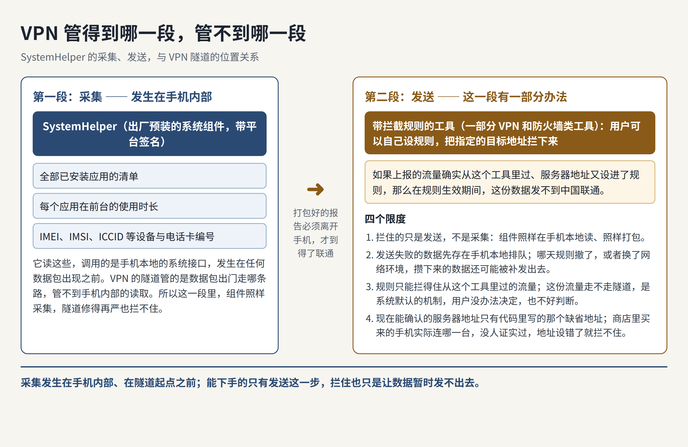
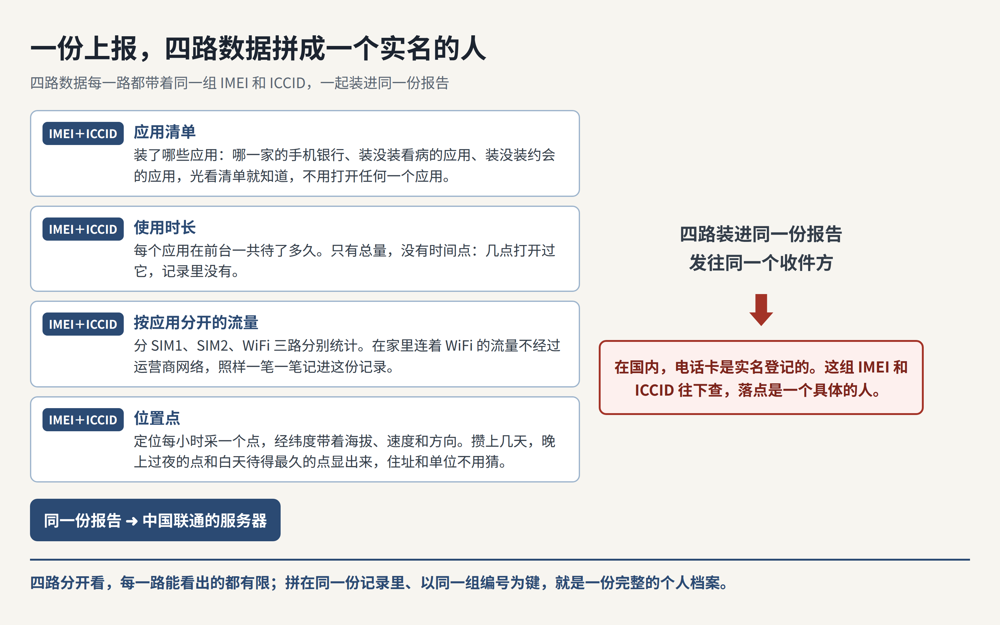

10 月 31 日，开发者 MeT 发帖说了一件事：他朋友接到当地公安的电话，对方要求他把手机里的 X 和 Telegram 卸掉。MeT 顺着这通电话往下查，查到的不是哪个 App 漏了信息，而是他朋友手机里一个出厂就装好的系统组件。这个组件会把他朋友这台手机过去 24 小时用过哪些应用、每个应用用了多久，一起打包发往中国联通的服务器。

你现在的主力机上，装着 Telegram 或者代理工具吗？如果装了，那么这台机器的系统应用列表，你有没有从头到尾翻过一遍？

MeT 的朋友那台手机是小米 14，系统是澎湃 OS 3，里面插的是中国移动的卡，而且已经 root 过。MeT 在 root 之后用电脑把他朋友手机里可疑的组件提取出来，借助 GPT 辅助反编译，最后锁定了两个会上报应用信息的组件。

一个是小米自己的系统安全组件，它把第三方应用的清单报给小米的反诈服务器。另一个叫 SystemHelper，它报的东西更多，而且收件方是中国联通。

顺带把一件容易混的事分清：网上热议的「每隔几秒录一段屏」，属于小米那个系统安全组件，不是 SystemHelper。这一篇只讲 SystemHelper，因为只有它被人完整拆开过，字段一个一个从代码里数清楚了，拿它正好能把 VPN 能挡住什么、挡不住什么讲明白。

11 月 5 日，V2EX 上一篇帖子把这件事汇总了出来，标题是「能不能给人留点隐私」，下面跟了 171 条回复。帖子把事情的经过讲完了，但有两个问题它没有回答：开了 VPN 挡不挡得住，还有，这一份数据到底能拼出什么。

## SystemHelper 的归属与去向

SystemHelper 不是小米写的，它是中国联通的设备管理客户端，业内叫 DM 客户端。联通自己的《Android 终端 DM 适配使用指南》里就写着它的预置路径，手册还特意要求，不要阻止它开机自启。

它在手机里的位置是系统特权目录，用的也是平台签名，所以普通应用没有的权限，它出厂就全拿到了。所谓平台签名，就是它是用手机厂商手里的平台密钥签的名，安卓因此把它当作签名级特权的系统应用来对待。它在桌面上没有图标，普通的应用列表里也翻不到它。因为它装在系统分区里，所以没有 root 的话，用户既卸不掉它，也没有办法把它的安装包提取出来分析。

它回连的地址写在代码里，缺省值是联通设备管理平台的一个网址，用的还是明文的 HTTP。它实际发出去的那份数据，在发送之前，要先在代码里过一遍应用层加密处理。地址走的是明文，可是那份数据先过了这一遍处理，所以半路上谁能看到什么，没有定论。这个问题我留在最后一节讲，到时候把能确认的和不能确认的分开说。

## 上报的字段

11 月 4 日前后，另一位审计者把一台 Redmi 上的这个组件完整拆了一遍，字段是一个一个从代码里数出来的。一份完整的上报大致由三部分拼成，我按部分列出来：

- 设备与电话卡：两张卡的 IMEI、IMSI、ICCID 和运营商网络代码，手机当前连着的小区编号（CID、PCI、TAC）与网络类型，还有 5G 与 VoLTE 的开关状态、厂商、机型、硬件与软件版本，一共约 40 个字段。

- 信号与位置：这一部分会把两张卡的编号再带一遍，并且在小区编号之外补上信道号（ARFCN）和信号指标（RSRP、RSRQ、SINR）。这一部分里还有内置的百度定位给出的经纬度，同时给出海拔、速度和方向。而且只有连着中国境内网络时，这一类记录才会往本地存。

- 应用使用：每个应用的包名和显示名、在前台被用了多久，以及它在两张 SIM 卡和 WiFi 上分别走了多少流量。过滤规则在代码里只有一个条件：包名以 com.android 开头的应用会被跳过。厂商自己预装的应用不落在这个条件里面，所以它们照样会被统计进去。

MeT 在他朋友的小米 14 上看到的统计口径是过去 24 小时。换句话说，它报的还包括这 24 小时里的使用记录。

换成任何一台装了这个组件的手机，记下来的也是同一套：机主实际用过哪些应用，每个应用在前台一共待了多久，还有各应用在两张 SIM 卡和 WiFi 上分别走了多少流量。它记的只有总量，没有时间点：一个应用总共用了多久有数，机主是在几点打开它的，记录里没有。这份记录里的每一项，都带着手机本身的编号和两张电话卡的编号。

它醒来的时机也写在代码里。开机、换卡或者网络变化，都会把它叫醒。另外还有定时的闹钟：定位采集的周期是一小时，闹钟用的还是能穿透休眠的精确闹钟，所以手机息屏放着，它也会照点醒来采集。上报失败的数据会先存在手机本地，等下一次再补发。

发送之前还有一个同意开关的判断。代码里这个变量在日志中叫「用户许可是否打开」，但是在代码里专门给小米手机用的那一部分里，它实际只检查一件事：新手机的首次设置走完了没有。所以你在设置里把相关开关关掉，这个判断照样通过。

## VPN 的盲区

VPN 在安卓上管的是网络层的事。它通过系统的 VpnService 建一条隧道，改变的是数据包出门走哪条路。它能藏住的，是你的流量去了哪里，以及在旁人眼里你是从哪个地址出来的。

但是 SystemHelper 的采集根本不经过网络。它拿着系统特权，在手机本地直接调用系统的接口：读全部已安装应用靠一个权限，读每个应用的使用时长靠另一个权限，读 IMEI 和电话卡编号再靠一个权限。这些读取发生在数据包出现之前，所以隧道修得再严，也管不到同一台机器内部的接口调用。

这三项读取对普通应用各有各的门槛，卡住它们的方式还不一样。手机和电话卡的编号这一项，从安卓 10 开始普通应用就拿不到 IMEI、IMSI 和 ICCID 了，只有带签名级特权权限的预装应用能读。装了哪些应用这一项，枚举全部已安装应用靠的也是签名级特权权限，普通应用同样过不去。

每个应用用了多久这一项，普通应用想读，得由用户自己去设置里手动打开「使用情况访问」，不是装上之后就能自己读到的。三项门槛拦的都是普通应用。SystemHelper 出厂就预装在系统里，又带着平台签名，所以这三项它全都够得着，问题正在这里。

就算只看发送这一步，隧道也不是没有办法绕过去。安卓的 VPN 机制本身就允许按应用分流，也允许应用把自己绑到指定的网络上、完全不进隧道。系统组件的流量走不走你的 VPN，你作为用户是没办法决定的，这是系统本身默认的机制，用户一般无法修改，也不好判断。

而且就算它老老实实走了 VPN，隧道能换掉的，也只有这次连接在旁人眼里的源地址。可是服务器把数据收下来、解开之后，看到的还是同一份记录，里面带着 IMEI 和电话卡编号。所以你的源地址变没变，对它认出这份数据是谁的，没有任何影响。

不过，发送这一步并不是完全没有办法。这一份数据在手机里打包好之后，总要发出去，才到得了联通。一部分 VPN 和带防火墙功能的工具，允许用户自己设拦截规则，把指定的目标地址拦下来。如果这份上报的流量确实从这个工具里过，而用户又把上报服务器的地址设进了规则，那么在规则生效的这段时间里，这份数据就发不到联通手里。

只是这条路有前提：拦截规则只能拦得住从这个工具里过的流量，而这份流量走不走你的隧道，前面已经说了，用户没办法决定，也不好判断。

它也有限度：拦住的只是发送，不是采集。这个组件照样在手机本地读、照样打包。发送失败的数据会先存在手机本地，等着下一次补发，所以哪天规则撤了，或者换了一个网络环境，攒下来的数据还是可能被发出去。

还有一个难处在动手之前：要拦，总得先知道该拦哪个地址。现在能确认的只有代码里写的那个缺省地址，商店里买来的手机实际连的是哪一台，没有人证实过，所以就算把缺省地址设进规则，也可能拦不住它真正要连的那一台。

## 拼合后的完整档案

单看应用清单，它就是一份关于兴趣和身份的指纹。比如你装的是哪一家的手机银行，装没装看病的应用，装没装约会的应用。要看出这些事，根本不需要打开任何一个应用去看内容，因为光是这份清单本身，就把这些事摆在明处了。

再加上使用时长，能看出来的是你的时间分给了谁。过去 24 小时里，哪个应用在前台待得最久、哪个只打开了一小会儿，总量记得清清楚楚。所以一个人的注意力主要落在哪几个服务上、哪几个服务占用的时间最多，从这些总量里就能看出来。不过它记的只有总量，没有时间点：几点打开、几点关上，都不在记录里。所以几点睡、几点起，单靠使用记录看不出来，那要靠位置记录才拼得出来。

流量这一项更容易被低估。它是按应用分开统计的，WiFi 上的流量还单独分开统计。这意味着哪怕你在家连着 WiFi、流量根本没走运营商的网络，每个应用在 WiFi 上走了多少流量，照样一笔一笔都记在这份记录里。

最后再加上位置。这份上报里既有基站编号，也有定位给出的经纬度。基站只能圈出一个大概的范围，经纬度给出的就是具体的点。而且定位采集在代码里的周期是一小时，点会一个接一个攒下来。攒上几天之后，晚上过夜的点和白天待得最久的点会从这串点里显出来，所以住址和单位不用再猜。定位数据里还带着速度和方向，所以你每天上下班走哪条路，也能顺着这串点描出来。作息和行踪靠的是位置记录。

这四部分如果分散在四个地方，问题还有限。但是在这一份上报里，它们从一开始就是拼好的。同一批记录里，应用、时长、流量和位置这四样，每一项都带着同一组 IMEI 和 ICCID。而在国内，电话卡是实名登记的，所以这组编号再往下查，落点就是一个具体的人。

## 运营商本来就握有的数据

话说回来，你自己的运营商本来就合法握着不少东西。你的实名登记、手机入网时的 IMEI、你连过哪些基站，它都有记录。你的流量去了哪些地址、花了多少，它同样有记录。这些是入网和计费绕不开的数据，换到哪个国家都差不多。

所以新增的，是运营商从网络那一侧永远看不到的那部分。它看不到你装了哪些应用，也看不到每个应用在屏幕前用了多久；WiFi 上走了多少流量，它看不到，定位给出的经纬度更不在它手里。更何况这份数据报给的是联通。开头提到的他朋友那台手机，插的明明是移动的卡，所以收集数据的一方和手机的主人之间，连一份合同都没有。

DM 这套制度本身，也不是小米或者联通偷偷发明的。三大运营商对入库机型都强制要求做 DM 适配，所以这个组件出现在很多品牌的国行机里。代码中的适配分支包括 OPPO、vivo、三星和中兴等厂商，这一串名单里没有华为和荣耀。

不过，其他品牌的情况和小米的情况还不能画等号。目前被完整拆开、字段一个一个数清楚的，只有小米的样本。其他品牌目前能坐实的只有两点：有这个组件，握有这些权限。它们是不是同样在上报，上报的字段一不一样，还没有人公开拆过，所以不能直接把小米的结论搬过去。

## 自查与移除

先查它在不在。打开设置里的应用管理，打开「显示系统应用」，搜 SystemHelper，能搜到就是有。会用电脑的，可以用 adb 查一遍包名，或者用开源工具 NOIR 把整台机器的应用和权限审计一遍，这个工具不需要 root。

查出来有，又想处理，可以用 adb 把它对当前用户卸载，同样不需要 root。但是有两点要先知道：这只是对当前用户卸载，恢复出厂设置之后它还会回来；另外，网上有一份爱好者维护的精简清单，专门列哪些预装应用可以删，清单里只说了它和双卡功能有关，没有说清卸掉之后具体会影响什么，所以卸完要先检查两张卡的通话和上网正不正常。后悔了，也有一条命令可以把它原样装回来。

但是有两件事做了也白做。一件是去关设置里的相关同意开关，前面已经说了，小米手机用的那一部分代码根本不看那个开关。另一件是只开一个普通的 VPN，让流量换一条路走。换路换掉的只有源地址，采集和打包都在手机本地完成，所以单靠换路没有用。带拦截规则的工具不算这一件：把上报服务器的地址设进拦截规则里，数据就暂时发不出去，它的前提和限度，前面那一节已经讲过了。

## 还没人回答的问题

到 11 月 5 日为止，小米和中国联通都没有就这一轮爆料发过公开声明。这份数据在联通那边存多久、谁能查、查的时候要走什么手续，目前没有任何公开材料能回答。

还有一处细节没人能证实：实机连的到底是哪一台服务器。服务器地址存在这个组件自己的配置里，没有 root 读不出来，所以现在能确认的只有代码里的缺省地址。拆开那台 Redmi 的那位审计者在短时间的观测里，也没抓到它实际发出的流量，所以上报的真实频率同样没有定论。

前面留下的那个问题也在这里交代：半路上谁能看到什么，同样没有定论。代码里写死的缺省上报地址是明文的 HTTP，它的应用清单文件（AndroidManifest）里也写明了允许发明文流量。但是那份要发出去的数据，在发送之前，要先在代码里经过 AES 和 RSA 的应用层加密处理，所以地址是明文，不等于数据本身也摊在明处。

只是到现在为止，没有第三方公开过把真实抓包解开的结果，像 /register（上报地址里用来注册的那个路径）这样的路径是不是也走了同一道处理，也没有被单独证实过。这几件事放在一起，谁能在半路上看到什么、能看到多少，没人能说定。

开头那通公安电话，也得在这一节里把话说清。这份上报和那通电话之间，现在能确认的只有先后：数据先在往上报，电话后来打了过来。中间是不是这份数据触发了那通电话，没有任何证据能把这条线连起来，能拿出来的只有当事人自己的推断。所以这一篇只把那通电话当作他起意排查的原因，不把它当作这份数据已经证实的后果。

如果你平时就在主力机上用 Telegram、用代理工具，我的建议很直接：先花上十分钟，把自己的机器查一遍。如果查出来有，就按上面的办法处理。如果一时处理不了，就先用带拦截规则的工具把上报服务器的地址拦下来，让数据暂时发不出去。如果连这个也做不到，那就把敏感的应用挪到另一台机器上。别让一份你看不见的档案，天天替你记着你用过哪些应用、去过哪些地方。

这类把系统层拆开看的文章，我还会接着写。觉得有用的话，欢迎订阅这个博客，或者先收藏起来。后面我还会接着写 AI、安全和开源方面的内容，都是像这一篇一样拆开看的那种。

来源：V2EX 原帖《能不能给人留点隐私》（https://www.v2ex.com/t/1254629 ）；GitHub 独立审计 LING71671/systemhelper-privapp-audit；证据汇编 beibing173/chinaphone；MeT（@MeTerminator666）2026-10-31 原帖及后续整理。
