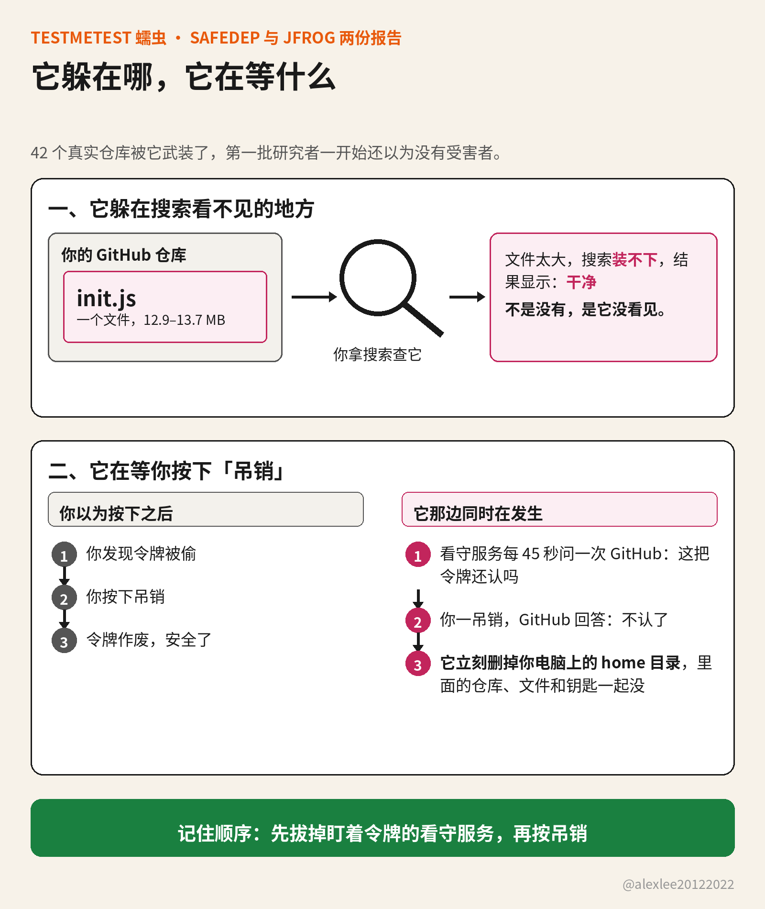

你的home目录被删了？先别找入侵者，动手的可能是你自己

你有没有想过，有一天回到电脑前，发现仓库里的文件没了，严重一点，整个仓库都不见了。这种事不用别人黑进 GitHub 也能发生，一条住在你自己电脑上的蠕虫就能做到，它叫 testmetest。它删文件的办法很特别：它自己不急着动手，它等你动手。等你发现令牌被偷、按下吊销的那一秒，它就把你电脑上的 home 目录清空。

被删的到底是什么：GitHub 网站上的仓库本体，这次没有被删。被删的是你电脑上的 home 目录，就是你平时放项目、文件和钥匙的那个用户目录。大多数开发者的仓库克隆就放在里面，还没推送的改动、SSH 钥匙、.env 文件也都在里面。home 目录一清，这些东西一起没。对天天在本地改代码的人来说，这和仓库被删了没有区别。

testmetest 不是一个包，是一批包：一串名字以 -testmetest 结尾的 npm 小工具，event-bus-lite-testmetest、data-pipeline-testmetest 这一类，名字听起来都是正经干活的。从 10 月 19 日起，这批包陆续出现在 npm 上，其中一些版本带着蠕虫。

我维护开源项目，装包、开仓库、管令牌就是日常工作。这条蠕虫的每一步，都是冲着我这类人的日常来的，所以两份报告我都从头读了：一份是 SafeDep 10 月 22 日拆包的那份，一份是 JFrog 顺着仓库查下去、10 月 26 日发的那份。

SafeDep 拆完包给出的判断是，它和今年 6 月那条叫 Miasma 的 npm 蠕虫同源，又多装了一件从 Mini Shai-Hulud 那里来的东西，就是那道吊销引信。血统只能说到这里，Shai-Hulud 的源码今年 5 月就公开了，谁都能拿去接着做，所以不能就此认定是原班人马干的。

它进机器，是在你装包的那一步动的手。它没有用常规的安装脚本，而是把执行藏进 binding.gyp 里。binding.gyp 是带原生代码的包安装时要用的编译配置文件，这类包一装，它就一定会被处理到。所以 npm install 还在跑，代码就已经执行了。SafeDep 专门提醒过，连 --ignore-scripts 这个装包时挡脚本的开关都拦不住它，因为它根本不靠脚本钩子。

跑起来之后，它在你的机器上做三件事。第一件是偷凭证，范围很宽：GitHub 和 npm 的令牌、SSH 私钥、.env 文件，连 Claude、Codex 这些 AI 工具存在本机的凭证，都一起打包带走。

第二件是在系统里留一个看守的服务，常驻着，其中一个叫 net-health-checker，它就是删文件那道陷阱的本体。第三件是繁殖，它拿到你的 GitHub 令牌之后，会去碰你名下的、还有你能协作的仓库。

net-health-checker 是这三件事里最要命的一件。它每 45 秒拿着你那把被偷走的令牌，去问一次 GitHub 还认不认，连续问 48 小时。它等的就是答案变成不认的那一刻。

答案一变成不认，它就动手删你电脑上的 home 目录。发现令牌被偷，马上吊销，是对的第一反应，每本应急手册也都是这么写的。而这条蠕虫就是围着这一秒建的，你按下吊销的那一下，就是它动手的信号。你的自救动作，成了它的发令枪。

所以真出了事，顺序比速度重要。JFrog 的处置清单里把顺序写得很直白：先把 net-health-checker 和另一个常驻服务 pkg-runtime 从机器上拔掉，然后再去吊销被盗的令牌。顺序要是反了，令牌照样废得掉，只是你按下去之前，home 目录可能已经在删了。

它在 GitHub 的仓库里没有删任何东西，它做的是往里面塞东西。JFrog 查到的是 42 个真实仓库、11 个所有者，被塞进了给 AI 编程工具和编辑器的钩子：Claude Code 的启动钩子、Gemini 和 Cursor 的配置、VS Code 打开文件夹时自动运行的任务，全都指向同一个文件，就是 .github 目录下的 init.js。

这个 init.js 有 12.9 到 13.7 MB，里面是一个发布器。以后你或协作者用这些工具打开这个仓库，钩子就会把 init.js 跑起来，发布器借着打开者的身份干活，借的是 npm 的可信发布。可信发布是仓库预先跟 npm 绑好的通道，仓库那边一触发，新版本直接就能发，不用当场输令牌。所以借到的身份当场就能用，新的带毒包就这样发出去。仓库还在，里面已经不是你放的东西了。

这批仓库不是一个一个慢慢感染上的。JFrog 还原的时间线是，9 月 28 日有一波脚本化的批量武装，几分钟内推完一个又一个账号，提交里写的作者日期，还是从各仓库的旧记录里抄来的假时间。其中一个被劫的账号，是 2013 年注册的一个阿根廷 PHP 开发者，他的 13 个仓库在两分钟里被装好。

它能藏这么久，还有一个原因：GitHub 的代码搜索不收这么大的文件，内容接口也取不出来。SafeDep 10 月 22 日发报告的时候说，没有找到第三方受害者，看到的都是操作者自己的测试账号，这个结论就是这么来的：按搜索去查，看得见钩子，看不见载荷，就会以为那些仓库里放的是空占位。

JFrog 换了查法。它绕开搜索，把每个账号名下的仓库按目录树一棵棵枚举下去，把大文件按原始数据取回来，离线拆开看，才确认 42 个仓库个个都装好了引信。它找到的十个版本的大文件个头各不相同，解码之后，是同一个大约 2 MB 的发布器，大小的差别只是编码方式留下的副产品。

行动后期，它又换了一副样子。新的包里连 JavaScript 加载器都没有了，换成一个预先编译好的原生插件，旁边放一个加密的缓存文件。插件先看环境：在 CI 里、在容器里、开着调试器或者抓包工具，它就不动，只在真实开发者的机器上才醒。自动扫描器平时待的地方，它都躲开了。

我最在意的是，这两件事瞄准的是同一种人：一个认真负责的维护者。查仓库，用平台给的搜索查；救账号，先把令牌吊销。两步都是标准动作，两步都被提前读过一遍。这条蠕虫算的不是你会不会犯错，而是你做对的时候，会先做哪一步。

如果你装过这批包里带毒的版本，名单在 SafeDep 和 JFrog 两份报告里都有，先把那台机器按已经失陷来处理。顺序照 JFrog 的清单走：先清掉那两个常驻服务，把丢不起的东西存出来，再换一台你信得过的干净机器，去吊销和轮换它可能见过的每一把凭证，GitHub、npm、SSH、云服务和 AI 工具的都算。

如果你维护仓库，查的时候别只靠 GitHub 搜索，搜索恰恰是看不见它的那个工具。按目录树查 .github/init.js，再看看钩子文件在不在：.claude、.gemini、.cursor 的配置，还有 .vscode 的任务文件，只要多出一个不是你放的，就要当真处理。

要是你没装过这些包，仓库也不是你的，这件事和你没有直接关系。可以带走的只有一条：一把令牌被偷之后，先别急着在中毒的那台机器上吊销它，先想清楚，那台机器上有没有什么东西，还在盯着这把令牌的状态。

这篇的事实来自 SafeDep 和 JFrog 两份报告，蠕虫的血统在两份报告里都没有定论，我不替任何一方下结论。JFrog 还提到，同一批被劫的账号里，出现过另一套拿 GitHub Actions 去扫 cPanel 漏洞的工具，这是同一批账号上的关联活动，是不是同一伙人、同一条链，他们没有下结论，我也不下。

以前讲供应链安全，讲来讲去是别装来路不明的包。这条蠕虫多走了一步，它把你出事之后的处置流程，也算进了自己的设计里。对我自己的提醒很具体：手册还是要照着做，只是按下第一步之前，先看看机器上是不是留着什么东西，正等着我按下去。说到底，它赌的是我们所有人的第一反应都一样。你发现自己令牌被偷的那一秒，手会先伸向哪一步？

来源：[JFrog 报告原文](https://research.jfrog.com/post/beyond-testmetest-42-hijacked-github-repos/) ；[SafeDep 报告原文](https://safedep.io/testmetest-npm-worm-miasma-variant/)

