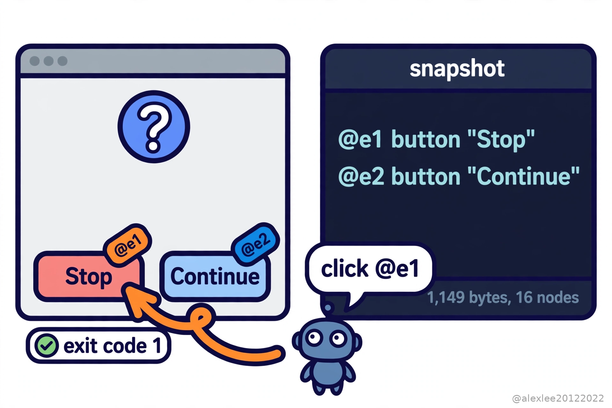

靠截图开电脑的 agent 是在猜。它先给你屏幕拍张照，再把照片发给一个视觉模型，让模型从像素里猜按钮在哪。你上一次看它把按钮点错，是什么时候？

Vercel 的 agent-desktop 给 agent 换了一条路，因为它读的是操作系统本来就记着的那份控件清单。这条路这几天很受关注。它 11 月 5 号那天单日就涨了大约 2,100 星，我第二天去查的时候，已经涨到 17,978 星，快 18,000 了。

这个工具是一个 Rust 写的命令行程序，外加一个 C 语言库。它按 Apache-2.0 协议开源，能跑在 macOS、Windows 和 Linux 上。

1.0.0 版是 10 月 28 号出的，之后版本一直在动，11 月 3 号出了 1.1.0，11 月 5 号又出了 1.2.0。它里面没有模型。决定下一步干什么的那个循环在你自己的 agent 那边，因为 agent-desktop 只是那双手，它只负责看屏幕和点击。

它看屏幕靠的是无障碍树。无障碍树就是操作系统给每个应用记的一份结构化清单。每一个按钮、输入框、菜单和复选框都在上面。每个元素叫什么名字、是个什么角色，也全写得清清楚楚。

这份清单在 macOS 上来自 AX 接口，在 Windows 上来自 UI Automation，在 Linux 上来自 AT-SPI。它本来是给读屏软件用的，是为了让看不见的人也能用电脑才有的。

agent 要一份快照，agent-desktop 就给它一段 JSON，里面每一个能操作的元素都有一个编号，像 @s8f3k2p9:e8 这样。agent 按这个编号点一下，然后再拍一份快照，看看刚才那一下到底起了什么变化。要是中间屏幕变了，那么这次操作就会报一个 STALE_REF，意思是那个编号已经过期了。agent 得重新拍一份快照，而不是对着旧编号瞎点。

这跟截图是两种不一样的看见。截图是一张照片，agent 得从像素里推算按钮在哪。快照是文字，按钮的名字就写在里面，所以 agent 不用猜坐标，也不用每走一步都把一张照片发给视觉模型去看。

它默认是无头模式，意思就是它直接跟无障碍接口说话，不用动你的鼠标，也不抢你正在用的窗口的焦点。从 1.2.0 开始，它还能把命令当成 MCP 工具提供出去，所以 agent 的宿主程序可以直接像调用其他工具一样调用它。

我把 1.2.0 的 Linux 版下载下来，放到我这台没有桌面环境的服务器上跑了一下。我想看看，在没东西可读的地方，它到底会怎么反应。

它的状态命令回答得很直白：无障碍权限是被拒绝的状态，能支持的界面一个都没有，给出的理由是连不上 D-Bus 会话总线。我给它开了一个新的 D-Bus 会话再跑，它还是拒绝，这次的理由是这台机器上没有装 AT-SPI，也就是 Linux 的那层无障碍接口。

我让它列出机器上的应用，它直接报错，说这个会话里没有可用的 AT-SPI 无障碍总线。所以在没有无障碍层的地方，这个工具什么都看不见，而且它会把缺的是哪一层说清楚。

所以我在这台服务器上把缺的层一层一层补了上去。先装上 AT-SPI，再配好会话总线和一块虚拟屏幕，它这次能看见应用了，但是认不出窗口，因为还差一个窗口管理器。把窗口管理器补上之后，它才真正能用。它预设的工作环境就是一台平时在用的桌面电脑，工具自带的说明里也写了，它是在 GNOME 桌面上测的。

补齐之后，我拿一个小对话框程序（zenity）当靶子。它弹出来的是一个问题对话框，上面两个按钮，一个写着继续，一个写着停止。快照回来的是一段 1,149 字节的 JSON，一共 16 个节点。能点的两个按钮各自有一个编号，停止那个是 e1，继续那个是 e2。

我让 agent-desktop 按编号点了停止那一下，它返回说动作已经送达。然后我去看那个对话框程序的退出码，是 1，正是按了停止那一侧的结果。这一下点没点中，不用看截图猜，程序自己的反应就说明了。

但是省多少这件事，还是没有可比的数字。市面上没有公开发表过的对比数字，因为没有人把它跟截图那条路放在同样的任务上比过。所以 token 能省多少、速度能快多少，我这里不会给你报一个对比数字。

省是省在结构上。进来的是文字而不是照片，出去的是准确的编号而不是猜出来的坐标，所以中间不用过视觉模型。但是这个结构自己也要消耗 token，因为快照本身就是一段要发给模型读的文字。我实测的两个对话框还都很小，一个 1,149 字节，另一个是带 40 行数据的列表，3,079 字节。界面上的控件越多、嵌套越深，这段文字就越长。

工具自己对这件事的解法是骨架快照：agent 先拿一份裁剪过的树把应用看个大概，然后再一个区域一个区域地往里钻，而不是一口把整棵树吞下去。我拿那个 40 行的列表试了一下，骨架快照是 1,630 字节，比完整的少了差不多一半。

顺带还发现一件事：那个列表有 40 行数据，快照里却只有 45 个节点，因为 GTK 的列表只把画出来的行放进树里，所以树的大小是跟着界面长什么样走的，不跟数据有多少行走。还有一种界面是这个工具看不见的：一个应用要是不提供无障碍树，那么它在这个工具眼里就是不存在的，工具自己也这么说了。

快照里可能装着你桌面上的隐私内容，剪贴板和截图也一样，README 里把这句话写得很明白：别把这些东西放进公开的日志和上传里。所以我会只把它交给自己信得过的 agent，快照不写进日志，而且先在一个不打紧的应用上试试，等摸熟了再让它去碰那个开着邮件和银行页面的应用。

我的看法是，电脑操作就是往这个方向走的，因为读清单总比猜像素靠谱，最后赢下来的工具会是那个读清单的，而不是那个给屏幕拍照的。但是装它之前，先想想它要的那份权限，因为拿着这份权限的 agent，你看到什么它就看到什么。

要是这篇让你去查了下自己的无障碍权限，欢迎订阅这个博客，或者先收藏起来。我会接着写 AI、安全和开源这几块的实事，下一篇我接着拆一个同类的工具。

来源：仓库 https://github.com/vercel-labs/agent-desktop ；发布帖 https://x.com/0xSpeter/status/2118512982657556508
