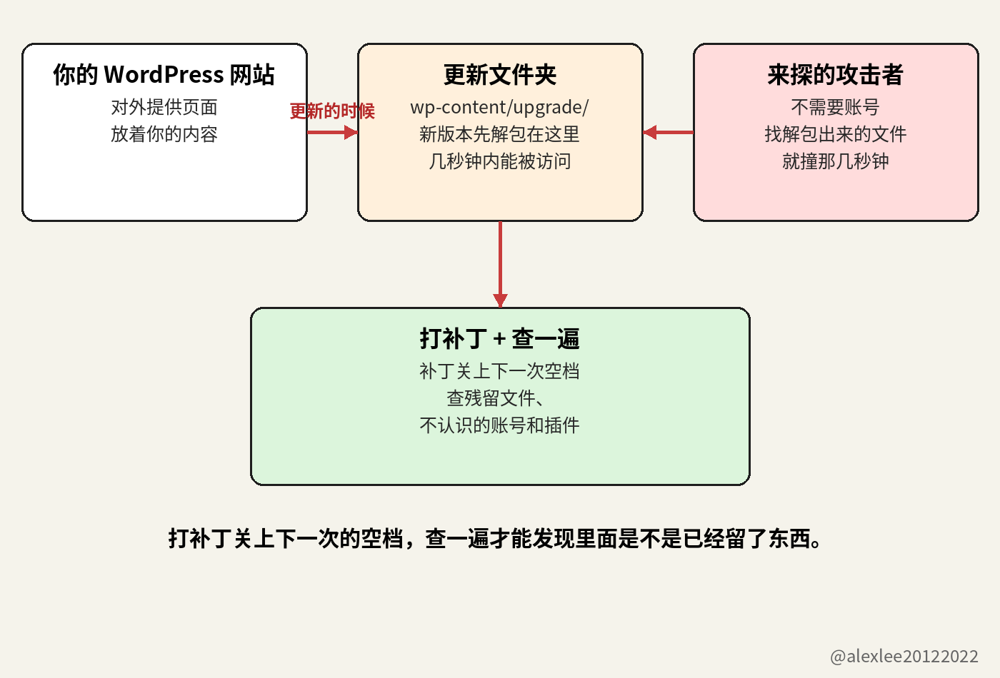

CISA 是美国网络安全和基础设施安全局。它在 11 月 3 日要求联邦机构把这个漏洞补上，而且补完之后还要再查一遍，看有没有人已经进来过。

这个要求是写给联邦机构的，所以它管不到你。但是它要求去查的那一遍，你在自己的网站上同样值得做，因为这个漏洞伤网站的方式，不会因为网站是不是联邦机构的就有什么不同。

你上次登录自己 WordPress 网站的后台，是什么时候？我说的后台，是网站自己的那个后台，就是能看到版本号的那个页面。主机商给你的控制面板是另一个东西，所以那个不算数。

如果你想了半天才想起来，那么这篇就是在说你的网站。因为会被这个漏洞伤到的，正是那些没有人登录的网站：它们一直跑着旧软件，而站长以为有别人在替自己盯着。

10 月 28 日，WordPress 发布了 7.1.4，这次发布里的一个修复，堵住了核心更新过程中的一个漏洞。到了 11 月 3 日，CISA 把这个漏洞列进了已知被利用漏洞清单，它的编号是 CVE-2026-119977。

这份清单只收已经被攻击者在真实系统上用过的漏洞，所以一个漏洞能进这份清单，就说明已经有人在真实系统上拿它动过手了。这一条还多带了一项要求，因为 CISA 给它标了取证排查。

取证排查的意思是，受影响的系统不光要把补丁装上，而且还要去查有没有已经被人动过手脚的痕迹。

CISA 给联邦机构定的处理期限是 11 月 6 日。对一个 WordPress 网站来说，处理是一个很具体的动作，因为它指的就是升到 7.1.4，或者升到你所在分支上那个已经修好的版本。

你的网站没有这个期限，因为这条要求和这个日期都是写给联邦机构的。但是你也不能把这个日期当成宽限期，因为试探根本没有等这个日期。补丁发布后的头 21 小时里，冲着更新解包出来的安装文件去的请求就已经超过了 18500 次。

核心更新换掉的是网站正在跑的那套软件，而换的过程当中，服务器还在照常给访客提供页面。更新进行时，WordPress 会把新版本解包到一个叫 wp-content/upgrade/ 的文件夹里。

在很多服务器上，网页服务器会把这个文件夹里的文件直接发给任何来要的人，就跟发普通页面一样。解包出来的那份副本会在文件夹里停留几秒钟，安装文件也在里面，然后 WordPress 把更新做完，再把文件夹清掉。

如果攻击者的请求正好落进这几秒钟，那么他就能把文件夹里那些解包出来的安装文件跑起来。然后他可以顺着这一步，走到在你的服务器上运行他自己的代码，而且整个过程他不需要登录。

这就是这件事里所说的远程代码执行：一个在你的网站上没有账号、也没有密码的人，最后在你的机器上跑起了他自己选的代码。

Wordfence 是一家给 WordPress 网站做防护的公司，它也发布 WordPress 漏洞方面的研究。它给这个漏洞打了 8.1 分，满分是 10 分，属于高危那一档。

11 月 3 日，主机公司 Carthage Electronics 在它的安全博客上发了一份威胁简报，这份简报解释了分数为什么没有打到顶。因为攻击者必须正好撞上一个很短的时间窗口，所以分数停在了高危这一档。

一个人坐在键盘前面，一边刷新一边碰运气，他几乎不可能撞进一个只有几秒的窗口，因为一个人能试的次数就那么多。但是脚本不一样，因为脚本可以把安装文件一次又一次地要，成千上万次，要多久都行。而脚本等的只有一件事，就是它在要的这段时间里，你的网站正好开始一次核心更新。

补丁发布后的头 21 个小时里，Wordfence 记录到超过 18500 次请求，这些请求要的都是那些解包出来的安装文件。所以第一个数字数的是请求，因为每一次请求，都是向服务器要一个那样的文件。

The Hacker News 在 10 月 30 日报道说，在那篇报道之前的 24 小时里，Wordfence 拦下了 62969 次尝试。第二个数字数的是被拦下来的尝试。它跟第一个数字数的不是同一段时间，因为第一个数字覆盖的是补丁发布后的头 21 小时，而第二个数字覆盖的这 24 小时在那之后。

这两个数字都不能证明已经有网站被拿下了，而且 Carthage 那份简报也记了同样的界限：到 11 月 3 日简报发出的时候，还没有人公开确认过有网站是通过这个漏洞被拿下的。

这个漏洞影响 WordPress 从 4.7 到 7.1.3 的每一个版本，而修复它的版本是 7.1.4。如果你的网站钉在一个旧分支上，那么你不用跳到最新的 WordPress 也能拿到这个修复，因为同一份修复被向后移植了。

向后移植的意思是，把这份修复搬回旧的分支，再在旧的分支上发布出来。旧分支上的版本从 7.0.8 一路到 4.7.39，中间的 6.9.11、6.8.12、6.7.11 也都有对应的版本。

Carthage 的简报说，大多数网站上周已经通过后台自动更新自己拿到了 7.1.4，所以如果你的网站也是这样，那么打补丁这一环就已经做完了。

同一份简报还点名了它担心的网站。它先说的是自动更新被关掉的那些网站。因为在那样的网站上，不管 WordPress 发出什么安全版本，都不会有任何版本自己送上门来。

简报还点名了钉在旧分支上的网站。钉在旧分支上并不等于拿不到修复，因为它所在的分支里也有带着同一份修复的向后移植版本。但是向后移植版本仍然要靠一次真的在那个网站上跑起来的更新来安装，而钉在旧分支上的网站，往往正是那些很久以前就不再跑更新的网站。

简报说的第三种网站，才是这篇真正想说的那种：名义上有人管的网站。这样的网站，要么是开发者给搭的，要么是服务商在托管，而且每个相关的人都觉得它有人在照看。

但是照看这件事要算数，得先有一个人真的登录进去。这个人要读过版本号，也要确认过更新到底装没装上。所以在这种名义上有人管、实际上没有人登录的网站上，一次没装上的更新可以几个月都没人发现。因为没有任何人会专门留一个时刻，去看这个网站现在是什么状态。

一个网站通过这样的漏洞被人拿下之后，它很少会自己喊出来。首页通常照样能打开，看上去也照样正常，因为首页要是被人改得乱七八糟，当天就会被发现，然后被清理掉。

安安静静的那种版本能留得更久：网站开始挂垃圾页面，或者替别人的骗局存放文件，或者把访客送到钓鱼页面上去。而站长往往是最后一个知道的，而且消息是从外面传到他耳朵里的：要么是主机商把他的账号停了，要么是访客的浏览器开始警告大家不要进这个网站。

CISA 这次的要求比打补丁多，就是因为结局可以这么安静。CISA 给这条标了取证排查，翻成大白话就是：把修复装上，然后再去找有没有已经被人动过手脚的痕迹。

装上补丁能把这个漏洞去掉，所以下一次更新的时候，那些解包出来的文件就不能再用这个办法被人利用了。但是补丁删不掉攻击者可能已经留在你服务器上的代码，而且它也撤不掉攻击者可能已经给自己建好的管理员账号。

要查的东西一共五站，第一站就是后台。打开后台，再打开更新，把屏幕上的版本号读出来。它应该是 7.1.4，或者是你所在分支的最新版本。

如果你的网站把自动更新关掉了，那么你今天就手动把更新跑一遍。但是在跑更新之前，你先看一眼有没有近期的备份。如果没有备份，那么你先把备份做了，然后再跑更新。

然后打开服务器上的 wp-content/upgrade/ 文件夹，看看里面留了什么。两次更新之间，这个文件夹里应该什么都没有，所以里面要是留下了文件夹或者 PHP 文件，那就需要一个说法。

再然后，去服务器日志里查，在更新跑过的那些时间前后，有没有反复请求 wp-content/upgrade/ 下面文件的记录。解包出来的安装文件里有一个叫 setup-config.php，而在那些请求里反复出现的，就是这个名字。

最后两站都是后台里的清单。打开用户清单，把管理员账号一个一个看过去。因为一个你不认识的账号，就是攻击者会留下来的那种东西，而且它的名字也不会是你起的。

然后打开插件清单，用同样的办法看一遍，找有没有你自己从来没有装过的东西。这两份清单都不长，所以这一部分的检查花不了几分钟。

如果这两份清单里有任何一份查出了你不认识的东西，那么你就按网站已经被拿下来处理，不要再把它当成日常维护。先从一份干净的备份里把网站恢复出来。

然后在恢复出来的网站上，把管理员密码和数据库密码都换掉，再把 wp-config.php 里的盐值换掉。盐值是 WordPress 混进登录状态里用来保护它的一串秘密字符串，所以换掉盐值，就会把当前所有登录着的会话都签出去。

把所有人签出去，跟改密码是两件不同的事。这两件事都要做。而且都要在干净的那份网站上做，不能在已经被动过的那份上做。

还有一处改动是在服务器那一层做的：让网页服务器拒绝浏览器对 wp-content/upgrade/ 下面任何东西的请求。在 nginx 上，这是一段 location 配置，它拒绝发往这个路径的每一个请求。

在 Apache 上，这是一条 RedirectMatch 规则，它对这个路径的请求回答 403。如果你自己改不了服务器配置，那么你就请你的主机商帮你把这条规则加上。

更新的时候解包还是会发生，解包出来的副本也还是会在那个文件夹里停留同样的几秒钟。但是这条规则把从网页进来的路堵上了，因为对那些文件的请求现在得到的回答是拒绝，而不是文件本身，所以安装文件从网页上就够不着了。

正常情况下，也没有任何正经东西需要用浏览器去读这个文件夹里的文件。

网站前面的网页应用防火墙会读每一个进来的请求，并且把那些它认出来是来探安装文件的请求挡下来。这跟上面那条服务器规则是两件不同的事，因为服务器规则拒绝的是发往这个路径的每一个请求，不管是谁发的，也不管它要什么。

而防火墙只拒绝它认得出来的请求，所以一个形状是它不认识的探查，就会穿过它，落到网站上。而且防火墙也改不了 WordPress 里面的更新过程，因为它后面的解包还是照原来的样子在发生。能把这个漏洞本身去掉的，只有把 WordPress 更新掉这一件事。

我维护别人的软件维护了很多年，我一直学不会去相信“有人管的网站”这句话。因为这句话要站得住，得有人能说出上次登录的人是谁，也能说出那个人在里面看到了什么。

如果你跑着一个 WordPress 网站，那么你今天就去把它的版本号读一遍。这篇里所有的检查，我这周会先做的就是这一件。

要是这篇让你打开了后台，欢迎订阅或者收藏这个博客。我会持续分享 AI、安全和开源方面的干货，下一篇还是这种你自己就能上手查的东西。

https://carthageelectronics.com/november-3-2026-cve-threat-brief/
