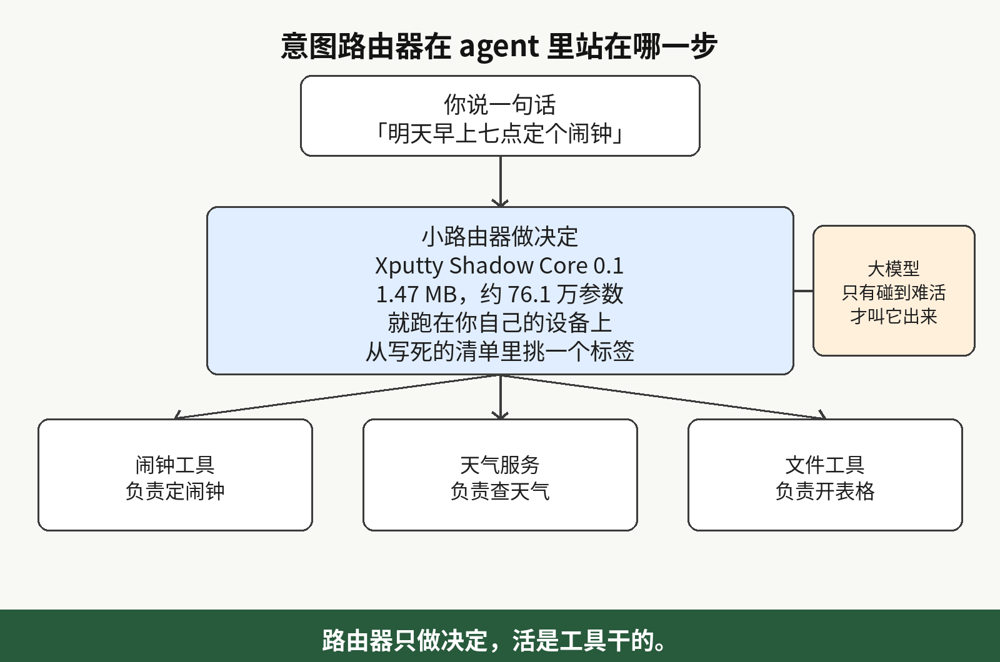
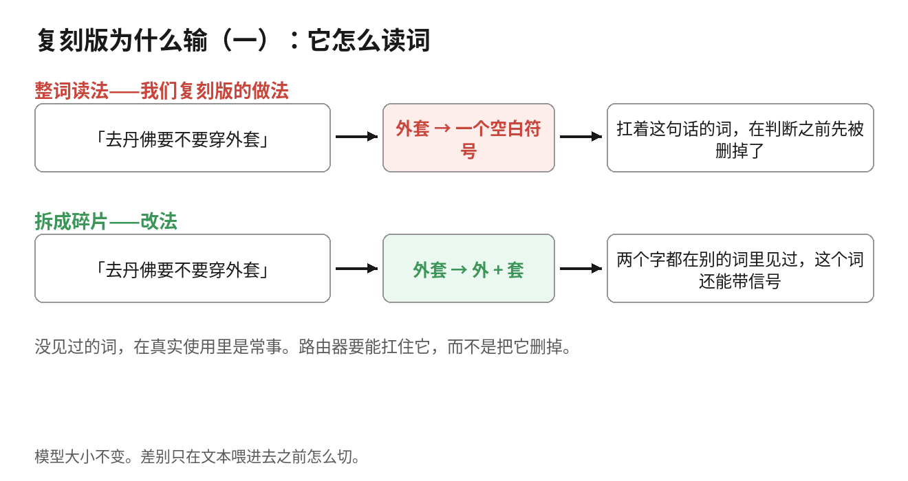
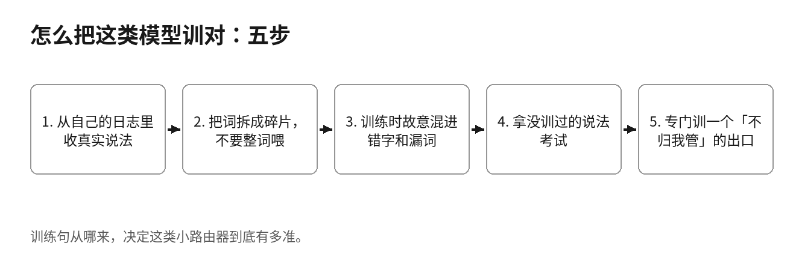
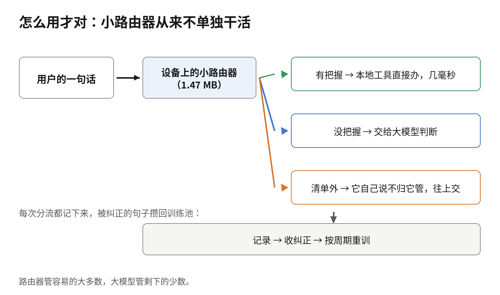

我照规格复刻了一个 1.47 MB、76 万参数的 agent 意图路由器，跟 if 判断比赛，它输了

10 月 31 日，一个叫 @openrunt 的小账号发了一份文件检查报告。他截图里的工作日志显示，这次检查花了 1 分 8 秒，查的是一个 1,542,912 字节、约 1.47 MB 的 GGUF 文件，文件里装着一个完整的模型。

这个模型叫 Xputty Shadow Core 0.1，是一个意图路由器：读一句话，判断说话的人想干什么，再把这句话送去对应的工具。帖子里没有下载链接，也没有模型页面，文件本体没法测。

我们觉得这种小的意图路由器值得有，就照着帖子里公布的规格做了一个，拿它跟一套关键词规则比了一场。比赛结果：训练里见过的说法，两边都是 100%；没见过的说法，规则 63%，我们的复刻版 42%。

## 我们为什么想要一个这么小的意图路由器

你对着一个助手说话，每句话在办成之前，都先要过同一道小判断。你说「定个十分钟的计时器」，它得知道这是计时器；你说「查一下丹佛明天的天气」，它得知道这是天气；你说「打开我昨天改的那张表格」，它得知道这是开文件。

先读懂一句话想办什么事，再把这句话送到对应的工具，这一步叫意图路由。意图，说的就是这个人想把什么事办成。

这一步现在多半是干正事的那个大模型顺手做的，我今年拆过的 agent 软件基本都是这样。一个几十亿参数的大模型读完「定个计时器」，回一句「计时器工具」，事情才接着往下走。

每句话都要完整调用一次大模型，慢。调用要联网，断网就停。那句话还得先离开这台设备，才能被分个类。

意图路由器要是住在设备本地，这三件事就都不存在。它几毫秒出结果，没信号的地方也能跑，飞机上、地下室里都行。用户的话不用离开这台机器，就能分好类。

如果是你个人使用，那么一天也就是调用大模型几次，其实无所谓的。但是如果是一个语音设备，或者是一个多人用的 agent，那么每天可能要处理成千上万次，这个成本就很大了。所以我们需要做的是把大多数的语句在本地进行处理，真正需要动脑子的部分才调用大模型。

把一句话分进一张固定清单，是语言软件里很老的一件事，小模型干这个已经很多年了。2016 年 Facebook 的 fastText 就能把文本分进标签，模型压缩之后只有几百 KB。

2024 年的 RouteLLM 是 LMSYS 和加州大学伯克利分校做的，决定一个问题该送给强模型还是便宜模型。它试过的办法里有 BERT 分类器，BERT 是 2018 年的一个小语言模型，当年主要用来给文本分类；也有一个查表的办法，先看历史记录里哪类问题通常哪个模型赢得多。

所以 Shadow Core 想做的事并不新鲜。新鲜的问题只有一个：文件做到这么小，还能不能把这件事办好。这个问题不用猜，测一测就知道。

## 引出这一切的那个文件

GGUF 是 llama.cpp 那套生态给本地模型用的文件格式，能跑 GGUF 的软件不用写新代码就能加载这种文件。帖子里把规格列得很全：

- 架构：Llama，3 层，4 个注意力头
- 嵌入维度：128，也就是每个 token 都存成一串 128 个数字
- 前馈宽度：320，是每一层中间那张表的大小
- 参数：总共约 76.1 万
- 词表：762 个 token。token 是模型读文本的单位，一块文本常常是一个词，或者一个词的一部分；词表就是它认识的全部文本块
- 数字的存法：大多用 F16 存，一个数字占 2 个字节；层归一化用 F32 存，一个数字占 4 个字节。层归一化是一小串数字，作用是把每一层算出来的数值拉回正常范围
- 上下文长度：160 个 token，一次大约读一小段指令
- 张量：总共 30 个。张量就是文件里存数字的一张表，这个数字是说，全部参数分装在 30 张表里
- 文件大小：1,542,912 字节，约 1.47 MB

帖子里说的 76 万参数，我们按规格自己重算了一遍。词嵌入表是每个 token 一行 128 个数字，762 个 token，共 97,536 个参数；输出表和它一样大，又是 97,536 个。

每一层里，四张注意力表合计 65,536；前馈部分有两张 128 乘 320 的表和一张 320 乘 128 的表，合计 122,880；再加上两条归一化向量，256。一层是 188,672，三层是 566,016。

把两张大表和最后一条归一化向量加上去，总数 761,216，跟帖子里说的对得上，张量数也正好 30 个。规格本身没有对不上的地方。我们的复刻版按同样规格导出成 GGUF，1,539,520 字节，张量同样 30 个。

## 复刻版和它的对手

复刻版和公布的规格一一对齐：同样的架构，同样的大小，参数总数也是 761,216。它读文本是一个词一个词读的，词表有 762 个位置，训练句里只出现过 228 个不同的词，剩下的位置都是空的。

我们给了它 16 种意图，都是家里的和办公室的助手天天要处理的：定计时器、定闹钟、查天气、打开文件、在网上搜索、在自己的文件里搜索、发消息、打电话、放音乐、记笔记、设提醒、开灯、关灯、读新闻、翻译、报时。

训练数据是 5,120 句用模板生成的话，时间、城市、人名、文件名在句子之间换着来。我们一直训到它把这批训练句全部背下来为止。

对手是一套关键词规则，你可以把它看成「一堆 if 判断」被认真整理过一遍的样子。每种意图占有一批关键词，取自复刻版训练句里出现过的词。打分时看这个词出现在哪几种意图的句子里。一个词只在一种意图里出现，打分时这个词得分就高；十六种意图里到处都有的词，得分就低。来了新句子，把每个词的得分按意图加起来，总分最高的那种意图就赢。这里面没有学习，也没有要训练的东西，开发者一个下午就能写出来，之后用户每说出一句新说法，就再往规则里补一条。

## 比赛结果

三组测试，每组 960 句。第一组的说法和训练里的一样，只是换了新的时间和人名，规则 100%，复刻版 100%。

第二组的说法全部没在训练里出现过，同一件事换一种说法。规则 63.0%，复刻版 42.3%。

第三组拿第二组的句子改错字、删词，弄成语音识别输出的那种样子。规则 54.9%，复刻版 34.1%。

我们还喂了 12 句跟 16 种意图全不沾边的话：「法国的首都是哪」「写一首关于月亮的诗」「陪我下棋」「股市明天会涨吗」。12 句全被分进了某个意图，因为它只会一件事：从清单里挑一个标签。

「股市明天会涨吗」被分去查天气，把握度 1.00，是它能给出的最高值。「陪我下棋」也是查天气，0.94；「法国的首都是哪」变成了打开文件，0.97。12 句里大约一半把握度低于 0.90，另一半在 0.90 以上，照样全错。

## 它为什么输

第一个原因，它按整词读文本。训练里没出现过的词，到它那里就变成一个空白符号，这个词带的信息，在它做判断之前就先被删掉了。

举个例子：「去丹佛要不要穿外套」是一个查天气的问题，这句话里最关键的词是「外套」。我们的复刻版没见过「外套」，这句话送到它面前的时候，最有用的词已经先被拿走了，剩下的词撑不起一个正确判断，它只能猜。

第二个原因在训练数据的来路。5,120 句全部出自模板，花样是占位符的花样：同一副句子骨架，换时间、换城市、换人名。它把这些骨架学得很好，见过的说法能拿 100%，原因就在这里。

真人说话的骨架比模板多得多。碰到没见过的骨架，它手里能抓的词很少。它学下来的是我们写模板的习惯。真人怎么把一句话说成一个意图，它没学到。

规则赢在这件事上：人换说法的时候，真正承重的词通常不动，计时器、闹钟、天气、打电话还是那几个词。关键词规则只给这些词打分，句子是什么骨架，它不在意。我们测试里规则高出的那 21 个百分点，主要来自这一条。

这一场比的是我们的复刻版。训练数据是我们自己用模板生成的那 5,120 句，分词也是整词。原帖那个文件可能训得比我们好得多，这场结果不能算到它头上。

## 这类路由器该怎么训

训练句要从真实使用里来。你的用户实际打出来、说出来的话，从你的日志里收，邋遢的说法也要留着。每种意图的说法花样越多越好，花样的多少正是模板给不了的东西。

合成句子只能在开始的时候用。只拿合成句子训的路由器，见到第一个真用户就会露怯，真人的说法一变它就跟不上，跟我们的复刻版在留出测试里的表现一样。真实说法是这类模型的原材料，原材料不对，后面都白搭。

分词要把词拆成碎片，不要整词喂。一个没见过的词，拆开之后，到模型面前的是它认识的碎片：「外套」可以拆成它在别的词里见过的部分，这个词就还能带一点信号，不会直接变成空白。

我们量到的最大一处毛病就是整词阅读，改成碎片分词就能拿掉它，模型大小不用变。原帖那个文件的词表也是 762，碎片词表可以是这个大小，我们这种整词的小词表也可以是这个大小，光看这个数字，分不出它是哪一种。我们的整词结果，推不到它头上。

训练的时候，要把脏输入一起训进去。真实输入有错字、有漏词、有说一半的话，从语音识别过来的尤其明显。拿出一部分训练句，照着这个样子弄脏：换个字、删个词、截掉词尾，再拿去训。

在训练里见过脏样子的模型，会把脏输入当成正常输入处理。我们的复刻版只见过干净模板，输入一脏，分数就从 42.3% 掉到 34.1%。

测试的时候，要把整种说法留出来考它，不能只随机扣句子。随机扣下来的句子，可能跟训练句是同一副骨架，轻松就能过。整种说法扣下来考，它没见过这种说法，考出来的分数才说明它能不能处理新说法。

考完还要逐个意图看它把什么跟什么搞混。拿助手举例，在自己的文件里搜和在网上搜，任何路由器都容易混。知道自己混在哪，你就知道该去哪补数据，哪些意图要多加一道确认。

还要教它说「这句不归我管」。能进生产环境的路由器，必须有一个清单之外的出口。做法是把清单外的话也当成一类，专门拿来训练，让它学会拒绝，而不是每句话都硬分一个意图。

为什么不能只靠把握度定一条线？我们的复刻版就是现成的例子：它清单外分错的那些话里，大约一半把握度在 0.90 以上。有了训出来的拒绝出口，再加一条拿留出数据定好的把握度线，清单外的话才会被转交出去。

## 这类路由器该怎么用

摆法是小路由器在前，大模型在后。没被路由器拒掉、把握度又高于那条线的句子，在本地直接完成处理，不用再交给后面的大模型。这样一次只需要几毫秒。我们的复刻版在我们自写的测试程序里、跑在一台小云服务器上，一次大约 9.5 毫秒。

剩下的句子，没把握的和被它拒掉的，往上交给大模型。大模型慢，调用一次还要花钱。可是难的句子只有它能想明白，所以该往上交的还是要往上交。本地的路由器管的，是容易的、大批的那些句子。

每一次判断都记下来。被大模型推翻的，被用户纠正的，那句话和它正确的意图一起进训练池，路由器按周期重训。路由器刚上线时只能粗粗分一遍，用得越久，它越清楚你的用户习惯怎么说话。这件事没有任何外来文件能替你做。

有一类动作不能让路由器直接放行，就是那些做错了收不回来的动作。放错一首歌，再换一首就是了，没什么损失。可是消息一旦发出去就收不回来，文件删了、钱付了也一样。这类动作，不管路由器多有把握，都要先停下来，让人确认了再做。

碰到这类意图，路由器可以把动作先准备好，最后拍板要有一个确认步骤，或者一条写死的规则检查。把握度多高都一样，这一步不能省。

说法能列全的地方，不要用路由器：操作员受过训练、只说固定命令词，或者一台设备上一共就十几个按钮。那种地方用规则，坏了也好查。路由器该用的地方，是说法花样多、还不断冒出新说法的地方。普通人对着机器说话，用的都是自己的说法，大多是这种场合。

## 回到引出这一切的那个文件

这种路由器该有，这一点我们的测试是支持的。Shadow Core 这个文件做得好不好，是另一件事，我们给不出分。

一个路由器做得对不对，看三样东西：它的意图清单、它怎么切词、它拿什么样的说法训练。这个文件三样都没有公开。文件本身没有放出下载。元数据是作者自己读的，按他读出来的结果，里面没有作者名字，没有许可证，也没有训练说明。

作者本人也还没展示过它运行的样子。他在帖子最后说，他打算去看看自己跟 Grok Build 能拿它做点什么。也就是说，帖子发出来的时候，试验还没开始做。

这个文件要是按对的方法做的，拿真实说法训练，分词拆成碎片，拒绝出口也训了，它在真的助手里面完全可能派得上用场。可是它到底是不是这样做的，上面那三样东西都没有公开，我们没办法核对；文件又没有放出下载，也没有人演示过它运行，它分得准不准，同样没有人测得了。

它做得好不好，我们确认不了，所以我们不会把它装到自己要负责的系统最前面。真需要这样一个路由器，我们就自己做一个：训练材料用自己日志里的真实说法，大模型兜底从第一天就接好。

你自己跑的东西里面，有没有这样一步：一个大模型读一句很短的话，回一个工具的名字？你的用户都是怎么说这些请求的，那些说法，你这周能从日志里收出来吗？收说法这件事，就是这类模型大半的工作。我平时就喜欢拆这种小模型和 agent 里的管道活，你要是觉得这种拆法对你有用，欢迎订阅或者收藏这一页，后面还会接着拆。

原帖：https://x.com/openrunt/status/2116475197603582347